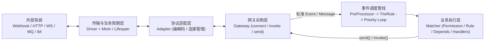

<div align="center">

# OpsMesh

**面向通用事件驱动、自动化运维与多协议网关场景的 Python 异步框架**

[](https://github.com/jhupo/OpsMesh/actions/workflows/ci.yml)
[](https://github.com/jhupo/OpsMesh/actions/workflows/security.yml)
[](pyproject.toml)
[](requirements.txt)
[](ruff.toml)
[](LICENSE)

[快速开始](#快速开始) · [架构设计](docs/architecture.md) · [适配器指南](docs/adapter-guide.md) · [插件指南](docs/plugin-guide.md) · [配置参考](docs/configuration.md) · [可运行示例](examples/webhook_ops/README.md) · [变更日志](CHANGELOG.md)

</div>

---

## 简介

**OpsMesh** 是一个纯异步、强类型、可扩展的 Python 3.11+ 事件驱动与协议网关框架。它在底层通过 **`Driver + Mixin`** 解耦网络传输与生命周期，在中层通过 **`Adapter + Gateway`** 抹平外部协议差异并统一出站动作调用，在上层通过 **`Event` / `Message` / `Matcher` / `Rule` / `Permission` / `Depends`** 提供声明式事件路由、权限控制、编译期依赖注入与多轮会话状态机。

无论你要构建的是 **Webhook 告警与运维自动化网关**、**多协议消息中枢**、**Agent 工具调用总线**，还是 **内部交互式指令服务**，OpsMesh 都能让你用一致的插件模型快速编排业务，而不被具体网络协议或 Web 框架绑定。

---

## 与 NoneBot2 的血缘与演进

OpsMesh 基于优秀的开源项目 **[NoneBot2 v2.5.0](https://github.com/nonebot/nonebot2)** 演进重构而来（完整保留上游许可声明于 [licenses/NoneBot2-LICENSE](licenses/NoneBot2-LICENSE)）。

我们完整继承了 NoneBot2 经过大规模生产验证的**驱动混入（Driver + Mixin）、事件响应器（Matcher）、编译期依赖注入（Depends）与 PEP 302 插件系统**，并面向**通用协议网关与现代 Python 3.11+ / Pydantic v2 技术栈**完成了系统性去聊天化与现代化重构：

| 维度 | NoneBot2 v2.5.0 | OpsMesh |
| :--- | :--- | :--- |
| **核心抽象定位** | 面向 IM 聊天机器人的 `Bot` 抽象 | 面向通用协议实例的 **`Gateway`**（`gateway.id`、`gateway.connect()`、`gateway.disconnect()`） |
| **出站动作接口** | `bot.call_api` / `adapter._call_api` / `MockApiException` | **`gateway.invoke`** / **`adapter._invoke`** / **`MockInvokeResult`** / **`ActionNotAvailable`**，配套 `@Gateway.before_invoke` / `@Gateway.after_invoke` |
| **事件标准模型** | `is_tome()` 无时间字段，续接默认写死 `"message"` | 统一 UTC `Event.time` / `get_time()`、语义中立的 **`is_targeted()`** 与 `targeted()` 规则；多轮续接默认沿用 `event.get_type()`，原生支持非消息事件续接 |
| **依赖栈与运行环境** | 兼容 Python 3.9+、`exceptiongroup`、Pydantic v1/v2 双兼容层 | 原生 **Python 3.11+**（原生 `except*`）与 **纯 Pydantic v2**（彻底移除 500+ 行 v1 兼容垫片） |
| **DI 与权限语义** | 保留无注解按参数名盲猜兼容与无前缀 `SUPERUSER` 兼容 | 强制**显式类型注解 DI**，严格 **`{adapter}:{user_id}`** 作用域 `SUPERUSER`，统一 `on_command` 默认 `block=True` 防穿透 |
| **工程稳健性修复** | 存在部分类变量共享与异常清理边界问题 | `Driver._adapters` 实例级隔离、`Lifespan.__aenter__` 启动失败自动回滚 `shutdown()`、`@Gateway.on_disconnect` 依赖栈正确析构序、顶层 `opsmesh.register_adapter()` |

---

## 核心特性

- **四层彻底解耦**：传输层（`Driver + Mixin`）、协议层（`Adapter + Gateway`）、调度层（`Matcher + Rule + Permission + Depends`）、组织层（`Plugin`）边界清晰，任意一层可独立替换。
- **动态传输组合**：服务端支持 `~fastapi`、`~quart`；客户端支持 `~aiohttp`、`~httpx`、`~websockets`；支持通过配置 `DRIVER=~fastapi+~httpx+~websockets` 自由组合，或使用 `~none` 运行纯本地/推送型事件循环。
- **编译期强类型依赖注入**：处理函数、规则、权限与钩子的签名在注册期编译为不可变 `Dependent` 并缓存 Pydantic v2 `TypeAdapter`，支持单事件依赖缓存、并发共享与同步/异步生成器（`yield`）自动资源回收。
- **声明式多轮状态流转**：通过 `@matcher.got()`、`@matcher.receive()`、`await matcher.pause()`、`await matcher.reject()` 自动派生高优先级临时 `Matcher`，零外部状态库即可编排交互式多步流程。
- **安全与工程基线内置**：Ruff（含 Bandit `S` 安全规则）、CodeQL SAST、`pip-audit` 依赖 CVE 审计、Dependabot 与跨平台（Linux / Windows × Python 3.11–3.13）CI 矩阵全链路保障。

---

## 架构总览



更深入的生命周期状态机、并发调度模型与依赖注入原理请参阅 [docs/architecture.md](docs/architecture.md)。

---

## 安装

要求 **Python >= 3.11**。

```bash
# 仅安装核心框架（配合 ~none 驱动或自定义驱动）
python -m pip install -e .

# 按需安装传输驱动扩展
python -m pip install -e ".[fastapi]"              # FastAPI ASGI 服务端
python -m pip install -e ".[fastapi,httpx]"        # FastAPI 服务端 + HTTPX 客户端
python -m pip install -e ".[aiohttp]"              # AIOHTTP HTTP/WS 客户端
python -m pip install -e ".[quart,websockets]"     # Quart 服务端 + WebSockets 客户端
python -m pip install -e ".[all]"                  # 安装全部官方驱动扩展
```

---

## 快速开始

### 1. 编写一个业务插件（`plugins/ops_deploy.py`）

```python
from pydantic import BaseModel

from opsmesh import get_plugin_config, on_command
from opsmesh.adapters import Gateway, Message
from opsmesh.params import ArgPlainText, CommandArg
from opsmesh.permission import SUPERUSER
from opsmesh.plugin import PluginMetadata
from opsmesh.rule import targeted


class DeployConfig(BaseModel):
    deploy_env: str = "staging"


__plugin_meta__ = PluginMetadata(
    name="服务发布助手",
    description="支持交互确认的服务发布命令",
    usage="/deploy [service]",
    type="application",
    config=DeployConfig,
)

cfg = get_plugin_config(DeployConfig)
deploy = on_command("deploy", rule=targeted(), permission=SUPERUSER)


@deploy.handle()
async def capture_arg(args: Message = CommandArg()) -> None:
    if args.extract_plain_text().strip():
        deploy.set_arg("service", args)


@deploy.got("service", prompt="请输入待发布服务名（api / worker）：")
async def run_deploy(gateway: Gateway, service: str = ArgPlainText()) -> None:
    target = service.strip()
    if target not in {"api", "worker"}:
        await deploy.reject("仅支持 api 或 worker，请重新输入：")
    res = await gateway.invoke("trigger_deploy", service=target, env=cfg.deploy_env)
    await deploy.finish(f"已触发 {target} 发布至 {cfg.deploy_env}：{res}")
```

### 2. 在 `pyproject.toml` 中声明插件

```toml
[tool.opsmesh]
plugins = ["opsmesh.plugins.single_session"]
plugin_dirs = ["plugins"]
```

### 3. 四步启动应用（`main.py`）

```python
import opsmesh
from my_adapter import Adapter as MyAdapter

# 1. 初始化环境（.env / .env.{env}）、全局配置与 Driver
opsmesh.init(superusers={"webhook:ops_root"}, deploy_env="prod")

# 2. 注册外部协议适配器
opsmesh.register_adapter(MyAdapter)

# 3. 加载插件（严禁提前直接 import 插件模块）
opsmesh.load_from_toml("pyproject.toml")

# 4. 阻塞运行框架事件循环与传输服务
if __name__ == "__main__":
    opsmesh.run(host="127.0.0.1", port=8080)
```

### 4. 运行端到端完整示例

仓库内置了零外部依赖的 [examples/webhook_ops](examples/webhook_ops/README.md) 示例（包含完整的 FastAPI Webhook Adapter、交互式 `/deploy` 插件与 `notice` 告警插件）：

```bash
cd examples/webhook_ops
python main.py
```

---

## 文档导航

| 文档 | 内容摘要 |
| :--- | :--- |
| [架构设计文档](docs/architecture.md) | 四层架构、驱动组合、`Lifespan` 生命周期、`handle_event` 调度时序、编译期 DI 与异常体系 |
| [适配器开发指南](docs/adapter-guide.md) | `Adapter` / `Gateway` / `Event` / `Message` 完整契约、ASGI 服务端与长连接客户端接入模式、Mock 测试 |
| [插件开发指南](docs/plugin-guide.md) | PEP 302 加载机制、`on_*` 默认阻断策略、`Rule` / `Permission`、多轮会话、依赖注入与 `single_session` |
| [配置参考手册](docs/configuration.md) | 全量 `Config` 字段说明、环境变量与 `.env` 优先级、`__` 嵌套语法、驱动专属配置 |
| [端到端示例](examples/webhook_ops/README.md) | 开箱即跑的 HTTP Webhook 网关示例与 `curl` 验证命令 |
| [贡献指南](CONTRIBUTING.md) | 开发环境搭建、分支与 Commit 规范、测试与安全检查门禁、PR 清单 |
| [安全策略](SECURITY.md) | 自动化安全基线与漏洞私密上报流程 |
| [变更日志](CHANGELOG.md) | 版本演进记录与上游变更摘要 |

---

## 本地开发与质量验证

```bash
python -m pip install -r requirements-dev.txt
python -m pip install -e ".[all]"

# 代码格式、静态检查与 Bandit 安全规则（S）
ruff format --check src tests examples
ruff check src tests examples

# 运行全量单元测试（含示例 ASGI 端到端测试）
pytest -v

# 构建并校验发行包
python -m build
```

---

## 致谢与许可证

- 感谢 [NoneBot2](https://github.com/nonebot/nonebot2) 社区奠定的优雅事件驱动架构基础。
- 本项目采用 [MIT License](LICENSE) 开源；上游衍生许可声明见 [licenses/NoneBot2-LICENSE](licenses/NoneBot2-LICENSE)。
