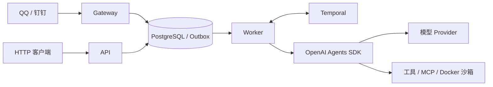

# OpsMesh

基于 OpenAI Agents Python SDK 和 Temporal 的开源 Agent 执行与编排平台。
提供持久智能体、隔离沙箱、工具审批、插件扩展和多用户权限，适合通过 API 集成到自己的产品或运维系统。

[安装](#安装) · [文档](docs/README.md) · [发布版本](https://github.com/jhupo/OpsMesh/releases) · [贡献](CONTRIBUTING.md) · [安全](SECURITY.md)

## 核心能力

| 能力 | 说明 |
| --- | --- |
| 智能体 | 管理 Agent/Provider 配置、草稿、发布及回滚；创建持久 Agent 与 SandboxAgent 实例 |
| 执行 | 私有 Session、运行事件、原生工具审批、取消、用量回执和外部效果对账 |
| 编排 | 定义与绑定实例分离，支持依赖、条件、并行、循环、工具节点和信号等待 |
| 持久任务 | Temporal 引擎适配、事务 Outbox、定时触发与签名 Webhook |
| 插件 | ZIP 安装、适配器注册和热更新；扩展工具、MCP、Skill、Hook、中间件与通道 |
| 权限与审计 | 用户所有权、显式授权、Token/并发/环境额度、金额预算和敏感状态加密 |
| 评测与观测 | 版本化数据集、评测实验、用户反馈、可续传事件及 OpenTelemetry/Prometheus |
| 通道 | 自研网关，内置 QQ 与钉钉，管理外部身份绑定、消息路由和持久投递 |

OpsMesh 目前交付后端 API 和命令行工具，**不包含 Web 管理界面**。插件 SDK 用于系统插件开发、注册和打包；业务集成直接调用 HTTP API。企业 SSO、组织管理、内置知识库及插件市场不在此版本范围内。

## 安装

正式部署支持 **Docker Compose** 和 **本机二进制 + systemd** 两种方式。安装器下载已构建的镜像和发行包；目标主机不需要 Git、Python、pip 或 uv，不从源码构建服务。

服务端当前支持 Linux amd64。独立运维 CLI 另提供 Linux arm64、Windows amd64 和 macOS amd64/arm64 下载；这些平台的 CLI 用于远程管理，不代表服务端支持这些系统。

### Docker Compose

在使用 systemd 的 Debian/Ubuntu amd64 主机上下载并检查安装脚本：

```sh
curl -fLO https://github.com/jhupo/OpsMesh/releases/download/v0.1.1/install.sh
sudo sh install.sh --version v0.1.1 --mode compose --origin https://agents.example.com
```

将 `--origin` 替换为自己的 HTTPS 地址，并配置反向代理到本机 `127.0.0.1:8000`。安装器准备 Docker/Compose 和主机工具，部署 API、Worker、Gateway、PostgreSQL、Redis 及持久 Temporal，校验发行清单、包摘要和固定镜像 digest。

### 本机安装

使用相同安装脚本，将 `--mode` 改为 `systemd`。先准备 PostgreSQL、Redis、持久 Temporal 及其命名空间，并按[部署手册](deploy/server/DEPLOYMENT.md)配置连接、专用 Temporal 服务和备份条件。服务由包含运行时的 `opsmesh-server` 二进制目录包提供，不依赖系统 Python。

完整步骤、首次登录和故障排查见[快速开始](docs/getting-started.md)。发行资产及支持矩阵见[发行格式](deploy/DISTRIBUTIONS.md)。GitHub 自动生成的 Source code 压缩包用于开发，不是部署包。

## 首次使用

安装结束后妥善保存一次性管理员密码。通过 `/api/v1/auth/login` 登录，请求使用返回的 `session_token` 作为 `X-Session-ID`。创建可执行实例前，先通过 `/api/v1/agent-catalog` 配置模型 Provider、凭据和 Agent，并发布配置。

工作流程为：发布 Agent 配置 → 创建执行实例与 Session → 提交 Run；编排则先发布定义、创建资源绑定实例，再提交编排 Run。Run 完成或取消不会自动删除持久智能体、沙箱或目录。

API 的 OpenAPI 合同由运行中服务生成；按需启用 `OPSMESH_ENABLE_API_DOCS` 后，通过受控网络访问 `/docs` 和 `/openapi.json`。生产环境默认关闭文档入口。

## 架构



API 管理身份和业务状态；Worker 执行持久任务并承载沙箱操作；Gateway 独立管理通道连接。
仅 Worker 持有 Docker 权限。多 Worker 使用同一 Docker 沙箱时必须连接同一个 daemon；当前部署拓扑不提供跨机器沙箱故障转移。

## 文档与维护

- [文档索引](docs/README.md)：部署、首次使用、平台管理与模块说明。
- [安装、升级与恢复](deploy/server/delivery-operations.md)：不可变发行目录、更新、备份和恢复。
- [插件开发 SDK](sdk/python/README.md)：注册协议、打包和安装。
- [更新日志](CHANGELOG.md)与 [0.1.1 发行说明](docs/releases/0.1.1.md)：版本范围、升级注意事项和限制。
- [贡献指南](CONTRIBUTING.md)与[测试说明](tests/README.md)：源码开发和验证范围。

发现问题请提交 [Issue](https://github.com/jhupo/OpsMesh/issues)，附上版本、部署方式和已脱敏日志。安全问题按[安全策略](SECURITY.md)私下报告。

## 许可证

OpsMesh 使用 [LGPL-3.0-only](LICENSE)。第三方代码来源和许可证见 [NOTICE](NOTICE)；发行包保留依赖元数据与许可证。
