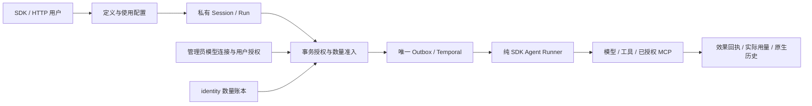

# 统一编排与基础平台收缩交付记录

日期：2026-10-20。唯一设计入口为 [V4 第 0.8 节](source-refactor-plan-v4.md)，
完整源码及逐文件说明见 [源码树](agent-orchestration-target-tree.md)。
本记录替代旧交付记录中被本轮改变的职责和接口，不延续旧产品验收结论。

## 2026-10-20 依赖规则清理

本次调整 V4 第 12 节、AGENTS、源码清单与 README，撤销完整根/二级依赖白名单和
跨模块必须经 bootstrap 注入的要求。服务端 import-linter 从 31 条收敛为 7 条，SDK
从 5 条收敛为 3 条；架构审计脚本删除重复依赖矩阵及业务不得调用 platform 的限制，
保留实际模块导入环、入口/私有访问、旧路径、空源码目录与重复表检查。

这是设计和工程检查清理，未改变业务 API、数据库、权限或运行实现。
ExecutionBindings、共享业务桥接、Session.info 查找和 bootstrap 中的业务协调仍待按调用链精简。
下文 31/5 条合同等结果属于此前源码交付的历史证据，不作为本次规则检查结果。

本次使用 Windows 当前 .venv，检查结果如下；不据此宣称运行代码精简或正式发布验收完成。

| 检查命令 | 结果 |
| --- | --- |
| `.venv/Scripts/ruff.exe check scripts/audit_app_layout.py` | 退出 0 |
| `.venv/Scripts/lint-imports.exe --no-cache` | 退出 0，7 kept / 0 broken |
| SDK 目录 `../../.venv/Scripts/lint-imports.exe --no-cache` | 退出 0，3 kept / 0 broken |
| `.venv/Scripts/python.exe scripts/audit_app_layout.py --architecture-check` | 退出 0，309 个 Python 文件、80 个唯一表所有者 |

两份 TOML 可解析；修改文档的本地链接检查通过。本次未改业务源码、路由或 schema，
未运行后端功能测试或真实 PG/Temporal/模型/沙箱验收；既有未关闭门槛仍保持未关闭。

## 已实现

- 根 execution 源码归入 orchestration。definitions 管可复用定义；configurations 管固定
  修订的使用配置、成员、邀请、关闭与 bindings；runs 唯一拥有 Agent Run/FlowRun/步骤
  和效果回执；sessions 管私有原生历史；runtime 管显式环境、命令及独立 MCP 生命周期。
  execution 只适配官方 SDK，没有业务 ORM、公开 API 或反向查询运行事实。
- 纯定义值和 SDK 输入分别放 definitions.contracts/execution.contracts。配置授权与
  运行提交通过 bootstrap 注入的命名合同调用；定义、运行、会话、运行设施之间无循环导入。
- 管理员模型连接、加密 Key 和逐用户模型授权归 platform.model_connections。
  identity.quotas 唯一管理 Token、存储、并发及环境数量额度；删除货币计价、预算与
  用户通用密钥仓库。模型调用与 host.models 共用实际用户授权、同事务 Token 预留、
  效果和用量核对；邀请不会继承配置所有者的模型权限。
- 每位用户拥有私有 Session。同 Session FIFO，不同 Session 并发；有未完成任务时
  拒绝重置历史。目录和 MCP 等共享资源须显式授权，取消单次任务不误停共享设施。
- 五类能力统一通过 capabilities 的定义、草稿、版本和包 API 管理；静态类型校验由
  bootstrap 显式注册。发布不 import 包；版本公开仍须审核，公开定义不泄露草稿。
- SDK composition.parameters 唯一实现有界纯参数展开；服务端重算并检查固定声明和实际
  MCP 连接。SDK sources 负责可配置 GitHub Release 来源和下载，composition.templates
  负责从已授权固定包导入用户定义。服务端仅静态校验、保存包并由管理员安装。
- 扩展隔离宿主通过 bootstrap 注入环境操作，共用运行设施的回执，不复制环境状态机。
  deployment.py 唯一维护常驻部署；managed_process 操作进程；MCP 生命周期保持独立。
  SDK 正式入口为 runtime.runner/runtime.managed，不依赖开发 extras。
- 删除核心邮件、通知、可变全局设置、业务归档与监控查询。账号邀请创建/重新签发只向
  管理员一次返回 token/acceptance_url，查询不返回凭据；投递由客户端或扩展负责。
  最小审计继续在业务事务中追加，保留幂等回执，删除全局哈希链与验证工作流。
- 同步 bootstrap、初始迁移、路由、OpenAPI、SDK 生成映射、镜像入口、CI 选择、来源表
  和 import-linter。命令示例使用 scripts/configuration_client.py，不再使用空间对话脚本。



## 接口与数据库

- 默认公开前缀仍为 `/api/v1`，认证仍用 `X-Session-ID`。
- Agent Run、私有 Session、环境、MCP、流程和模型操作统一位于 `/orchestration`；
  Agent Run 使用 `/orchestration/runs`，显式 FlowRun 使用 `/orchestration/flows`。
  SDK 只生成 orchestration 分组，不保留 api.execution 或旧 URL 别名。
- 模型连接及逐用户授权位于 `/platform/model-connections`；用户可查询 available
  模型列表，不读取上游 Key。管理员身份不替代模型授权。
- 能力创建使用 `/capabilities/definitions`，请求通过 `declaration.type` 区分
  tool/mcp/skill/channel/extension；版本 UUID `version_id` 用于安装和绑定。
- 初版迁移仍只有 `0001_v4_initial`，最新模型为 80 表、75 索引。仅支持空库初始化，
  没有旧业务数据迁移或兼容升级路径。本轮验证库与现有服务器业务库隔离。

## 已验证

测试环境：Windows Python 3.13；独立测试服务器的隔离 Linux 容器、PostgreSQL 16、
Redis 与真实 Temporal。远端使用当前源码快照和锁定依赖，没有替换为 SQLite 或备份源码。
Linux 快照的服务端、SDK、operator 共 370 个 Python 源文件与本地逐文件 SHA-256 一致。

| 检查 | 实际结果 |
| --- | --- |
| Linux `pytest tests operator/tests sdk/python/tests` | 836 passed，11 skipped；真实 PG/Redis/Temporal，11 项真实产品测试由单独门禁执行 |
| SDK 独立目录 `python -m pytest` | 149 passed，包含容量拒绝到 SDK 额度异常的映射 |
| 委托审计、发布门禁及部署目录回归 | 20 passed；覆盖审计主体/实例隔离、外部请求拒绝、无跳过门禁和目录合同 |
| 空库 schema 对比 | 当前迁移完成后 `alembic check` 退出 0，No new upgrade operations detected |
| 根 strict mypy | 356 源文件通过 |
| SDK 独立 mypy / import-linter | 47 源文件、5 条合同通过 |
| 服务端 import-linter | 31 条合同通过 |
| 干净源码架构检查 | 309 个服务端 Python 文件、80 个唯一表所有者，无循环；本地残余缓存目录另见清理记录 |
| API / SDK 生成 | 实际 routes/schema 导出，生成物一致性检查通过 |
| 来源与最终去向 | 966 条来源，业务延期扩展中心的 238 条明确列出，不宣称已实现 |
| 干净 wheel | SDK 47、服务端 309、operator 14 个 Python 文件，与源码逐文件及字节匹配；先构建 sdist 再生成 wheel |
| SDK 干净环境安装 | 无服务端及开发依赖；正式 runner 发现真实 fixture 扩展，managed 帮助入口通过 |
| 服务端 wheel 隔离导入 | API、Worker CLI、80 个 ORM 模型通过 |
| 当前 compute 镜像 | 原生 sandbox 生命周期、文件读写、续接和真实 stdio MCP 通过 |
| 两套 Compose 存储目录 | server/local 均验证 Worker UID 10001、10002 与 GID 10001；原生 sandbox 双向文件读写通过 |
| 最新完整真实产品门禁 | 9 passed、2 failed、0 skipped；2 项流程被上游连接错误阻断，不能按通过计入 |
| 扩展流程最后单独复跑 | 1 failed；组合直接 Run 的模型调用遇到 `APIConnectionError`，状态为 needs_attention |

后端测试包括模型授权与撤销、额度竞争与下调后的再次准入、用量核对、审批回滚、
能力公开审核与草稿隔离、邀请并发、私有历史、FIFO、跨用户并发、共享文件 CAS、
持久等待重启、取消和 Replayer。真实 Temporal 测试中的确定性模型响应不冒充外部模型。
SDK HTTP 的 Worker 注册包括 SourceEventWorkflow 与真实 TriggerActivities.consume；
测试等待所发布来源事件全部消费完成并重放，不以后台任务失败换取前台回执通过。

完整产品验收命令（真实模型、Docker 镜像、SDK wheel、Redis、Temporal 地址及隔离 PG 已配置）：

```bash
uv run python scripts/check_product_acceptance.py
```

该门禁强制运行模型、工具、扩展、独立 MCP、常驻进程、HTTP、取消和重放测试；
缺配置、跳过或任一失败均不能通过。模型使用 `gpt-6.1-sol`，`reasoning_effort=medium`。
凭据只通过隔离测试环境注入，不写入仓库或证据文件。现有服务器应用未切换版本。
本轮 26 个隔离测试容器及 PostgreSQL/Redis 匿名卷已清理，包含暂存模型凭据的测试数据库
和 runner 环境；现有 API/Worker 及原有数据库、Redis 和 sandbox 保持运行。

测试报告：[JUnit](evidence/2026-10-20-agent-orchestration-tests.xml)。
打包报告：[独立 wheel](evidence/2026-10-20-agent-orchestration-wheels.json)。
来源与最终摘要：[来源表](s14-source-map.csv)、[目标表](s14-target-inventory.csv)。
最新发布核验摘要：[脱敏证据](evidence/2026-10-20-release-acceptance.json)。该摘要只包含
用例状态、耗时、模型设置及 wheel 摘要，不包含原始请求、响应、凭据或捕获日志。

## 2026-10-20 发布加固

- 运行模型和 `host.models` 的公开合同支持显式 `reasoning_effort`，通过官方 SDK 传递；
  未指定时保留上游默认。`host.models` 使用 Responses 的标准消息数组输入。
- 原生 sandbox 使用可写运行根目录，并校验容器身份、权限与挂载；允许镜像继承标签。
  compute 和批准扩展产物以正确 UID/GID 执行，网络采用底层默认行为。
- 配置编译保留 MCP 连接自己的环境，重验其归属及可用状态，允许与 Agent/扩展环境不同；
  独立 MCP 环境关闭后拒绝继续编译，真实 PG 回归 11 项通过。
- Compose 存储挂载的宿主与容器绝对路径一致；本地部署通过显式初始化服务设置目录
  所有者和共享组权限，systemd 的 API/Worker 可保持不同 UID。
- 未知外部效果核对期间 Session 转为 closing，同事务取消其排队任务；完成核对和取消
  后关闭 Session，不让后续任务继续使用可能缺失的历史，不停止共享环境。
- 扩展审计读取要求真实 Worker 委托上下文、当前用户及当前实例，仅允许按明确 ID 读取；
  外部伪造头、跨实例、跨用户、配置范围不符及无范围列表请求继续拒绝。
- 发布 CI 增加真实产品强制门禁，通过命名 Secret/变量注入连接；只上传脱敏诊断。
  构建统一从 sdist 生成 wheel，避免旧 `build/lib` 把已删除业务混入发行包。

## 2026-10-20 仓库清理

- 删除用户组装、通用事件、明确调用与 shared 安全的 4 份旧交付记录，以及旧用户组装的
  3 份 JUnit 回执；当前证据仍保留在上方两个报告中。旧公开审核交付记录改为
  [公开审核说明](capability-publication-guide.md)，去掉已失效的源码路径和历史验收表。
- 删除无引用的 `migrations/data/0113_configuration.json` 和废弃的
  `tests/workspaces/__init__.py`；唯一空库初始迁移和当前业务测试保留。
- 更新 README、V4、创建流程、常驻合同、SDK 说明及来源清单脚本的引用；忽略测试存储、
  临时 mypy、grimp 和 uv 缓存。两份只读备份、用户运行数据和 HTML 成品保留。
- 本次检查退出 0：清单脚本 Ruff、来源映射回归 3 passed、31 条导入合同、11 份 API
  与 7 份 SDK 生成物一致、19 份 Markdown 的本地文件链接有效。
- 缓存/旧构建产物/退役目录的递归清理，以及普通空目录的非递归清理，均被自动审批以
  `blocked by policy` 拒绝，命令没有执行。目录清理未完成；架构检查仍退出 1，报告原有
  16 个无实现源码目录及根 execution 残留，没有通过修改检查规则隐藏这些结果。

### 本轮补充清理

- 删除 bundled 的发行清单、占位天气 MCP、旧工作空间 Skill 及其拒绝规则，共 4 个
  残留文件。启动、打包及测试均不读取这些文件；测试样例由测试自身构造。README、
  仓库规则、V4 与当前目标清单不再将 bundled 作为本仓库的交付内容。
- V4 第 14 节删除重复且失效的旧路径矩阵，统一引用当前来源/目标清单；原始规划 CSV
  仍是来源脚本的只读输入。设计入口、源码树、使用说明、当前 API 合同及运行证据保留。
- 部署观测说明重命名为 `deploy/server/observability.md`，删除货币成本与历史采样描述，
  修正密钥轮换的实际所有者。删除 4 条退役成本/审计哈希链告警，容量指标改用用户账本，
  Grafana 改为当前 FlowRun、Token/存储预留和用户额度；移除失效的审计环境配置及重复变量。
  Compose、systemd、镜像和独立主机安装/恢复工具仍保留。
- 本轮验证：Ruff 退出 0，来源映射与存储部署回归 5 passed；13 份部署 YAML 与 Grafana
  JSON 可解析，监控引用的 16 个应用指标名均对应当前导出，环境模板无重复变量；
  11 份 API 和 7 份 SDK 生成物检查通过，23 份 Markdown 本地文件链接有效。
- 用户再次授权后，已确认旧源码目录中只有 Python 缓存；删除命令仍被自动审批以
  `blocked by policy` 拒绝，未执行。16 个退役源码目录、bundled 空目录和旧证据空目录
  尚存；架构检查退出 1，仅报告上述退役源码目录，未修改检查器或绕过删除拦截。

## 未验证与阻塞

- `gpt-6.1-sol` / medium 的真实 Responses、工具调用、独立 MCP、流程、审批扩展和
  宿主作业已实际执行；上游间歇出现 `APIConnectionError`，对应 Run 保留未知效果并进入
  `needs_attention`，未增加自动重跑外部操作。最新完整门禁 9 passed、2 failed，扩展单项
  复跑也失败；需要可稳定完成 Responses/工具调用的连接，重新运行无失败门禁后才能关闭。
  配置关闭后的最终清理与 Worker 中断恢复未在本轮扩展全流程走完，不因前半段成功而关闭。
- 当前 compute 镜像的 Docker/stdio MCP 和常驻进程的并发、取消、丢失及 drain 已真实验证。
  厂商通道协议和领域扩展仍归扩展中心，不属于本仓库已交付的基础功能。
- 尚未创建的扩展中心仓库无法完成真实 Release 下载和安装产品验收；已验证 SDK 的
  来源限制、摘要、静态包和公开 API 合同，不宣称独立业务扩展已交付。
- Linux operator 文件锁已纳入 Linux 回归；GitHub 发布工作流、带证明的正式候选镜像及
  原生发行归档未在本轮触发，不用源码容器验证替代这些发行产物验收。
- 旧源码已删除，但 16 个仅剩缓存的目录尚未删除。最新目录检查和删除拦截情况见上节，
  本地目录清理仍未关闭；相同检查在干净源码快照上通过。

发行版本目前保留 `0.1.0rc23`；源码实施、自动化回归、外部效果验收和实际发行分别报告。
没有自动提交、推送、创建 GitHub Release 或切换现有服务器版本。
