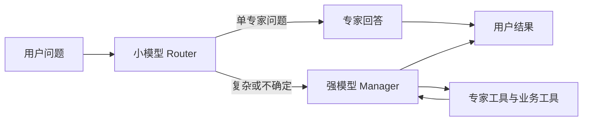

# Agent 的记忆与知识工具

本文描述当前源码合同。内置工具必须在 Agent 工具清单中显式启用，并绑定对应资源授权；仅修改指令不会授予权限。

## 三种存储

| 存储 | 用途 | 模型访问方式 |
| --- | --- | --- |
| SDK Session | 同一会话的历史 | SDK Session 自动管理，不提供另一套历史 CRUD |
| SDK 本地记忆 | Agent 持久经验文件 | 启用 `memory_policy.sdk_memory` 后使用 SDK Memory、Shell、Filesystem；文件命名空间与隔离限制见 [SDK 原生执行](sdk-native-execution.md) |
| 工作空间共享记忆与知识 | 受权限、版本、审计控制的业务资料 | 下列产品工具，经授权 RPC 调用服务和 PostgreSQL |

本地记忆的读写整理交给 SDK 文件能力；平台产品工具不重写该流水线。

## 共享记忆

| 工具 | 行为 |
| --- | --- |
| `search_workspace_memory` | 在授权范围检索记忆和知识，返回有限摘要与引用 |
| `list_semantic_memory` | 分页列出共享语义记忆，默认 20 条，最多 50 条；可显式包含归档条目 |
| `get_semantic_memory` | 按 `memory_entry_id` 读取当前条目，或通过 `revision` 读取授权范围内的历史版本 |
| `list_semantic_memory_revisions` | 分页查询版本号和变更时间，不批量返回历史正文 |
| `upsert_semantic_memory` | 新增或修改；调用时传入 `expected_revision` 可防止覆盖并发变更，创建使用 0 |
| `archive_semantic_memory` | 按预期版本归档，保留历史与审计 |

需要 `memory_collection` 的读、写或读写授权。授权可进一步限制 `source_types`、`tags`、`scope_types`、`scope_ids`。历史正文同时校验当前条目和目标版本的范围，不能通过旧版本绕过权限。

## 知识资料与向量索引

| 工具 | 参数与结果 |
| --- | --- |
| `search_knowledge` | 只检索知识来源，默认前 5 条、最多 10 条摘要和引用 |
| `list_knowledge` | 分页列出授权资料的 ID、类型、版本和状态，默认 20 条、最多 50 条 |
| `get_knowledge` | 读取来源信息；文本正文按 `content_offset` / `content_limit` 分页，默认 8,000 字符、最多 12,000 字符 |
| `create_knowledge` | `name`、可选 `description`，以及 `content` 或 `workspace_file_id` 二选一；返回来源版本与入库任务 ID |
| `update_knowledge` | `source_id`、`expected_version` 及待修改字段；返回新版本与入库任务 ID |
| `archive_knowledge` | `source_id`、`expected_version`；归档后退出检索，经过审批策略 |
| `get_knowledge_ingestion` | `source_id`、`ingestion_id`；返回入库状态、分块数、向量状态计数与 `vector_ready` |
| `get_knowledge_citations` | 按检索结果中的引用定位读取完整片段 |

模型文本写入最多 3,000 字符；大资料使用已授权工作空间文件。文件来源同时要求文件读权限和 Runtime 文件策略允许。URL 来源可以检索、读取状态和归档；Agent 修改工具只接受文本与授权文件。

写入需要 `memory_collection` 写授权，以及调用者身份对应的知识资源权限。知识内容、版本和入库投递记录在同一事务内保存；执行成功后发布事务投递记录。修改后旧分块立即归档、清除向量，新版本由 Worker 解析、分块及索引。模型不直接操作向量数据库或提交任意向量。

`status=succeeded` 表示入库解析和分块成功；只有当前版本所有活动分块的向量均已就绪，`vector_ready` 才为真。是否使用向量检索还取决于工作空间检索和嵌入配置。写入工具不会把整个知识库回传给模型。

HTTP 知识来源接口也支持 `source_type="text"`，正文为 `config.text`。API 完整参数见 [接口参考](api/knowledge.md) 与 [数据模型](api/schemas.md)。迁移 `0121_text_knowledge_sources` 更新来源及版本表类型约束；降级前必须导出并删除文本来源及文本历史版本，否则拒绝降级以避免丢失数据。

## 路由模型与回答模型

推荐把入口 Router 与业务 Manager 分成两个 Agent，用户分别配置模型和指令：



Router 只选择已授权目标，不接收专家结果后重新生成业务答案。明确的单专家问题使用 SDK `handoff`，由专家接管当前分支和最终回答；多专家综合问题交给强模型 Manager，通过 SDK `Agent.as_tool` 调用专家，再由强模型根据证据汇总。不能确定目标时升级到强模型，不依赖未经校准的模型自报置信度。每次用户输入仍需保留原问题和 SDK 会话上下文，不能只传小模型改写的摘要。

生产 Chat 使用同一次原生 SDK 执行图。入口 Router 配置示例：

```json
{
  "allowed_tools": [],
  "handoffs": {
    "enabled": true,
    "require_handoff": true,
    "allowed_agent_profile_ids": ["<expert-uuid>", "<strong-manager-uuid>"],
    "max_depth": 3,
    "max_turns": 12,
    "max_targets": 5
  }
}
```

占位符须替换为真实 UUID。`require_handoff` 禁止入口模型直接结束回答；目标描述和 Router 指令由用户维护，平台不内置业务分类。强模型 Manager 配置 `tool_policy.agent_tools`，字段为 `enabled`、`allowed_agent_profile_ids`、`max_depth`、`max_turns`、`max_targets`。SDK `Agent.as_tool` 返回专家证据给 Manager；handoff 将最终回答权交给目标。

显式目标列表可以不绑定团队；绑定团队时还要求目标是活动、接收任务的团队成员。`allowed_agent_profile_ids="*"` 仅用于当前团队。每种目标默认最多 5 个、深度 1、回合预算 8；硬上限为 10、3、20，整张图最多 25 个目标节点。入口 `handoffs.max_turns` 设置本次 SDK Run 的整体回合预算，handoff 共享这份预算；`agent_tools.max_turns` 设置每次专家工具调用的预算。循环引用、跨工作空间、跨 SDK 提供商家族及不可访问目标在准入阶段拒绝。Claude 适配器当前不支持原生图配置。

每个目标使用自己的冻结 Profile、模型、凭据、设置、输出格式、护栏、记忆策略和能力目录。handoff 使用目标的授权能力；专家工具还要求与父节点能力相交。执行仍在同一获准 Runtime 边界，目标不能扩大文件范围或改变 Runtime 绑定。工具及模型调用重新检查活动状态和原始用户权限。事件记录实际 Agent，混合模型分别计量计费。

图内模型请求保留 SDK 的请求重试能力。重试耗尽后终止本次图执行，记录实际失败 Agent、模型和凭据；平台不会切换入口模型并重跑整个图，避免重复执行已经完成的工具。

同一对话的 SDK Session 保留原问题及历史；平台不拼接专家结果创建总结 Run。审批使用 SDK RunState 恢复。最终回答者由 Turn `final_agent` 返回，下一条用户消息仍从入口 Agent 开始。

迁移 `0122_native_agent_routing` 前必须排空或取消非终态 Run 和对话轮次。旧执行链接存档在原 Task 输入，历史 Task、Run、事件保留。旧发现与委派工具已删除，须从 Agent 和 Tool Group 工具清单移除并配置新目标列表。旧授权快照不能用于新执行，应发送新消息。降级恢复旧执行链接；存在同一次执行多模型计费记录时，先导出并移除这些记录才能降级。

依据：[OpenAI 编排与 handoff](https://developers.openai.com/api/docs/guides/agents/orchestration)、[Anthropic 路由与 orchestrator-workers](https://www.anthropic.com/engineering/building-effective-agents)。
