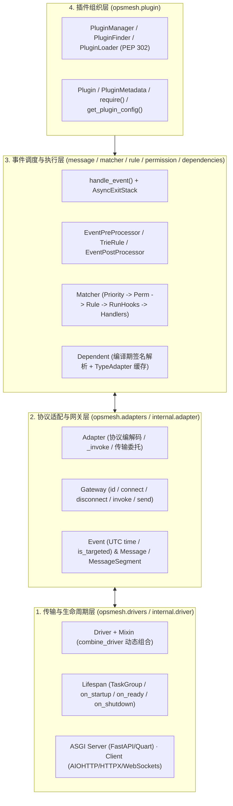
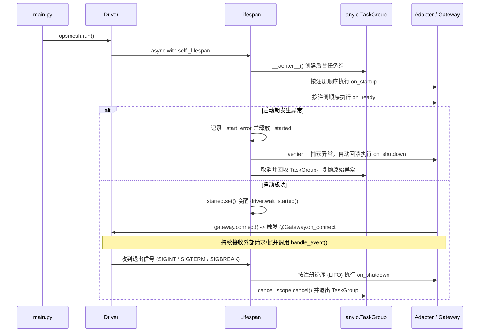
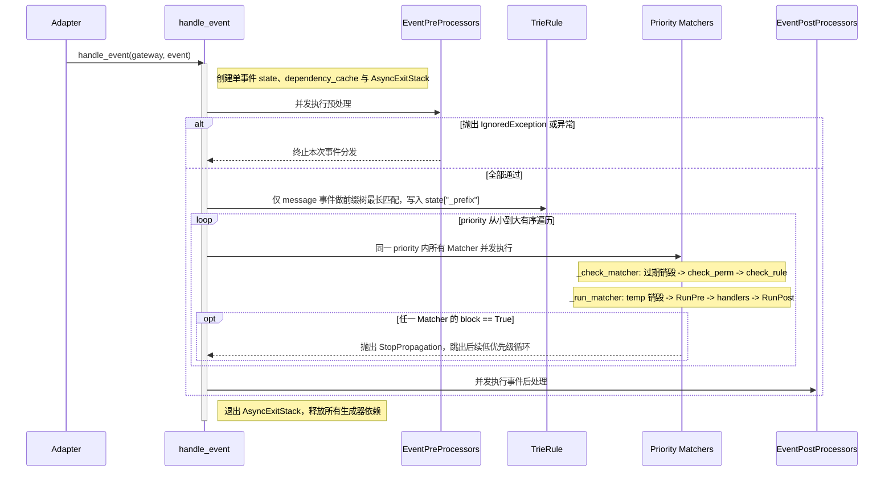

# OpsMesh 架构设计白皮书

本文档深入阐述 **OpsMesh** 的设计目标、四层架构边界、异步生命周期模型、事件调度管线、编译期依赖注入引擎与插件导入机制，帮助框架维护者、适配器开发者和高级插件作者全面理解内部运行原理。

---

## 一、设计哲学与边界

OpsMesh 衍生自 [NoneBot2 v2.5.0](https://github.com/nonebot/nonebot2)，围绕以下四条核心原则面向通用协议网关与异步自动化场景重构：

1. **机制与策略彻底分离**：框架内核只提供传输抽象、事件分发、权限/规则编排、依赖注入与插件加载机制，不内置特定业务流控、持久化或聊天领域假设。
2. **内外模型严格转换**：一切外部协议（HTTP Webhook、WebSocket、MQ、gRPC、IM、CLI 等）必须在 `Adapter` 边界解码为框架标准 `Event` / `Message`，业务层 `Matcher` 与 `Plugin` 仅面向内部模型编程。
3. **显式优于隐式**：所有依赖注入必须通过类型注解或 `Depends(...)` / `Arg(...)` 声明；`SUPERUSER` 强制按 `"{adapter}:{user_id}"` 隔离；插件加载必须通过 `load_*` / `require()` 显式触发。
4. **现代原生运行时**：直接基于 Python 3.11+（原生 `except*` 异常组）与 Pydantic v2（原生 `TypeAdapter` 与 `CoreSchema`），零历史版本兼容垫片。

---

## 二、四层分层架构



---

## 三、传输层（`Driver + Mixin`）与生命周期（`Lifespan`）

### 1. 动态驱动组合

`Driver` 负责托管异步事件循环与全局生命周期，`Mixin` 负责附加具体的服务端或客户端能力：

| 抽象基类 | 能力范围 | 官方实现 |
| :--- | :--- | :--- |
| `Driver` | 进程生命周期、`TaskGroup`、适配器/网关登记表 | `~none`、`~fastapi`、`~quart` |
| `ASGIMixin` (`ReverseMixin`) | HTTP / WebSocket 服务端路由注册与 ASGI App 暴露 | `~fastapi`、`~quart` |
| `HTTPClientMixin` (`ForwardMixin`) | 异步 HTTP 请求、流式请求（`stream_request`）与连接池会话（`get_session`） | `~aiohttp`、`~httpx` |
| `WebSocketClientMixin` (`ForwardMixin`) | 出站 WebSocket 长连接、心跳（`ping_interval` / `Timeout.ping`） | `~aiohttp`、`~websockets` |

通过 `DRIVER=~fastapi+~httpx+~websockets`，`combine_driver()` 在 `opsmesh.init()` 时动态派生组合类，将服务端与客户端能力注入同一 `Driver` 实例。同时，`Driver._adapters` 与 `Driver._gateways` 均为**实例级属性**，保证单元测试或嵌入式多实例运行互不污染。

### 2. `Lifespan` 完整时序与异常回滚



---

## 四、网关双向通信模型（`Adapter` & `Gateway`）

- **单适配器多网关实例**：一个 `Adapter`（如 `webhook` 或 `slack`）可同时管理多个不同 `id` 的 `Gateway` 实例；通过 `gateway.connect()` 登记至 `Adapter.gateways` 与 `Driver.gateways`，退出时调用 `gateway.disconnect()` 注销。
- **钩子与依赖栈顺序**：`Driver._register_gateway` 与 `_unregister_gateway` 均采用 `async with AsyncExitStack() as stack, create_task_group() as tg:`，确保 `@Gateway.on_connect` / `@Gateway.on_disconnect` 中所有并发钩子执行完毕后，再逆序析构生成器依赖。
- **出站动作拦截链路（`gateway.invoke`）**：
  1. 并发执行所有 `@Gateway.before_invoke(gateway, action, params)`；若任一钩子抛出 `MockInvokeResult(result)`，跳过真实 `adapter._invoke()` 直接采用模拟返回值。
  2. 调用 `await self.adapter._invoke(self, action, **params)` 执行协议层真实出站逻辑；支持语法糖 `await gateway.<action>(**params)`。
  3. 并发执行所有 `@Gateway.after_invoke(gateway, exception, action, params, result)`；后置钩子同样可通过抛出 `MockInvokeResult(new_result)` 覆写结果并吞掉上游异常。

---

## 五、事件分发管线（`handle_event`）



### 优先级与阻断规则

- `priority` 数值越小优先级越高（`priority=0` 默认留给多轮会话临时续接 `Matcher`，业务响应器默认 `priority=1`）。
- **同一优先级内的多个 `Matcher` 并发执行，彼此不阻断**；`block=True`（或运行时调用 `matcher.stop_propagation()`）仅阻止事件继续流向**更低优先级（更大数值）**的响应器。
- **默认阻断策略**：消息与命令类响应器（`on_message`、`on_command`、`on_shell_command`、`on_startswith`、`on_endswith`、`on_fullmatch`、`on_keyword`、`on_regex`）统一默认 `block=True`，防止已命中的指令穿透到低优先级兜底处理器；通知/请求/元事件/类型监听类响应器（`on`、`on_notice`、`on_request`、`on_metaevent`、`on_type`）统一默认 `block=False`。

---

## 六、编译期依赖注入引擎（`Dependent`）

OpsMesh 的依赖注入位于 `opsmesh.dependencies` 与 `opsmesh.internal.params`，其高性能源于**注册期编译 + 运行期缓存**：

1. **注册期编译（`Dependent.parse`）**：
   - 解析函数签名与 `ForwardRef` / PEP 695 `TypeAliasType`；
   - 按优先级匹配参数类型：`DependParam` -> `GatewayParam` -> `EventParam` -> `StateParam` -> `ArgParam` -> `MatcherParam` -> `DefaultParam`（后处理器额外包含 `ExceptionParam`）；
   - 将每个参数封装为 `ModelField`（内含懒加载缓存的 Pydantic v2 `TypeAdapter`）。
2. **运行期并发求解与防击穿缓存**：
   - 同一事件分发周期共享一个 `dependency_cache: dict[Callable, DependencyCache]`；
   - `DependencyCache` 内置 `PENDING / FINISHED` 状态与 `anyio.Event` 等待锁：当同一事件内多个并发 `Matcher` 或同函数多个参数同时请求同一个 `use_cache=True` 子依赖时，仅首次调用实际执行，其余并发方自动挂起等待并复用结果或异常；
   - 生成器（`def ...: yield`）自动经 `run_sync_ctx_manager` 包装、异步生成器（`async def ...: yield`）经 `asynccontextmanager` 包装，统一压入事件级 `AsyncExitStack`，保证无论正常返回还是异常中断均可靠清理资源。

---

## 七、多轮会话续接机制

当处理器调用 `await matcher.pause()`、`await matcher.reject()`、`await matcher.reject_arg(key)` 或 `await matcher.reject_receive(id)` 时，框架不会阻塞当前协程，而是：

1. 抛出控制流异常 `PausedException` 或 `RejectedException`；
2. 若为 `RejectedException`，将当前处理函数重新插回 `remain_handlers` 队首（`pause` 则保留下一个处理函数）；
3. 调用 `update_type()`（默认沿用当前 `event.get_type()`，支持非消息事件如 `webhook` 续接）与 `update_permission()`（默认通过 `User.from_event()` 将权限收敛至当前 `session_id`）；
4. 动态创建一个 **`priority=0, temp=True, block=True, expire_time=config.session_expire_timeout`** 的临时 `Matcher` 挂载到全局调度表，继承当前 `matcher.state`；
5. 同一会话的下一条事件到达时优先命中该临时响应器（命中即销毁），超时未回复则自动清理。

---

## 八、PEP 302 插件导入机制

`opsmesh.plugin.manager` 在导入期将 `PluginFinder` 插入 `sys.meta_path[0]`：

- 调用 `load_plugin` / `load_plugins` / `load_from_toml` 时，先创建 `PluginManager` 扫描并登记受控模块路径映射（`controlled_modules`），**不会立即执行模块**；
- 随后调用 `importlib.import_module(...)`，`PluginFinder.find_spec` 识别目标模块属于受管插件，将 loader 替换为 `PluginLoader`；
- `PluginLoader.exec_module` 在执行插件顶层代码前创建 `Plugin` 实例、通过 `ContextVar` 设置 `_current_plugin`，使得插件内顶层调用的所有 `on_*()` 自动挂载 `MatcherSource` 并归属到 `plugin.matcher`；执行完毕后读取 `__plugin_meta__`。
- 若加载期间抛异常，`_revert_plugin` 自动回滚登记，避免留下半初始化脏状态。

---

## 九、框架异常体系

```text
OpsMeshException
├── ParserExit                 # shell_command 参数解析退出/错误
├── ProcessException           # 调度过程控制异常
│   ├── IgnoredException       # PreProcessor 忽略事件或取消响应器运行
│   ├── SkippedException       # 跳过当前处理函数（Matcher.skip）
│   │   └── TypeMisMatch       # 依赖注入参数类型不匹配
│   ├── MockInvokeResult       # 钩子拦截并模拟 Gateway.invoke 返回值
│   └── StopPropagation        # 阻断事件向更低优先级传播
├── MatcherException           # 多轮会话流转控制异常
│   ├── PausedException        # 暂停并等待下一事件进入下一处理器
│   ├── RejectedException      # 拒绝输入并等待下一事件重跑当前处理器
│   └── FinishedException      # 立即结束当前 Matcher 执行
├── AdapterException           # 协议适配器异常
│   ├── NoLogException         # 抑制当前事件的框架日志输出
│   ├── ActionNotAvailable     # 网关不支持指定的出站动作
│   ├── NetworkError           # 底层网络通信异常
│   └── ActionFailed           # 远端动作调用返回业务失败
└── DriverException            # 底层驱动异常
    └── WebSocketClosed        # WebSocket 连接已关闭
```
