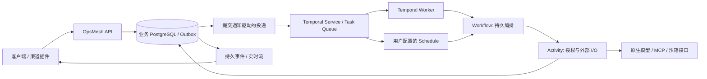

# OpsMesh 架构与验证边界

更新日期：2026-10-12。本文描述当前源码，不代表任何生产环境已完成升级。接口以生成的 [API 合同](api/README.md) 为准，配置和安装见 [部署说明](../deploy/server/DEPLOYMENT.md)。

## 1. 执行边界

OpsMesh 是企业 Agent 控制面。平台负责工作空间、身份、Agent 配置、用户编排、资源授权、审批、审计、成本和产品状态。Temporal 是唯一持久执行引擎；OpenAI Agents SDK 是唯一 Agent 执行内核。

平台不内置订单 Manager、专家、路由模型或强制的总结流程。这些是用户配置的 Agent 图与业务编排。框架提供经过授权的执行能力，不替用户决定业务流程。

| 边界 | 当前职责 | 源码入口 |
| --- | --- | --- |
| API | 认证、租户授权、配置、短事务、执行意图与实时读流 | `bootstrap/routers.py` |
| Temporal 接入 | Client、加密 payload codec、Outbox、Worker 注册和生命周期 | `runtime/temporal/` |
| Workflow | 确定性业务推进、子执行、等待审批和恢复 | 各 feature 的 `workflow.py` / `workflows.py` |
| Activity | 数据库事务、模型、工具、文件、外部 API 与产品结果 | 各 feature 的 `activities.py` |
| OpenAI 集成 | 原生 Agent 图、Runner、工具、handoff、Session、guardrails 与 tracing | `agents/execution/providers/openai/` |
| 沙箱产品层 | 授权环境、原生会话引用、加密状态、生命周期证据 | `runtime/sandboxes/` |
| PostgreSQL | 产品持久事实、SDK 历史、审批、事件和副作用凭证 | feature 模型与 Alembic |
| Redis | 部分缓存和短期派生状态 | 具体 feature 的基础设施 |

所有源码入口相对于 `src/opsmesh/`。保持 feature-first；依赖为 `routes → service/domain → infrastructure`，由 import-linter 和布局检查约束。Workflow 不持有 ORM Session、活连接或密钥，不执行数据库或其他外部 I/O。

## 2. Temporal 官方 OpenAI 集成

锁定版本为 `temporalio==1.34.0`、`temporalio-openai-agents==1.1.0`、`openai-agents==0.22.3`、`openai==3.28.0`、`mcp==2.3.0`。运行环境通过 `uv.lock` 安装；升级整组依赖须复核公开 API 和真实恢复行为。

`runtime/temporal/worker.py` 注册官方 `OpenAIAgentsPlugin`、模型参数、MCP 工厂和 `SandboxClientProvider`。`AgentWorkflow` 调用原生 SDK Runner；官方集成将模型、MCP 和沙箱操作调度为 Activity。Client 和 Worker 使用官方 `OpenAIPayloadConverter`，产品 codec 加密敏感历史载荷。

平台没有第二个 Agent 循环、模型 Activity 引擎或 SDK 执行协议。`AuthorizedModelProvider` 使用 SDK 的公开 `ModelProvider` 扩展，在模型 Activity 中校验工作空间、Agent、凭据和预算，再委派原生 OpenAI 模型客户端。它处理产品授权与成本，不能替代官方集成的重放或推理机制。

固定 Python Activity 可以用官方 `activity_as_tool()` 转成工具。当前产品工具来自用户启用的动态名称与 JSON Schema，还需要调用身份、审批和工具结果审计；公开 `FunctionTool` 的回调只委派产品 Activity。其参数格式与审批合同不适合直接暴露通用 `AgentToolOperation` 给模型。这是产品适配，不复制 SDK 工具循环。

远程及托管 MCP 通过原生 `MCPServer` 和 `temporal_mcp_server` 接入。授权包装校验动态目录、已冻结的能力指纹、凭据状态及执行身份；MCP 协议与工具调用由原生客户端负责。

原生 SDK 提供 tracing、guardrails、handoff、agents-as-tools、RunState 和 Session 协议。平台使用这些公开接口，只增加业务授权、持久审批记录和可供客户端读取的事件投影。[Temporal OpenAI 官方集成](https://docs.temporal.io/develop/python/integrations/openai-agents)

当前只支持 `openai` 和 `openai-compatible` 凭据，API 拒绝其他供应商。其他 AI 框架的依赖、执行器、探针和专用审批字段已删除。未来接入先采用 Temporal 官方 AI 集成，不恢复多套自研执行器。

## 3. 两种沙箱的区别

| 沙箱 | 解决的问题 | 当前方式 |
| --- | --- | --- |
| Temporal Workflow Sandbox | 限制非确定性行为，支持 Workflow replay | Temporal Python Worker 默认的 Workflow sandbox |
| 工具代码沙箱 | 在独立执行环境中运行用户文件、命令和 stdio 服务 | OpenAI Agents SDK `DockerSandboxClient` |

Temporal Workflow Sandbox 不是运行不可信代码的容器，也不提供 CPU、内存或网络隔离。[官方 Workflow Sandbox 说明](https://docs.temporal.io/develop/python/best-practices/python-sdk-sandbox)

`runtime/sandboxes/factory.py` 当前只注册 `docker` 后端，直接构造 SDK `DockerSandboxClient`。原生后端负责创建、恢复、文件、命令和删除。OpsMesh 保存经过工作空间授权的环境与 Session 引用，并将原生状态加密持久化；未知创建或删除结果明确标记，不能静默换后端。

创建 Agent 配置或提交普通模型请求不会自动创建沙箱。需要文件、命令、插件或托管 stdio 的执行才使用用户绑定的环境/会话。原生环境会话按工作空间、用户、配置 Runtime 与产品执行范围保存；串行对话按会话续接，独立任务和并行步骤分别隔离。Agent、Run 和重试标识不决定容器创建；同一执行范围的 handoff 复用环境，取消只清理对应范围的进程。

锁定的 `temporalio-openai-agents==1.1.0` 拒绝 `SandboxRunConfig.session`。平台通过公开 `session_state` 将受权原生状态交给官方客户端代理，SDK 负责 Agent、工具、handoff 与恢复。公开 Worker `ActivityInboundInterceptor` 在领取沙箱 Activity 时重新验证身份和环境引用，并把 SDK 对临时 Runner 资源的删除转为产品会话持久化；配置 Runtime 的明确删除才释放环境。这层适配处理版本缺口与产品会话所有权，不修改 SDK Runner 或维护自研执行协议。

原生 Shell、stdin 和 patch 使用 SDK `configure_tools` 接入工作空间命令审批策略。执行前再次校验当前授权及审批参数，已领取但结果未知的批准调用不能重复执行。原生 Session 状态和工具结果保持加密，事件只保存调用标识与脱敏证据。

当前托管 stdio MCP 连接使用独立原生沙箱，在连接清理时删除该沙箱；远程 HTTP MCP 不创建本地沙箱。`MCPDeployment` 保存部署和目录状态，不表示一个永久存活的 stdio 进程。这个接法会产生按连接创建的临时容器，不能描述为所有 MCP 共用一个容器。生命周期与实际后端保持一致，未知清理结果留证核对。平台已移除自研宿主池、UID 槽、执行租约、RPC、执行级防火墙与资源限制，不重新维护等价执行系统。

当前没有启用本地无隔离后端，也不把 SDK 未安装的沙箱后端当作可用能力。新增后端必须显式注册、校验原生参数并完成真实流程测试。[OpenAI 原生沙箱客户端](https://openai.github.io/openai-agents-python/sandbox/clients/)

## 4. 消息与 Agent 执行

1. API 解析用户与当前工作空间，校验执行目标、资源状态、配额和能力。
2. 在一个 PostgreSQL 事务中保存输入、Turn/Task/Run 初始状态及 Temporal 投递意图。
3. 提交后返回标识；PG 通知驱动 Outbox 投递。HTTP 请求不等待模型或其他任务。
4. ConversationWorkflow 串行推进该会话的 Turn，不同会话独立并发。AgentWorkflow 在准备 Activity 中重新检查权限和冻结配置。
5. 原生 Runner 执行用户的 Agent 图。模型、工具与 Session 操作经 Activity；需要审批时保存原生 RunState，Workflow 持久等待决定。
6. 审批恢复重新验证身份与资源，使用原生 RunState 继续；取消通过 Temporal 传播，并保存产品结果。
7. Activity 将结果、回答者、工具证据、审计和成本写回 PostgreSQL。客户端通过查询或 SSE 读取。

API 接收与最终回答是两个阶段。重复消息按幂等键返回原 Turn；相同键而正文不同返回冲突。输入一经准入冻结，不提供实时插话或 `add_instruction`。

handoff 将回答权转给目标 Agent；agents-as-tools 的结果返回调用者，由其配置决定是否汇总。框架不强制“小模型再总结专家结果”，不新增外层强制循环。

澄清以正常回复结束，补充信息作为新 Turn。失败重试是显式产品操作，不能自动重发未知工具副作用；有后续 Turn 时拒绝原地改写历史。具体 HTTP 与事件合同见 [对话文档](conversations.md)。

## 5. 原生 Session、审批和外部副作用

SDK 历史只有一个来源：原生 `SQLAlchemySession`。产品 Session 标识包含工作空间与授权范围。`TemporalSession` 实现公开 Session 协议并委派 Session Activity，因为 Workflow 不得直接访问 PostgreSQL；它没有第二套消息历史、复制规则或压缩状态机。

平台只提交当前输入，不拼接历史、专家摘要或隐藏指令。Session 不隐式包裹压缩器，不设置压缩阈值，不为压缩额外请求模型。可观测日志只能记录 SDK 实际产生的行为。历史会话被归档或冻结后不能重新执行。

审批使用 SDK 原生 interruption/RunState 与 Temporal 持久等待。审批暂停释放 Activity 槽；批准或拒绝仍须通过受权 API。自然语言“同意”不能替代审批记录。

一次恢复只消费该次送入 SDK 的审批决定。其他工具在模型恢复期间才收到的决定保留未消费状态，由持久信号唤醒下一次恢复；不能按整个 Run 批量标记已消费。工具实际执行前仍需校验当前授权、参数与该次审批绑定。

外部写操作区分明确失败、成功与未知结果。工具调用使用业务调用 ID、事务状态与副作用凭证；未知结果进入人工核对或显式恢复，不能因 Activity 重试自动重复业务写入。已完成的模型 Activity 在 Workflow 重放时读取历史结果。[原生 Session 文档](https://openai.github.io/openai-agents-python/sessions/)

## 6. 并发与分布式

Worker 使用 Temporal 原生 Workflow Task 和 Activity 并发预算。网络等待使用异步 Activity/SDK；同步数据库或阻塞操作使用受控线程执行。线程池容量与同步 Activity 预算一致，不把一个长期 Agent 占用为永久同步线程。

Workflow 的审批和业务依赖等待持久化在 Temporal，不占用 Activity 执行槽。Activity 的 `start_to_close` 超时只计算已开始执行的时间，不能用容量排队触发长任务失败。各外部操作仍保留明确的单次请求期限。

不同机器的 Worker 连接同一个 Temporal namespace，并领取相同或明确路由的 Task Queue。这是分布式扩容，不要求本机按 Agent 数量增加 Worker/Runtime。Temporal 负责调度与故障恢复，平台保留租户准入、成员业务容量和操作权限。

团队成员容量和用户发布的依赖图是产品约束，不是第二套节点调度器。平台没有 Redis Job 领取循环、WorkerLease、节点租约恢复扫描或外层 Agent execution loop。

Worker 关闭按原生排空与取消合同执行。原生沙箱会话的状态必须在 Activity 中保存；Workflow 结束不等于不可信进程自动消失，清理结果通过产品生命周期记录验证。

## 7. 入口、回复与定时插件

插件采用独立远程连接器。不可变的 `PluginRelease` 与稳定的 `PluginInstallation`、资源 `PluginBinding` 分离；一个发布物支持多个安装，升级只改变安装的当前发布引用。平台不托管第三方插件常驻进程，没有专用插件 Worker 或任务队列。

`messaging/channels` 管机器人连接、CloudEvents 输入去重和回复交付证据；连接不包含 Team 或工作流。管理员在 Automation 配置连接、发送人、会话、Team、已发布编排及输入/输出投影。插件通过 `/plugin-services` 调用已授权的平台服务，不能自行选择执行目标。

入口安装身份校验后在同一 PostgreSQL 事务中持久化事件、连接内去重事实和 Temporal Outbox。重投在评估可变路由前返回原事件。AutomationEventWorkflow 完成受权准入与执行关联。渠道安装、组织、发送者和会话标识属于工作空间范围。插件协议适配不负责另一套 Agent 循环。

执行完成后，ReplyDeliveryWorkflow 独立投递结果。HTTP 202 仅表示连接器受理，Workflow 等待实际回执且不占用 Activity 槽。发送结果未知时保持同一个投递 ID 等待新证据，不自动重发或重新运行 Agent；公开群或外部目标的披露权限仍须校验。临时凭据保存加密引用，不写入 Workflow 参数或日志。

定时配置使用 Temporal Schedule、版本和控制 Workflow，不依赖普通维护扫描推进。ScheduleTickWorkflow 复用相同准入合同；重复触发与重叠策略有独立去重与证据。

独立插件中心包含钉钉与 QQ 连接器。真实应用协议尚未验收；平台协议与模拟收发测试不能证明第三方渠道可用。用户未提供测试应用凭据。

## 8. 实时事件与观测

Chat POST 返回后即可订阅该 Turn 的 SSE，不必等待 Run 出现。持久 Task 事件包括阶段、工具、脱敏文字预览、审批与完成状态。断线按游标续读；读流不会重新执行任务。

PostgreSQL 通知与异步查询推进实时读取，等待时释放事务。SDK 流事件映射为产品事件；模型尝试与序号明确，重试输出不能拼成同一回答。配置输出 guardrail 或结构化输出时，未验证的文本不提前披露。

SDK tracing 和 guardrails 使用原生公共接口；OTel 与结构化日志连接基础设施链路。业务租户授权和副作用拒绝仍在 Activity 强制，不能仅把 SDK guardrail 挂在入口 Agent 上。

关联字段覆盖请求、工作空间、会话、Turn、Task、Run、Workflow、Activity、工具调用和沙箱引用。诊断保留安全的异常类别、状态码和错误关联；凭据、授权 URL、原始内部思考不得进入事件或日志。详见 [观测合同](observability.md)。

## 9. 数据迁移与代码清理

旧 Redis Job、队列锁、执行租约、Runtime 宿主池、UID/资源/网络策略、Agent RPC、多 SDK 基类及专用供应商执行器已从运行源码删除。API、Worker、测试、配置、依赖和发布路径使用一条 Temporal 执行链，不保留旧开关或兼容入口。

Alembic 迁移保留升级与降级路径。旧运行表和旧状态通过明确迁移退役；历史 Run、审计和成本是业务证据，不能作为“死代码”数据删除。

`0142_openai_execution_only` 在升级前拒绝尚未排空的非 OpenAI Agent Run；移除旧审批字段与未使用的模型请求审批规则，禁用不支持的凭据，删除 SDK 选择元数据并将旧 SDK 会话标记为 `retired`。普通激活不能复用退役历史；用户创建新会话或通过明确清空历史的配置重置建立原生会话。迁移专用保存表只供 downgrade 恢复配置，运行代码不读取它，不构成执行兼容层。

升级后设置了新的活动默认凭据时，降级先明确拒绝，须先取消新默认再恢复旧凭据。退役会话显式重置并写入新原生历史后，也须先导出并移除该会话才可降级，不能将新历史重新标记成旧 SDK。迁移记录原历史消息水位，保留未重置的历史。降级恢复备份的审批配置，可能覆盖升级后修改的规则；不会自动选择或覆盖新的默认模型。

切换须备份、停止新准入、处置旧执行、升级 schema 和明确更新服务。新代码不复活旧 Runtime 状态，也不靠静默降级处理旧审批或未知副作用。

## 10. 文档与 SDK 规则

仓库技能 [temporal-python-sdk](../.agents/skills/temporal-python-sdk/SKILL.md) 提供官方 SDK、AI 集成、Workflow Sandbox 与原生沙箱文档入口，并要求先核对锁定版本。`AGENTS.md` 已加入 Temporal 官方集成优先规则。

- [Temporal Python](https://docs.temporal.io/develop/python) / [中文安装入口](https://docs.temporal.org.cn/develop/python/set-up-your-local-python)
- [Temporal AI integrations](https://docs.temporal.io/develop/python/integrations) / [中文集成入口](https://docs.temporal.org.cn/develop/python/integrations)
- [OpenAI Agents 集成](https://docs.temporal.io/develop/python/integrations/openai-agents)
- [Temporal Python API](https://python.temporal.io/) / [源码](https://github.com/temporalio/sdk-python)
- [OpenAI Agents SDK](https://openai.github.io/openai-agents-python/) / [沙箱后端](https://openai.github.io/openai-agents-python/sandbox/clients/)

中文页面用于导航；接口和版本以官方英文文档、锁定发行元数据及安装源码为准。不把可变网页复制成过时的 SDK 文档快照。

## 11. 验证记录

实现、验证和部署分开记录；静态检查不能证明生产可用。

| 范围 | 状态与证据 |
| --- | --- |
| Temporal 唯一执行链、原生 Agent/Session/审批/streaming、产品入口及后台任务 | `implemented`；受影响真实 PostgreSQL/Temporal 回归覆盖执行与恢复 |
| API 拒绝未支持供应商、依赖/调用方清理、OpenAI-only 升降级 | 本轮最终回归记录在验收输出中，完成前不宣称通过 |
| Linux Docker 与 PostgreSQL 原生沙箱 | 已有文件、恢复、租户拒绝、独立清理与托管 MCP 真实流程证据（1 项通过）；不是全后端压力测试 |
| 持久 Temporal / PostgreSQL 服务物理重启 | 已验证原生 Agent 从历史继续、离线模型 Activity 只执行一次、官方 Replayer 通过 |
| 生产服务器切换 | `unverified`；本分支尚未部署生产 |
| 第二台机器故障与跨机器调度 | `unverified`；未提供第二台节点 |
| 真实模型、订单 API 与钉钉应用 | `unverified`；本轮不重复调用真实业务 API |

最后一次受影响修改后的验证才支持完成声明。PR 使用静态合同与受影响流程，发布使用完整套件；具体命令、基础设施和 opt-in 边界见 [验证文档](verification.md)。
