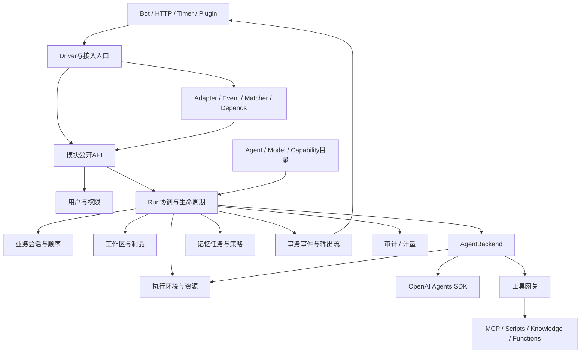

# opsmesh 总体详细设计

## 1. 产品范围与实现边界

opsmesh面向通过机器人、HTTP、定时任务和插件使用Agent的应用。用户可以选择已发布Agent，绑定会话、工作区和资源；Agent按权限获得工具、Skill、MCP及知识检索能力，产生消息、结构化结果和文件。

管理能力覆盖本地用户、部门、角色、资源权限、Agent配置发布、模型连接、Bot绑定、能力目录、执行资源、审批、审计和费用。身份源限定本地账号；Web只预留目录。当前已实现CLI、HTTP/SSE、业务持久化和真实SDK的离线运行闭环；生产环境与付费模型接入尚未验收。逐项状态以SDK覆盖表为准。

首个SDK后端为OpenAI Agents SDK；未来Claude Agent SDK通过后端合同接入。模型供应商、Agent SDK和沙箱提供商是三个独立变化维度。异步事件驱动支持持久任务和实时消息，但必要结果仍使用明确的await调用。

## 2. 总体结构

图表示调用与数据关系，不要求部署为对应数量的微服务。同步返回值走模块API；跨进程任务、已提交事实和订阅通知走事件传输。

## 3. 模块所有权

| 模块 | 拥有的事实/行为 | 不承担的职责 |
|---|---|---|
| accounts | 本地账号、部门、角色、登录会话、资源授权 | 外部SSO；SDK护栏实现 |
| agents | 定义、修订、代码工厂声明、发布和默认运行策略 | Bot绑定归bots；活跃Run状态和SDK对象归runtime |
| models | 模型配置、连接/凭据引用、参数及兼容能力 | 计费价格与Agent SDK循环 |
| bots | Bot账号、外部身份映射、连接、频道到Agent发布版本的绑定、回复交付 | 模型历史和平台用户权限源 |
| scheduling | 持久计划、执行身份、启停、授权、租约和TimerEvent | 进程内定时器归framework；具体任务策略可由插件扩展 |
| sessions | 会话归属、参与者、展示消息、逻辑执行顺序 | 原生RunState和沙箱连接状态 |
| capabilities | MCP/Skill/工具/知识库定义及版本、解析和调用治理 | SDK文件Manifest或持久工作区 |
| runtime | Run/Attempt、调度、上下文、输出、审批、检查点、模型历史 | 记忆策略与价格账本 |
| execution | Worker环境和沙箱会话、资源、网络/文件/进程策略 | 持久Agent定义和文件制品目录 |
| workspaces | 持久文件、WorkspaceManifest、挂载计划、产物与快照 | 容器生命周期、记忆生成策略 |
| memory | 命名空间、策略、生成任务、候选版本、索引发布和清理 | 聊天展示历史或通用知识库 |
| configuration | 业务配置、配额策略、插件启用范围 | 密钥明文和环境启动配置 |
| audit | 操作/授权/执行证据、脱敏和留存 | 以追踪采样替代审计 |
| usage | 用量事实、价格版本、预算预占/结算与成本 | 模型连接和运行结果 |

每个模块的`api.py`是Python公开合同，必要的`events.py`是事实定义；HTTP路由属于`entrypoints/http/routes/`，调用公开服务。接口传DTO或标识，不交换ORM实体。`infrastructure`提供连接池、缓存、传输和遥测，不拥有业务规则。

Agent与Bot绑定、账号、会话运行、知识目录和持久调度属于平台服务，未加载业务插件也应可用。插件通过Depends取得这些服务，提供命令、业务规则和第三方扩展。通用通知中心和通用工作流尚未实现，属于平台功能缺项；不为它们创建空插件包来表示完成。

## 4. 五类核心标识

1. `agent_revision`：冻结行为、工厂/代码包、模型和能力绑定版本；可重复构建。
2. `session_id`：用户交互及顺序；一段对话可包含多个Run。
3. `run_id / attempt_id`：一次任务及其执行尝试，恢复仍关联原Run。
4. `workspace_id / sandbox_session_id`：持久内容与实际执行环境分别标识。
5. `memory_namespace / memory_conversation_id`：经验存储范围与提取分组，不由Agent显示名称或沙箱ID推断。

统一关联字段用于审计/追踪，不将这些对象合并为同一“上下文”。SDK本地Context是Worker内依赖对象；模型上下文是明确选择的可见输入；持久事件只携带可序列化信息。

## 5. Agent配置与运行解析

AgentDefinition可编辑；发布生成不可变AgentRevision。声明包含指令/Prompt、模型、输出类型、工具/Skill/MCP/知识库、handoff/as-tool、护栏/hooks、工具终止策略、工作区默认值、资源和记忆策略。回调引用必须指向已部署且带版本的代码声明。

发布校验：依赖存在、schema有效、引用版本可用、Agent图合法、模型/后端/工具能力匹配、资源配置可满足。用户可克隆配置形成新定义，不能把SDK的浅拷贝当作资源复制或并发隔离。

提交Run时再根据当前权限、预算、配额及环境状态解析；发布时通过权限检查不代表以后始终有权调用。RunRequest覆盖仅允许白名单字段，生成的ExecutionPlan和ToolManifest记录摘要与版本。

Agent工厂和后端扩展可通过插件实现动态逻辑。HTTP只提交数据和已注册引用，不上传任意Python表达式。普通插件不直接接触业务internal或SDK实例。

## 6. 完整执行链

1. HTTP鉴权或Bot身份映射得到本地主体；Timer/系统任务使用明确的服务主体。
2. 接受请求并保存业务输入，检查幂等键、会话访问权、Agent版本和预算；分配run_id。
3. Runtime在自己的事务中保存Run和Outbox任务；协调器领取任务并获得带版本的执行权。
4. 解析模型配置、ToolManifest、WorkspaceManifest、MemoryPolicy及资源配置。必要前置检查失败时保存标准错误。
5. Workspaces解析内容与制品；Execution分配实际环境。由一个owner完成文件落地，禁止平台和SDK各装配一次。
6. Worker加载固定code bundle，重建RunServices，创建本次SDK Agent实例；不得并发修改共享Agent/工具对象。
7. Backend执行Runner。模型、工具、handoff和流事件转换为框架类型；必要授权、审批、预算及工具治理在执行通路落实。
8. 遇到审批中断，保存checkpoint与待审批项，再转WAITING_APPROVAL；释放Worker时保留会话逻辑顺序或明确创建分支。
9. 审批决定经授权、版本校验及事务提交后恢复原检查点。批准本身不直接执行工具，拒绝工具不必导致整个Run失败。
10. SDK执行完成后先进入FINALIZING：持久化必需产物、输出、rollout及本策略要求的快照，验证摘要和可读取性。先写不可变对象，再提交业务引用；失败时保留收尾进度，不能提前宣告完成。
11. 原子提交COMPLETED、已持久的输出引用及Outbox终态/后续任务请求。展示消息和通知由幂等消费者更新；订阅端以持久终态为准。启用managed_job时，由持久请求触发独立记忆任务；额外费用关联原Run，不重复发布RunCompleted。
12. 按owner释放环境。回收失败登记清理任务，不重复执行已完成的Agent；先前未引用成功的不可变对象由宽限期GC清理。

## 7. 状态、并发与故障

Run主路径：`QUEUED → PREPARING → RUNNING → FINALIZING → COMPLETED`；审批为`WAITING_APPROVAL → RESUMING → RUNNING`；取消、政策阻断与故障分别使用`CANCELLED/BLOCKED/FAILED`，保存结构化原因。SDK返回Completed仅表示SDK执行已结束，平台完成事实必须等待持久化收尾。

Attempt记录领取者、租约代次、开始/结束、checkpoint和资源引用。会话默认单个逻辑写者；等待审批不允许新的Run静默改变同一历史基线。显式并行通过独立会话分支/工作区分支及合并策略实现。

进程崩溃后先检查持久状态和调用结果，避免重复工具副作用。Redis租约不能替代数据库版本和fencing。无幂等能力的外部操作进入人工核对或明确补偿，不自动重跑整个Agent循环。

流式输出采用run_id、attempt_id与单调seq。SSE/WS断线不等于取消Run；客户可重新查询状态和订阅。允许丢弃的临时token与必须持久的消息、审批、终态、费用分开。目标恢复语义详见数据协议。

## 8. 执行与扩展边界

AgentBackend负责SDK循环；ModelProvider负责模型调用；ExecutionProvider负责环境。未来Claude后端需要自己的类型/事件/工具/状态适配及能力矩阵。保存的RunState不保证跨SDK或跨版本恢复。

RunWorker整体容器隔离与SandboxAgent工具沙箱是两层。根据部署配置可以分别使用资源，也可由平台受控桥接复用环境；不能无意创建双层环境或双重清理。普通Python工具和stdio MCP的执行位置必须明确。

ToolGateway并非所有Hosted工具的自动拦截点：需要代理端点或Provider策略，无法满足逐调用治理的能力应拒绝启用。输入/输出护栏也不替代工具权限和副作用控制。

## 9. 插件与交互

沿用NoneBot式模块导入、PluginMetadata、Matcher、规则/权限、Depends、Driver生命周期。导入阶段仅注册无IO代码声明；启动阶段验证并冻结引用，随后创建资源与连接Bot。具体设计见[插件专项](plugins.md)。

核心框架统一Event/Message行为接口；传输使用Envelope和显式payload schema，保留平台消息段扩展。Timer/Run事件没有Bot时，参数注入、命令解析和reply控制必须按能力处理。业务关键提交不能依赖Matcher传播是否被阻断。

插件禁用先阻止新调用，已有Run按代码版本完成或被明确取消。初期用受控重启/滚动发布，不承诺卸载Python模块就能撤销所有副作用。

## 10. 非功能要求与交付

原图的可用性目标落到：持久Run队列、幂等消费、checkpoint和版本校验、Worker健康与排空、会话顺序、数据库备份及资源回收。初始化阶段不承诺未测量的吞吐或恢复时长。

验收必须覆盖权限隔离、工具副作用、恢复兼容、费用去重、记忆发布及实际资源限制。日志、指标、追踪、审计、计费五类数据分别设计。详见[运维设计](../operations.md)、[实施路线](../roadmap.md)和[SDK覆盖表](sdk-coverage.md)。
