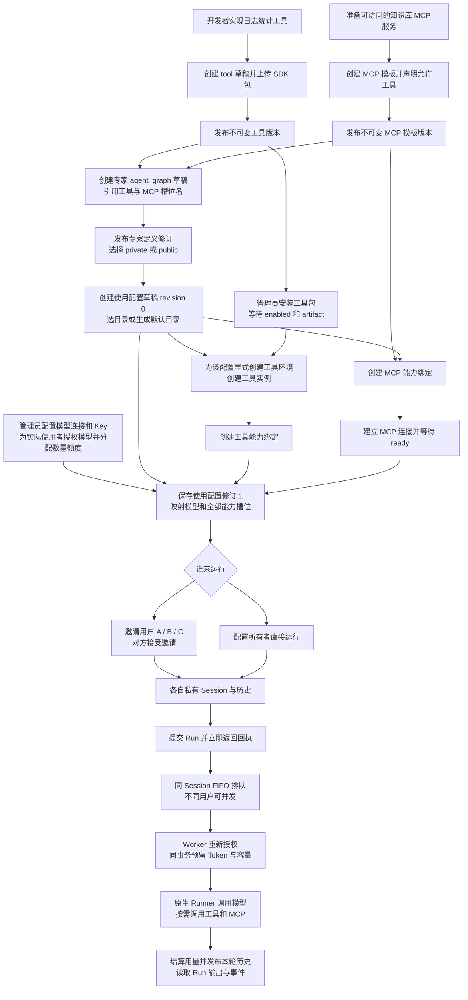
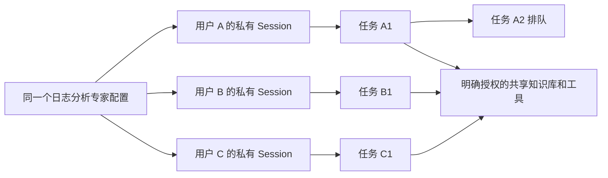

# 工具、MCP 与组合专家的创建和执行

依据：2026-10-20 当前源码及生成的 [OpenAPI](openapi.json)。本文是操作说明，不是新的重构方案。
示例为“日志统计工具 + 知识库 MCP + 日志分析专家”。本仓库没有前端，以下均使用 API。

每个 `CapabilityVersionView` 都返回能力版本 UUID `version_id`。管理员安装与能力绑定
均使用这个 UUID；`definition_id` 和整数 `version` 只用于定位定义和版本序号。
真实模型、MCP 和沙箱在本轮对象调整后也尚未完成整条产品验收。

## 全流程图



图中的“专家”是 `kind=agent_graph` 的组装定义，不再创建 expert 专用实体。
这里不经过通用 `flow` 执行器，也不需要 workspace 或 project。

## 对象与发布的含义

| 对象 | 保存什么 | 不保存什么 |
| --- | --- | --- |
| 工具/MCP 定义与版本 | 名称、公开性、调用声明、静态包或连接模板 | 运行实例、用户密钥、对话历史 |
| 专家定义与不可变修订 | 指令、Agent 图、模型槽位、工具/MCP 槽位 | 实际模型连接、私有能力绑定、用户历史 |
| 使用配置与不可变修订 | 定义修订、实际模型/能力绑定、环境和目录引用 | 其他使用者的 Session 和记忆 |
| Session / Run | 当前使用者的原生历史、输入、执行状态与输出 | 其他参与者的对话 |

“公开发布专家”发布的是可复用定义。其他用户选择它后需要创建自己的使用配置，
绑定自己有权使用的连接和能力；当前模板只有槽位名，不自动创建工具实例或 MCP 服务。
“邀请使用已有专家配置”则允许受邀者使用所有者已绑定并明确授权的资源。
受邀者仍各有私有 Session，运行 Token 额度与容量归实际调用者；管理员必须为每位使用者
授予模型权限，邀请不会继承配置所有者的模型授权。
两种方式都不会因发布而公开用户凭据、目录或历史。

## 请求约定与准备

所有路径默认以 `/api/v1` 开头，前缀可配置。请求携带：

```http
X-Session-ID: <当前用户的登录 Session>
Content-Type: application/json
```

管理员安装时使用管理员自己的登录 Session。登录 Session 与模型 Session 是两种对象。
下文 `<...>` 均为待替换值；UUID 从对应接口响应取得，不能照抄占位符。
有 `idempotency_key` 的请求将它放在 URL 查询参数中：同一次操作重试复用原值，
新消息或新操作使用新值。`expected_revision` 必须使用接口返回的当前修订号。

运行前需有 API、Worker、PG、Temporal 和执行沙箱设施，以及允许的构建/运行配置。
管理员还需配置所选模型的上下文上限，确保实际调用用户有模型授权、Token 额度和容量。
平台没有货币计价或预算账本，创建模型连接也不会自动授予所有用户。

## 1. 创建日志统计工具

工具至少需要实际代码、SDK manifest 和 Python 包元数据。下面展示最小纯计算工具；
它统计消息中传入的日志文本，不读取主机文件、不访问网络。

目录结构：

```text
log-stats-package/
  pyproject.toml
  log_stats.py
  manifest.json
```

`log_stats.py`：

```python
from opsmesh_sdk.extensions.operations import OperationResult, declare_operation
from opsmesh_sdk.extensions.package import ExtensionExports
from opsmesh_sdk.manifest import PackageManifest


def exports(context):
    @declare_operation(
        "count_errors",
        description="Count ERROR lines in supplied log text",
        input_schema={
            "type": "object",
            "properties": {"text": {"type": "string"}},
            "required": ["text"],
            "additionalProperties": False,
        },
        output_schema={
            "type": "object",
            "properties": {"errors": {"type": "integer"}},
            "required": ["errors"],
            "additionalProperties": False,
        },
    )
    async def count_errors(arguments):
        count = sum("ERROR" in line for line in arguments["text"].splitlines())
        return OperationResult(value={"errors": count})

    return ExtensionExports(
        PackageManifest(
            package_name="log_stats",
            version="1.0.0",
            description="Log text statistics",
        ),
        operations=(count_errors,),
    )
```

`pyproject.toml`：

```toml
[build-system]
requires = ["setuptools>=77"]
build-backend = "setuptools.build_meta"

[project]
name = "opsmesh-log-stats"
version = "1.0.0"
requires-python = ">=3.11.8"

[project.entry-points."opsmesh.extensions"]
log_stats = "log_stats:exports"

[tool.setuptools]
py-modules = ["log_stats"]
```

在已安装本仓库独立 SDK 的开发环境中，进入该目录，生成自己的 manifest 后构建 ZIP：

```sh
python -c "from pathlib import Path; from log_stats import exports; Path('manifest.json').write_text(exports(None).manifest.model_dump_json(indent=2), encoding='utf-8')"
opsmesh-sdk validate manifest.json
opsmesh-sdk build . --target ../log-stats.zip
```

这是作者本地生成自己的声明。服务端发布仅静态校验包；实际入口发现与构建在批准隔离环境执行。
涉及额外依赖、文件、密钥、宿主 API 或网络的工具，还需声明锁定依赖、effects 和权限，
不能通过本例的空权限绕过授权。

创建草稿：`POST /api/v1/capabilities/definitions`。五类能力共用此入口，`declaration.type`
选择对应静态声明。

```json
{
  "key": "log_stats",
  "name": "日志统计工具",
  "visibility": "private",
  "declaration": {"type": "tool", "configuration": {
    "execution_mode": "sdk_export",
    "entrypoint": "log_stats:exports",
    "operations": [{
      "name": "count_errors",
      "input_schema": {
        "type": "object",
        "properties": {"text": {"type": "string"}},
        "required": ["text"],
        "additionalProperties": false
      },
      "output_schema": {
        "type": "object",
        "properties": {"errors": {"type": "integer"}},
        "required": ["errors"],
        "additionalProperties": false
      },
      "effects": [],
      "timeout_seconds": 60
    }]
  }}
}
```

保存响应的 `definition_id` 和整数 `version`。以原始 ZIP 字节上传：

```http
PUT /api/v1/capabilities/definitions/<TOOL_DEFINITION_ID>/draft/package
Content-Type: application/octet-stream

<log-stats.zip 的二进制内容>
```

发布当前草稿版本，无请求体：

```http
POST /api/v1/capabilities/definitions/<TOOL_DEFINITION_ID>/versions/<TOOL_VERSION_NUMBER>/publish
```

工具目录与 ZIP 中的 operation 名、输入/输出 schema、effects、超时和工厂入口必须一致。
安装使用的是能力版本 UUID `<TOOL_VERSION_ID>`，不是整数版本号；从创建或发布响应的
`version_id` 字段取得它。

## 2. 创建知识库 MCP 模板

先准备一个已经实现并可访问的 MCP 服务。创建模板只登记其调用方式，不部署知识库服务。
示例地址必须替换为真实获准的 HTTPS MCP endpoint，`search` 也必须是服务实际提供的工具。

`POST /api/v1/capabilities/definitions`：

```json
{
  "key": "kb_search",
  "name": "知识库检索 MCP",
  "visibility": "private",
  "declaration": {"type": "mcp", "configuration": {
    "transport": "remote",
    "endpoint": "https://mcp.example.com/mcp",
    "tools": [{"name": "search", "description": "Search the knowledge base"}]
  }}
}
```

同样通过通用能力版本发布接口发布，得到不可变模板。
静态模板 `transport=remote`，实际连接时再选 `streamable_http` 或 `sse`。
创建模板成功不证明连接和发现已成功。当前没有用户密钥仓库或 MCP 认证密钥槽；本例使用
无需认证的测试 MCP，普通参数不能用于传递密钥。运行容器采用底层默认网络行为。

## 3. 组装并发布专家定义

`POST /api/v1/orchestration/definitions`：

```json
{
  "name": "日志分析专家",
  "kind": "agent_graph",
  "visibility": "public",
  "spec": {
    "entry_agent": "analyst",
    "agents": {
      "analyst": {
        "name": "日志分析专家",
        "instructions": "分析用户提供的日志。使用 log_stats 统计错误，需要背景资料时检索 kb，给出依据和建议。",
        "model_slot": "default",
        "tools": ["log_stats"],
        "mcp": ["kb"]
      }
    }
  }
}
```

此时 `log_stats`、`kb`、`default` 是槽位名，不是工具 ID 或 MCP 连接 ID。
创建响应的 `id` 是专家定义 ID，`revision` 是草稿修订号。

可先 `POST /api/v1/orchestration/definitions/<EXPERT_DEFINITION_ID>/validate`，再发布：

`POST /api/v1/orchestration/definitions/<EXPERT_DEFINITION_ID>/publish`：

```json
{"expected_revision": 1}
```

示例 `1` 只适用于未修改过的新草稿。发布响应的 `id` 是 `<EXPERT_REVISION_ID>`，
与专家定义 ID 不同；保存它用于创建使用配置。修改后再次发布会生成新修订，
原使用配置固定的旧修订不会自动切换。

当前 API 必须先发布定义，才能创建引用该修订的使用配置；没有“一次发布整个带连接专家”接口。
选择 `private` 则定义不进入公开目录，仍可在配置就绪后邀请别人使用已有配置。
公开专家引用的工具和 MCP 若也希望被他人独立配置复用，必须分别授予其可见性/使用权限。

## 4. 创建使用配置草稿并取得模型授权

`POST /api/v1/orchestration/configurations?idempotency_key=create-log-expert-1`：

```json
{
  "name": "日志分析专家运行配置",
  "definition_revision_id": "<EXPERT_REVISION_ID>"
}
```

省略 `specification` 使其保持 `draft`、`revision=0`，从而先取得配置 ID，
再创建必须归属该配置的环境、工具实例和 MCP 连接。草稿不能运行。
未提供 `root_directory_id` 时由资源所有者建立默认目录；响应返回目录 ID。
指定目录时必须使用自己有权配置的资源目录 ID，不能传任意宿主路径。

管理员创建模型连接：`POST /api/v1/platform/model-connections`：

```json
{
  "name": "专家模型连接",
  "api_key": "<ADMINISTRATOR_MODEL_API_KEY>",
  "base_url": "https://provider.example.com/v1",
  "default_model": "<MODEL_NAME>",
  "models": ["<MODEL_NAME>"]
}
```

Key 加密保存且响应不回传。管理员调用
`PUT /platform/model-connections/<MODEL_CONNECTION_ID>/users/<ACTUAL_USER_ID>`，请求
`{"models":["<MODEL_NAME>"],"is_default":true}`。每位受邀运行用户都要授权，管理员自身
运行也需要授权。用户通过 `GET /platform/model-connections/available` 获取获准模型，
不会取得上游 Key。管理员同时通过用户额度 API 分配 Token、存储和容量上限。
可通过 `POST /platform/model-connections/<MODEL_CONNECTION_ID>/probe` 发起探测，
同路径 `GET` 查询结果；这些路径同样位于 `/api/v1` 下。

## 5. 管理员安装工具，所有者创建实例

此处使用步骤 2 创建或发布响应中的 `<TOOL_VERSION_ID>` 继续安装和绑定。
已有获准安装可以复用，安装不需要每个专家或每次消息重复执行。

管理员调用 `POST /api/v1/extensions/installations`：

```json
{
  "operation_id": "install-log-stats-v1",
  "version_id": "<TOOL_VERSION_ID>",
  "permission_ceiling": []
}
```

这是异步意图。通过 `GET /extensions/installations/<INSTALLATION_ID>` 等待
`status=enabled`，保存实际 `artifact`。随后使用配置所有者自己的 Session 创建环境：

`POST /api/v1/orchestration/environments?idempotency_key=create-log-env-1`：

```json
{
  "configuration_id": "<CONFIGURATION_ID>",
  "root_directory_id": "<ROOT_DIRECTORY_ID>",
  "image": "<INSTALLATION_ARTIFACT>"
}
```

`image` 必须是这个安装的固定制品，不是任意 Python 镜像。轮询
`GET /orchestration/environments/<ENVIRONMENT_ID>`，等待 `ready` 后创建实例：

`POST /api/v1/extensions/instances`：

```json
{
  "installation_id": "<INSTALLATION_ID>",
  "configuration_id": "<CONFIGURATION_ID>",
  "environment_id": "<ENVIRONMENT_ID>",
  "configuration": {},
  "permissions": []
}
```

实例 `configuration` 要符合包自己的配置 schema。本例为默认单次 sandbox 模式，
要求显式环境；常驻包则使用其独立部署生命周期，不套用本例环境步骤。

## 6. 创建工具和 MCP 能力绑定

工具绑定，`POST /api/v1/orchestration/capability-bindings`：

```json
{
  "name": "log_stats_binding",
  "version_id": "<TOOL_VERSION_ID>",
  "configuration": {
    "instance_id": "<TOOL_INSTANCE_ID>",
    "export_id": "count_errors"
  }
}
```

保存响应 `id` 为 `<TOOL_BINDING_ID>`。
绑定实例的安装版本必须与这里的能力版本一致，实例必须归当前使用配置。

MCP 绑定，同一个创建接口：

```json
{
  "name": "kb_binding",
  "version_id": "<MCP_VERSION_ID>",
  "configuration": {}
}
```

保存响应 `id` 为 `<MCP_BINDING_ID>`。`<MCP_VERSION_ID>` 使用 MCP 创建或发布响应中的
`version_id`。绑定只接收公开声明允许的普通参数，不接收密钥引用。

建立连接，`POST /api/v1/orchestration/capability-bindings/<MCP_BINDING_ID>/connection?idempotency_key=connect-kb-1`：

```json
{
  "expected_revision": 1,
  "configuration_id": "<CONFIGURATION_ID>",
  "transport": "streamable_http"
}
```

新绑定未修改时修订号为 `1`。响应中的 `configuration.mcp_connection_id` 是实际连接 ID，
绑定修订也会增长；通过 `GET /orchestration/mcp-connections/<MCP_CONNECTION_ID>` 等待 `ready`。
模板声明的工具名必须被实际发现；若声明参数 schema，也必须与发现结果匹配。

stdio MCP 改用静态模板 `transport=stdio` 和 `command/arguments`，连接请求选择 `stdio`
并提供同配置的显式环境。服务代码及依赖必须已在批准环境中可用；上传模板包不等于部署代码。
不要把非并发安全的长连接强制共享给所有任务；连接生命周期和并发约束独立于用户 Session。

## 7. 保存可执行配置修订

`PUT /api/v1/orchestration/configurations/<CONFIGURATION_ID>`：

```json
{
  "expected_revision": 0,
  "specification": {
    "models": {
      "default": {
        "connection_id": "<MODEL_CONNECTION_ID>",
        "name": "<MODEL_NAME>",
        "max_output_tokens": 4096
      }
    },
    "capabilities": {
      "log_stats": {"binding_id": "<TOOL_BINDING_ID>"},
      "kb": {"binding_id": "<MCP_BINDING_ID>"}
    },
    "environment_id": "<ENVIRONMENT_ID>"
  }
}
```

这里的三个键必须与专家图中的槽位一致。保存时校验并固定定义、能力版本、实例修订、
模型连接修订和 MCP 工具集等依赖。新草稿成功后生成配置修订 `number=1`，配置变为可运行。
后续依赖修订变化需要显式更新配置，不会静默转向新实现。

## 8. 执行专家、查询输出与重置记忆

可直接提交，省略 `session_id` 时自动取得当前用户在该配置下的默认 Session：

`POST /api/v1/orchestration/configurations/<CONFIGURATION_ID>/runs?idempotency_key=message-1`：

```json
{
  "configuration_revision": 1,
  "input": "请统计这段日志中的错误，并检索知识库解释原因：\nINFO started\nERROR connection timeout"
}
```

返回 HTTP 202、`run_id`、`session_id` 和排队序号，不等待模型结果。
模型按指令和工具声明决定是否调用工具/MCP；绑定能力不代表每次请求都会调用它。

| 操作 | API |
| --- | --- |
| 查询自己的 Run 与最终输出 | `GET /orchestration/configurations/<CONFIGURATION_ID>/runs/<RUN_ID>` |
| 读取执行事件 | `GET /orchestration/configurations/<CONFIGURATION_ID>/runs/<RUN_ID>/events` |
| 显式获取/创建自己的默认 Session | `POST /orchestration/configurations/<CONFIGURATION_ID>/sessions`，无请求体 |
| 读取自己的历史 | `GET /orchestration/configurations/<CONFIGURATION_ID>/sessions/<SESSION_ID>/history` |
| 重置自己的记忆 | `POST /orchestration/sessions/<SESSION_ID>/history/clear?idempotency_key=reset-memory-1`，无请求体 |

表中路径均补 `/api/v1` 前缀。重置空闲历史返回 204；存在排队、执行、审批等待或待核对
任务时返回 409。清空 Session 历史不会删除知识库、共享目录文件或其他人的历史。

同一用户再次提交使用新的消息幂等键，复用其开放 Session：第一条完成后才执行第二条。
重新发送同一条消息时复用原幂等键，避免网络重试创建额外任务。

## 9. 邀请别人使用已有配置

所有者调用 `POST /api/v1/orchestration/configurations/<CONFIGURATION_ID>/invitations`：

```json
{
  "user_id": "<INVITED_USER_ID>",
  "permissions": ["read", "use"],
  "directory_access": false
}
```

被邀请者使用自己的登录 Session 调用：

```http
POST /api/v1/orchestration/configurations/invitations/<INVITATION_ID>/accept
```

接受后即可按步骤 8 调用同一个配置，不需要取得所有者密钥。
`directory_access=false` 不授予直接浏览或操作共享目录的权限；需要这项权限时由所有者明确授予。
各工具与宿主调用还要在效果边界按当前主体和资源权限复核，邀请不能绕过资源授权。



跨用户 Run 可并发，不代表同一个 sandbox、MCP 连接或知识库写操作必然可并发。
本例单个 sandbox 同时接受一个操作，共享该环境的工具调用可能等待或冲突；
知识库写入并发、版本冲突和外部存储恢复由其扩展实现。共享资源不共享对话历史。

## 当前可用范围

本文逐项对应当前 routes/schema 和组装实现；请求示例不是一次已执行的端到端验收。
真实模型/MCP/沙箱与共享知识库的本轮产品验收仍未关闭。邀请通用 `flow` operation/host.jobs
的范围闭环也尚未完成，不能用本例
`agent_graph` 的执行合同代替它。实现与验证状态见[当前交付记录](agent-orchestration-delivery.md)。
