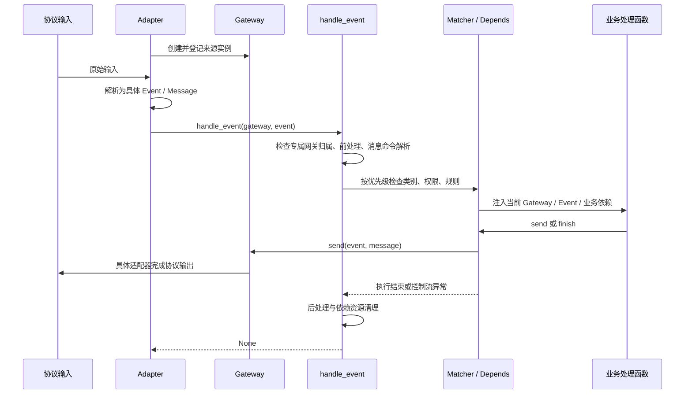

# Gateway 网关与事件流程

核对日期：2026-11-20。状态：现行框架文档。本文说明 Gateway 的登记、事件分发、归属、注入和回复；QQ 和钉钉由独立适配器插件提供，通用 HTTP 业务适配器仍未实现。

整体文件树、插件加载、依赖注入及设计思想见[框架架构](framework.md)，HTTP 传输和接口文档见 [OpenAPI](openapi.md)。

## 1. 网关是什么

Gateway 是适配器管理的一个事件来源实例，以及通过该来源回复和调用协议 API 的对象。它沿用上游 Bot 在调用链中的位置，没有增加一层代理或独立服务。适配器负责创建具体 Gateway/Event/Message，框架通过统一抽象执行处理器。

| 对象 | 职责 | 不负责 |
| --- | --- | --- |
| Driver | 进程生命周期、传输能力、适配器和网关登记 | 解释某个平台的业务事件 |
| Adapter | 协议通信、认证、事件转换、网关创建和资源释放 | 另建业务分发器 |
| Gateway | 来源实例标识、`send`、协议 `call_api` | 保存所有请求共享的“当前事件”或“当前响应” |
| Event / Message | 当前业务事件及其消息内容 | 代替 Driver 的 HTTP Request/Response |
| Matcher / 业务插件 | 匹配、权限、依赖、业务处理和显式回复 | 管理网络连接 |

一个适配器可以管理多个 Gateway，每个 Gateway 可以处理多个事件。`gateway.id` 是稳定的实例标识，不是请求 ID、用户 ID 或会话 ID。Driver 在登记时拒绝重复的网关 ID，且不自动添加命名空间；适配器应选择在整个 Driver 内唯一的标识。

## 2. 当前命名与源码位置

| 上游名称 | 当前接口 | 源码 |
| --- | --- | --- |
| `Bot` / `bot.py`、`self_id` | `Gateway` / `gateway.py`、`id` | [gateway.py](../src/opsmesh/internal/adapter/gateway.py) |
| `get_bot/get_bots` | `get_gateway/get_gateways` | [框架入口](../src/opsmesh/__init__.py) |
| `current_bot`、`BotParam` | `current_gateway`、`GatewayParam` | [Matcher](../src/opsmesh/internal/matcher/matcher.py)、[参数求值](../src/opsmesh/internal/params.py) |
| `Adapter.bot_connect/bot_disconnect` | `Adapter.connect/disconnect` | [adapter.py](../src/opsmesh/internal/adapter/adapter.py) |
| `bots/_bots` | `gateways/_gateways` | [Adapter](../src/opsmesh/internal/adapter/adapter.py)、[Driver](../src/opsmesh/internal/driver/abstract.py) |
| `Driver._bot_connect/_bot_disconnect` | `_register_gateway/_unregister_gateway` | [Driver](../src/opsmesh/internal/driver/abstract.py) |
| `on_bot_connect/on_bot_disconnect` | `on_connect/on_disconnect` | [Driver](../src/opsmesh/internal/driver/abstract.py) |
| `_bot_connection_hook/_bot_disconnection_hook` | `_connect_hooks/_disconnect_hooks` | [Driver](../src/opsmesh/internal/driver/abstract.py) |
| `on_calling_api/on_called_api` | `on_calling/on_called` | [Gateway](../src/opsmesh/internal/adapter/gateway.py) |
| `_calling_api_hook/_called_api_hook` | `_calling_hooks/_called_hooks` | [Gateway](../src/opsmesh/internal/adapter/gateway.py) |
| `T_BotConnectionHook/T_BotDisconnectionHook` | `T_ConnectHook/T_DisconnectHook` | [typing.py](../src/opsmesh/typing.py) |
| `T_CallingAPIHook/T_CalledAPIHook` | `T_CallingHook/T_CalledHook` | [typing.py](../src/opsmesh/typing.py) |
| `BOT_HOOK_PARAMS`、`skip_calling_api` | `CONNECTION_HOOK_PARAMS`、`skip_call` | [Driver](../src/opsmesh/internal/driver/abstract.py)、[Gateway](../src/opsmesh/internal/adapter/gateway.py) |

当前框架不提供 Bot 别名和旧连接入口。`call_api` 与 `Adapter._call_api` 保留名称，因为它们确实表示协议 API 调用；不是调用业务插件的通用 API。

相关代码的职责分布：

```text
src/opsmesh/
├── __init__.py                 # get_gateway / get_gateways
├── adapters/__init__.py        # Gateway、Adapter、Event、Message 公共导出
├── message.py                  # handle_event(gateway, event)
├── params.py                   # 事件、消息、命令参数辅助函数
├── plugin/on.py                # on_message / on_command / on_request 等
└── internal/
    ├── adapter/
    │   ├── adapter.py          # connect / disconnect、传输委托
    │   ├── gateway.py          # 实例标识、send、call_api、调用钩子
    │   ├── event.py            # 事件接口
    │   └── message.py          # 消息与消息段
    ├── driver/abstract.py      # 网关登记、连接钩子
    ├── params.py              # GatewayParam / EventParam
    └── matcher/matcher.py      # 当前上下文、处理器与回复
```

## 3. 启动、登记和注销

QQ、钉钉的声明式注册与连接配置见[框架配置契约](framework.md#6-插件配置与声明式连接)。
```text
启动程序：init → 加载并启用插件 → opsmesh.run
  → 校验插件配置 → 注册声明的协议适配器
  → Driver 启动，进入生命周期作用域
  → 适配器准备协议资源，创建具体 Gateway(adapter, id)
  → Adapter.connect(gateway)
      → Driver._register_gateway：检查 ID、写入全局网关表
      → 将 on_connect 钩子安排到 Driver 任务组
      → 写入 Adapter.gateways

适配器确认来源不可用或进入关闭流程
  → Adapter.disconnect(gateway)
      → 从 Adapter.gateways 移除；未登记时报错
      → Driver._unregister_gateway：移除全局登记
      → 将 on_disconnect 钩子安排到 Driver 任务组
  → 适配器完成协议资源关闭及任务退出
  → Driver 完成自身关闭流程
```

`connect/disconnect` 是登记操作，不建立或关闭 TCP/WebSocket 连接，也不自动取消已经开始的事件。传输建立、重连与释放顺序由适配器负责；登记和注销钩子需要 Driver 的任务组已启动且尚未退出。

这两个方法是同步方法，钩子被调度到任务组执行，返回不表示钩子全部完成。钩子异常按 Driver 当前逻辑记录，不能把连接钩子当成带回滚的启动事务或插件停止协议。

`get_gateway(id)` 和 `get_gateways()` 查询已登记实例；业务处理时通常直接注入本次 `gateway: Gateway`，避免从全局集合猜测事件来源。

## 4. 输入、匹配与回复



Gateway 基类不自动接收输入或创建 Event；入口在适配器。框架也不根据协议名强制分类：消息事件交给 `on_message`，符合配置的命令消息交给 `on_command`，请求/通知/元事件分别按对应类别匹配。

`Gateway(..., owner_plugin_id=None)` 是共享入口，保留现有分发。QQ、钉钉根据插件依赖配置创建专属入口时，把声明该配置的插件 ID 作为 `owner_plugin_id`，而不是从事件内容中读取归属。专属事件只检查该插件已有的 Matcher，并只调用同一插件的事件、运行和 API 前后钩子；无法识别归属的钩子不处理专属消息。归属插件未加载或禁用时，新事件直接丢弃，不回退到共享分发。禁用仍不等于立即关闭连接或取消已开始的调用。该规则是同进程内的分发约束，不是插件沙箱。

同一使用方的多个 Gateway 可以复用同一套 Matcher。默认的多轮续接仍由 `event.get_session_id()` 决定；跨 Gateway 的会话 ID 防碰撞目前需适配器负责，框架尚不强制按 Gateway 隔离续接。

`on_command` 是消息处理规则，不是独立传输或新的事件类型。消息进入 `handle_event` 后由 `TrieRule` 解析命令前缀及参数。同一业务插件可接收多个来源的同类事件，但各适配器必须提供兼容的消息和业务字段；仅有相同的类别字符串不保证业务契约一致。

### 读取当前输入

| 需要的信息 | 当前已有入口 |
| --- | --- |
| 事件类别和名称 | `event: Event`，`get_type()`、`get_event_name()` |
| 当前来源 | `gateway: Gateway` 或兼容的具体子类注解 |
| 当前消息 | `EventMessage()`，或当前事件的 `get_message()` |
| 当前消息纯文本 | `EventPlainText()` |
| 命令后的消息参数 | `CommandArg()` |
| 自定义业务输入 | `Depends(parse_input)` 校验当前事件提供的数据 |

Gateway 参数按类型注入，不依赖变量必须叫 `gateway`，也没有按无注解参数名 `bot` 注入的兼容分支。当前事件已经由框架交付，不需要再请求一次才能读取。查历史记录、下载附件等额外 I/O 则由适配器实际能力决定，框架不保证所有网关都支持。

### 回复关联与调用钩子

Matcher 在本次运行上下文中设置 `current_gateway/current_event`，退出时恢复；`Matcher.send` 读取这两个对象并调用 `gateway.send(event=event, message=...)`。因此业务代码无需手动选择另一个平台实例来回复。异步任务若脱离本次执行继续运行，不能仅凭继承了上下文就声称回复或资源仍然有效。

`finish` 可先发送，再用 `FinishedException` 结束当前 Matcher。它不代表整个事件传播必然结束，后续是否传播还受 `block` 等规则影响；同优先级 Matcher 可以并发执行。handler 普通 `return` 不会成为 HTTP 响应，`handle_event` 当前返回 `None`。

显式调用协议能力的路径为：

```text
gateway.call_api(api, **data)
  → on_calling 钩子
  → adapter._call_api(gateway, api, **data)
  → on_called 钩子
  → 返回结果或传播调用异常
```

调用钩子支持现有的模拟结果/跳过行为；它们不包围每次入站事件。入站观测和业务拦截使用 event/run 前后处理钩子。`Gateway.send` 是具体 Gateway 必须实现的抽象方法，不保证内部调用 `call_api`；具体 Adapter 必须实现抽象的 `_call_api`，不支持该能力时由适配器明确报错。

## 5. 已完成范围与当前限制

| 项目 | 状态 |
| --- | --- |
| Gateway 类、稳定 ID、集合、查询、注入与钩子命名 | 框架已完成 |
| 现有 Event → Matcher → Depends → handler → Gateway.send | 已有统一执行链 |
| HTTP Request/Response、HTTP 路由及 WebSocket 传输 | Driver 已有，详见 [OpenAPI](openapi.md) |
| 独立 QQ Bot 协议接入 | [QQ 插件](../packages/qq/README.md)复用现有 Adapter、Gateway 和 Matcher；待真实账号联调 |
| 通用 HTTP 请求转换为业务事件、请求级回复状态 | 未实现；不是网关改名自动附带的能力 |
| 非聊天事件免实现消息/用户/会话方法 | 未实现；当前 Event 仍声明这些抽象方法 |
| 任意字典作为统一 `send/finish` 回复 | 未实现；当前公开契约仍以字符串和消息类型为主 |
| 插件启停与基础卸载 | 框架已有接收开关及卸载接口；这不代表支持资源排空、版本持久化或依赖升级 |
| 其他包、平台通道和旧示例迁移 | 另行推进，不能由框架命名改造推断已经完成 |

新的协议接入应复用当前分发和注入机制。需要扩展非聊天事件、回复类型或取消语义时，先指出现有契约中的具体缺口并完成该功能设计，不重新创建 Gateway、分发器或并行兼容入口。
