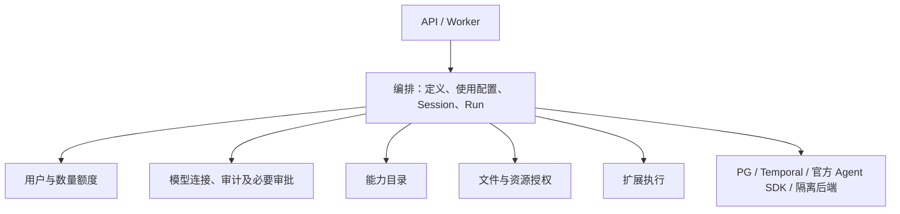

# OpsMesh 完整重构方案 V4：平台、SDK 与扩展

## 0. 2026-10-19 用户确认的对象与并发合同

本节为本轮实施的现行合同，取代下文涉及 workspace/project、expert/team 专用能力和邀请共享模型 Session 的旧设计。第 0.8 节进一步修订基础编排目标、源码职责及 SDK 边界，与此前条目冲突时以第 0.8 节为准。2026-10-20 已清理旧依赖白名单与强制注入设计，依赖方式统一以第 12 节为准。同一模型 Session 仍按接收顺序串行执行。既有 S1-S14 运行证据不证明本轮变更已实现或通过。
本轮实现与验证状态见[统一编排交付记录](agent-orchestration-delivery.md)。

### 0.1 唯一所有者与依赖

- 删除 `workspaces` 产品模块、workspace/project 表与 API，以及 `capabilities.experts` / `capabilities.teams` 类型、路由和强制绑定。不建立默认空间、兼容别名或替代的项目容器。
- capabilities 只拥有 tool/mcp/skill/channel/extension 定义、包和不可变版本；用户使用能力的绑定配置归 orchestration.configurations.bindings。静态发布不执行代码，执行包安装仍只允许管理员。
- orchestration.definitions 拥有用户创建的可复用组装定义、不可变修订与定义授权；orchestration.configurations 拥有使用配置、修订、成员和邀请。定义可公开/私有，kind 为 agent_graph 或 flow；专家/团队只是命名，不是两套实体或状态机。flow 继续复用唯一通用流程执行器。
- 使用配置固定定义修订、模型连接/能力槽位映射、目录引用和配置所有者。发布定义不公开凭据、会话或目录；邀请只授予配置使用和明确共享资源权限，每位使用者的模型 Session、Run、记忆和计量独立。配置不是租户或通用资源容器。
- platform.model_connections 拥有管理员模型上游、加密 Key、模型列表和用户授权。删除用户 credentials 与用户模型连接；运行代码调用所属模块的授权/解析操作，仅在 I/O 边界解密，不交给扩展或客户端。
- resources 拥有用户目录、文件、内容版本和 Artifact，并明确授权配置参与者的资源使用。identity 用户默认 work_root 只是默认值，不是授权凭据或任意主机挂载许可。
- identity.quotas 唯一拥有 Token、存储与执行/环境容量数量账本；删除货币计价和预算。准入继续使用同一 PG Session，按 Session/Run -> 用户 Token/存储额度 -> 执行/环境容量锁序执行，网络 I/O 不持锁。
- 通知策略与邮件业务归独立扩展包，核心保留账号和配置邀请事实。业务协作优先直接调用所属模块公开函数，具体依赖原则见第 12 节；不要求跨模块操作一律由 bootstrap 转接。

### 0.2 使用配置、主体与工作目录

- 使用配置所有者明确授权使用其连接和能力；实际调用用户是 Run/FlowRun 的执行、计量和付费主体。配置所有权不授予读取其他成员 Session 或 Run 的权限。成员移除及依赖撤销在领取、重试、审批恢复和敏感效果边界重新授权。
- 中性执行来源使用 `configuration_id`，用户级调用不伪造该 ID。Session 始终记录实际用户 `scope_id`、`principal_id` 和 `owner_ref=user:<id>`，配置来源单独记录。Run 的配置范围与实际用户分别保存；范围授权由配置模块验证，底层 execution 适配器不查询编排 ORM。
- 用户默认目录在其工作根下幂等生成；配置所有者的共享目录须显式授权。目录 ID、隔离挂载、相对路径与符号链接检查限制文件工具，不靠 cwd 限制权限。
- A/B/C 使用同一配置各有独立 Session、原生历史和记忆。同一用户在同一配置下只有一个开放 Session，重复创建幂等复用，多个 Task 在其中排队；关闭中拒绝创建替代会话以免绕过 FIFO。不能指定、列出或修改其他用户的 Session。原生 Agent 图直接产生 Agent Run，flow 才产生 FlowRun，统一由 orchestration.runs 提交。
- 环境/MCP 显式创建、复用、释放，不按消息自动创建容器。不同资源操作可并发；同文件使用版本检查或局部互斥，不支持并发的连接按连接互斥。关闭配置协调停止其自有触发、流程、Run 和部署，实际关闭由各唯一所有者执行；不误停共享环境。

### 0.3 私有 Session、任务排队与唯一历史

- 消息提交在同一 PG 事务保存 Run 输入、实际发起者、幂等键和 Outbox；提交不占执行容量。界面通过 Run 引用展示未完成输入，不另存一套模型消息历史。
- 同一 Session 的 Run 按接收序号 FIFO 执行；后续任务在前序完成后读取最新已提交历史。排队、执行、审批等待和 needs_attention 均保留会话顺序；排队不占活跃槽或执行超时。不同用户、不同 Session 可以并发执行。
- Session 通过官方 SDK 公开 Session 协议实现 PG 存储，替换独立提交的 SQLAlchemySession。保留原生 item 格式和 Runner；同一存储中的待提交项在发布时原地标记批次，不复制正式历史或 Agent 执行器。
- get_items 返回已提交历史加本 Run 待提交项；add_items/pop_item 操作当前 Run 写集。用户可清空自己的 Session 记忆，但存在排队、执行、审批等待或待核对任务时拒绝重置，避免丢失上下文。
- 成功且输出防护通过后，完整输入/工具调用/工具结果/响应按批次原子发布：历史项可见性、会话修订、稳定操作 ID/摘要/回执同一 PG 事务提交，不将不同 Run 的工具记录交错。当前 SDK 未提供这些业务保证，必须验收公开 Session 集成。
- 失败/取消保留输入、检查点、效果和费用回执，不发布不完整工具交互为正常完成轮次。未知提交结果使用同事务回执读取确认，未知外部效果 needs_attention 且不得重跑；取消一条 Run 不取消其他并发 Run。
- 审批等待保留会话归属和当前写集并释放活跃容量，恢复重新授权。共享知识库、工具、文件和连接按其唯一所有者提供版本检查、局部锁、幂等和效果回执；不能用 Session 锁串行所有用户，也不能因共用工具而共享对话历史。

### 0.4 实施与验收

先交付用户连接/能力配置和共享定义/授权、目录，再接通原生执行、FIFO/写集/原子提交，最后切换流程、触发、渠道、宿主、治理和清理。删除旧类型/表/路由/注册/导入/SDK 和工程检查引用；空库初始迁移重封，不提供旧数据库升级链。

验证对象授权、目录隔离、跨用户资源共享/撤权、配置 CAS/固定修订、事务回滚与幂等、同用户 FIFO、跨用户并发、历史隔离、空闲重置与忙时拒绝、历史批次原子发布、提交中断恢复、审批与取消、同文件冲突、环境/MCP 生命周期，以及 SDK/接口生成和独立打包边界。真实 PG/Temporal/模型/MCP/沙箱分别提供证据，未执行项标记 unverified；既有产品验证不能提前关闭本轮门槛。

### 0.5 能力公开审核（2026-10-19 用户确认）

- MCP、tool、skill、channel、extension 共用版本发布和公开审核合同。`publish` 只静态验证并冻结版本，作者可以私有使用；用户来源的版本必须经平台管理员逐版本批准才对其他用户公开。`visibility=public` 本身不能授予未审核版本的访问权限。扩展中心的管理员导入和发行预置记为 `source=system`，不记为操作管理员的私有作品；它们仍不得向其他用户泄露草稿。
- 公开访问需同时满足定义为 public、版本已 published、用户版本有 approved 决定。列表、最新版本摘要、详情、下载、UUID 能力绑定、模板、通道账号及已安装包的访问使用相同版本授权。作者和管理员可以检查草稿；新增版本不继承旧版本审核。拒绝新版本不撤销已批准的旧版本，平台可以通过定义禁用阻止后续使用。
- `platform.approvals` 唯一保存能力公开审核请求 的 pending/approved/rejected/cancelled 状态、提交者、理由、决定人和时间；这是人工公开发布审核，不是扩展的自动评审算法或市场评论。`capabilities` 验证目标并应用公开可见性，不再复制决定。市场扩展仍只提供展示、搜索及市场业务。
- 作者提交已冻结版本，可查询本人记录或撤回待审核记录。管理员查询待审/历史记录及目标内容，通过或拒绝；其他用户不能查询这些记录。重复相同决定幂等返回，冲突决定返回 409；被拒绝或撤回后可再次提交。已批准版本可以转私有再公开，但不能用旧决定公开其他版本。
- 锁序为 definition → review；目标检查、治理决定、可见性和追加审计使用同一 PG Session/事务，服务不自行 commit。并发相反决定只能有一个生效；审核时拒绝未公开批准的依赖。转私有、禁用或删除取消 pending 申请；重复决定不能重新公开已经转私有的定义。审核绑定不可变版本内容，定义级名称/描述仍是作者可编辑的目录元数据。
- 本轮增加公开接口、SDK 与初始空库模型，不提供历史库迁移兼容。使用步骤见[能力公开审核说明](capability-publication-guide.md)，验证范围见[统一编排交付记录](agent-orchestration-delivery.md)。

### 0.6 明确函数调用与平台约束（2026-10-19 用户修订）

本节取代通用事件分派方案及下文 governance 旧归属。交付证据见 [统一编排交付记录](agent-orchestration-delivery.md)。旧通用事件、成本和邮件交付文档已清理，不作为当前实现依据。

- 删除 shared/events/、bootstrap/events.py 和通用注册/分派/结果合并。审计、操作策略和审批分别通过明确函数或必要合同调用，强制能力缺失必须报错。不新增 Session.info 业务服务查找；当前查找实现列为第 12.3 节待精简项。
- 当前 shared.audit 声明审计输入和写入合同，shared.approvals 声明审批目标与快照，shared.policies 提供策略调用桥接。这是现存实现，不要求业务通过 shared 间接访问平台；后续将业务调用移回所属功能，只保留中性值。资源授权始终归资源所有者，策略不能授予缺失权限。
- platform.audit 唯一拥有最小审计与安全记录及幂等回执；写入使用调用方 PG Session、不 commit，失败使所在业务事务回滚。失败登录等事实由操作边界另开事务保存。全局哈希链及验证任务迁出核心，不保留串行链头锁；具体实施状态另行验收。
- platform.policies 管理声明式策略并提供直接检查函数；允许、拒绝、需要审批是策略结果。领取、重试及审批恢复重新校验当前权限和策略；未明确支持审批的路径遇到需要审批时拒绝执行。
- platform.approvals 唯一拥有通用审批，保留用户/角色审批人、固定目标修订、输入摘要、尝试标识和决定幂等。bootstrap 注入目标校验及决定应用；持久唤醒通过同一事务 Outbox，通知不是决定事实。capabilities 不创建第二份审批状态机；definition → approval 锁序及旧决定不得重新公开已转私有定义的约束保持。
- identity.quotas 唯一拥有 Token、存储与容量数量账本；不保留 identity.costs、币种、计价及货币预算。管理员管理用户上限，用户不能自行提高额度。强制账本直接调用并使用同一事务；未知用量保留预留待核对。
- telemetry.logging 直接接收标准 logging，保留脱敏、截断、有界队列、丢弃计量和退出排空，删除日志事件桥接。脱敏规则由 bootstrap 单独注入，不再通过分派对象获取；shared 脱敏函数只使用调用方规则。
- Run 进度记录、扩展命名空间发布及 orchestration.triggers 持久订阅保留，均不依赖通用总线。跨事务投递复用 temporal.dispatch 唯一 Outbox。现有 hooks 保留顺逆序、补丁校验与逐次效果回执，不新增全平台回调框架。
- SMTP/TLS 与邮件发送配置、意图及核对随业务迁至独立扩展包，不保留 shared.mail/platform.mail。shared.security 保留加密、显式规则脱敏和限流；网络范围以第 0.7 节为准。

目标文件树：shared/{audit,approvals,policies}.py；identity/quotas/；platform/{audit,approvals,policies,model_connections}/；telemetry/logging.py；bootstrap/{platform,approvals,source_notifications}.py。删除 shared/events/ 和 bootstrap/events.py。公开审计路径与权限命名空间统一为 /platform/audit、platform.audit.*；SDK 重新生成，不保留旧别名。SDK 扩展通知结构归 SDK 自身，不再复制服务端通用事件合同。

验收覆盖强制依赖缺失/拒绝/审批路径、业务/审计/Outbox 回滚原子性、幂等冲突、审批恢复和角色撤销、逐版本公开与草稿隔离、数量预留和未知效果、日志脱敏/饱和/排空、SDK/API 和权限命名一致性。真实 PG、Temporal 与静态证据分别记录；缺失环境标为 unverified。

日期：2026-10-16  
状态：唯一重构设计入口；第 0.8 节源码修订已实施，验证及未关闭的产品门槛见 [统一编排交付记录](agent-orchestration-delivery.md)，不据此宣布正式发布。  
适用范围：服务端、独立 Python SDK、扩展中心集成合同、API 合同与验收；扩展中心包源码不属于本仓库。

S14 常驻部署的所有者、状态、授权、事务、取消和验收细化见
[常驻部署合同](s14-managed-execution.md)。网络控制已按第 0.7 节移出当前范围；
状态以实际代码和运行证据为准。

### 0.7 共享脱敏规则与网络范围（2026-10-19 用户修正）

- shared.security.redaction 只提供递归脱敏和匹配函数，规则由调用者显式传入；不内置产品字段或凭据格式。平台规则归 platform.policies，由 bootstrap 注入日志、追踪与审计写入；配置校验使用同一显式规则，不能因迁出规则而泄露凭据。
- 当前不实现网络控制，也不因申请直接联网增加拒绝分支。移除 Docker 网络规则、辅助镜像、专用网络、DNS 固定、网络就绪门与 network_targets 授权接线；运行容器和原生 sandbox 使用底层默认网络行为。平台不宣称提供网络隔离或目标白名单。
- managed_worker 的显式部署、并发、停止、效果核对及资源释放保持各自所有者；网络能力后续若实现，归执行基础设施，不能放回 shared。安装权限、宿主 API 授权、凭据边界和容器其他安全限制继续有效。
- 本节取代下文与受控网络相关的旧目标、验收和已交付描述。同步删除旧 schema/SDK 字段及空库初始迁移列，不提供兼容别名；旧网络验收证据不适用于当前实现。

### 0.8 基础编排平台与源码职责修订（2026-10-19 用户确认）

本节收敛本轮用户确认的基础平台目标，取代下文旧的根 execution、用户 credentials/模型连接、
costs/货币预算、通知/邮件核心业务、审计哈希链与完整性验证、监控查询和业务归档职责。
第 9、10、12、15.2 节及[完整源码清单](agent-orchestration-target-tree.md)按本节修订；
其余章节保留的旧对象和路径应按本节映射理解，不作为恢复旧职责或接口的依据。
本节的功能收缩已按源码实施；2026-10-20 依赖精简的设计、已完成规则清理和待调整实现见第 12 节。
本轮证据单列于 [统一编排交付记录](agent-orchestration-delivery.md)，
不改变旧交付记录的实际证据范围，也不把旧产品验收自动延续到新合同。

- **对象与唯一事实**：definitions 只管组装定义/修订/授权；configurations 管使用配置、成员、
  邀请、关闭和运行来源引用，bindings 是其能力使用子模块。Run 状态唯一归 runs。
  删除根 execution，将 runs/sessions/runtime 归 orchestration，execution 只作内部官方 SDK
  适配，不含 ORM 或第二套公开运行 API。配置不是租户，成员 Session/历史仍各自私有并遵守 FIFO。
- **管理员模型与额度**：platform.model_connections 保存管理员配置的上游 URL、加密 Key、
  模型和用户授权；运行代码可直接调用模型公开操作，运行适配器不查平台 ORM。
  identity.quotas 唯一管理 Token、存储与容量，删除价格、币种、货币预算及通用用户密钥仓库。
  扩展通过受限 host.models 调用，不取得模型 Key，manifest/context 不保留用户密钥槽。
- **纯算法与权威校验**：SDK composition.parameters 提供单一有界纯解析/规范化算法，无 I/O 和授权。
  服务端 configurations.compilation 从持久化固定版本和参数重算有效声明，bindings.validation
  比较实际 MCP 地址/命令/环境等字段并执行当前授权；客户端结果和摘要不能替代服务端检查。
  绑定变更、Run 领取/重试/审批恢复及敏感效果边界验证修订和撤权，网络 I/O 不持锁。
- **MCP 独立环境**：stdio MCP 使用创建连接时显式选择的环境，可与 Agent/扩展环境不同。
  配置编译重验 MCP 自有环境的当前归属和 ready 状态，并冻结环境引用；不得用 Agent
  的环境覆盖 MCP 环境，也不得跳过固定命令、参数、工具声明及连接范围的检查。
- **隔离与部署**：runtime 只拥有环境、命令和独立 MCP 生命周期。extensions.sandbox 拥有扩展
  启动入口、调用信封和宿主通信，通过环境公开操作复用运行设施，不重复维护环境状态。
  deployment.py 唯一推进常驻部署状态及并发，managed_process.py 操作进程，Activity 执行 I/O；
  删除职责重叠的 managed.py。取消不误停共享资源，未知效果保留回执，不重跑外部写入。
  默认容器计算镜像与 Worker 使用相同 UID/GID 10001，自定义镜像须具有相同目录访问权限，
  挂载目录不通过开放全局写权限解决。源码 CI 按 runner 的 UID/GID 构建验收镜像。
- **存储挂载**：通过 Docker socket 创建原生 sandbox 时，API/Worker 的存储目录必须与
  daemon 宿主使用相同绝对路径。server Compose 固定安装根下的 `data/storage`，local
  Compose 使用 `OPSMESH_DOCKER_STORAGE_ROOT`，由一次性初始化容器设置 10001:10001、2770；
  不再用具名卷或容器内路径别名承载这条 bind mount 调用链。systemd 保持独立服务 UID、
  共享 GID 10001 与 UMask 0007，实际沙箱目录授权仍由资源所有者提供。
- **模型参数与发布门槛**：冻结模型配置与受限 host.models 支持显式 `reasoning_effort`，
  通过官方 `ModelSettings.reasoning` 传递，不在 Worker 中写死思考等级或供应商型号。
  发布前必须执行真实模型、Docker/MCP、扩展安装、常驻并发、取消与重放验收；缺少配置、
  用例跳过或失败均阻止发布。源码先构建 sdist，再由 sdist 构建 wheel，并核对当前源码内容。
- **未知效果核对**：管理员确认完整未决集合并结算后，Run 结束为失败，受影响 Session
  进入关闭，取消其中尚未执行的排队 Run；取消落库后关闭 Session。不得在核对后继续使用
  该 Session，也不关闭无关共享环境。委托审计读取同时满足当前主体、实例和调用范围；
  用户范围仅能按 ID 请求自己的无配置记录，公开审计 API 仍执行当前用户的读权限检查。
- **源码与 SDK 命名**：bootstrap.connections 代替 resources；安全算法使用 encryption 和
  url_validation；JSON Schema 校验使用 schema_validation。SDK runtime/{runner,managed,loading}
  是正式隔离执行代码，development 仅构建/验证/本地测试；生产运行不依赖开发 extras。
- **精简与保留**：capabilities.routes 统一五类能力 CRUD、版本及包操作，类型目录保留静态校验，
  不再复制薄 CRUD 路由。通知/邮件、知识、领域规划/协作、模板等由独立扩展包提供；SDK 只提供通用合同。
  GitHub 包源查询/下载归 SDK sources，服务端保留包校验与管理员安装。监控查询归 operator，
  telemetry 继续上报，platform 保留必要维护。最小审计仍在业务事务中追加。
- **实施与验收**：完整调用流程、受影响项和顺序见源码清单末尾；同步 routes/schema、SDK、
  初始迁移、镜像入口、import-linter 与工程检查，删除旧引用，不建立兼容别名。
  验证绕过 SDK 篡改连接、参数越界、撤权/修订变化、私有历史、FIFO/并发、共享资源关闭、
  部署未知效果及 SDK wheel 无开发依赖运行；真实 PG/Temporal/模型/MCP/沙箱证据缺失时仍为 unverified。

## 1. 设计依据与本版结论

V4 汇总此前的架构讨论和功能盘点，作为唯一实施设计入口。旧版重构草案不再作为仓库文档来源；历史差异已经收敛到本文的功能去向和验收章节。本文包含服务端树、SDK 树、对象归属、依赖图、关键流程、功能去向、实施步骤与验收。扩展中心项目的职责树由该项目单独维护。

参考归档基线（2026-10-16）：源码迁入 `backup_2/opsmesh`，历史完整源码位于 `backup/opsmesh`；当时按 `rg --files` 统计分别为 125 和 841 个文件（不含忽略文件）。两者只读，不属于运行包或兼容导入路径，文件多寡不代表功能数量。旧方案与 API 文档保存在 `backup_2/docs`，不约束新接口。当前目标源码已重建于 `src/opsmesh`，独立 SDK 位于 `sdk/python`，API 文档由实际 routes/schema 生成；本文仍是唯一重构方案。实现状态由第 16 节和各步运行证据说明，不能把设计树、参考源码或旧测试文件的存在当作完成证据。逐文件映射同时记录两份来源、目标、授权、状态、外部效果和验收。

确定的设计：

1. 平台拥有身份、空间/项目、能力目录、基础资源、执行、通用流程编排、治理、通道账号和运维事实。
2. 知识库、模型记忆、内容防护、分类路由、规划/匹配、任务/团队协作、评审/对话/通知策略、公告、能力市场、发行查询、coding 工具和厂商通道协议由独立扩展中心项目维护；OpsMesh 提供通用包导入、安装授权、受限宿主与公开 SDK 合同。
3. SDK 是可安装的独立发行包 `opsmesh-sdk`，导入名 `opsmesh_sdk`；同时提供业务 API 客户端、扩展合同、受限宿主调用和开发工具。
4. SDK 的业务功能包含可用客户端实现，不只有 Protocol；用户/项目等业务规则和数据库实现仍由服务端所有者负责。
5. 扩展通过 operation（操作）、hook（执行阶段钩子）、event（异步事件）组合；按实际需要声明导出，不继承强制实现所有方法的大基类。
6. capabilities 是定义、作者、公私有、不可变版本、包资源、导出清单和依赖的唯一目录。extensions 是安装、实例、调用和扩展宿主机制的唯一所有者。
7. 只有平台管理员可以安装、替换、扩大安装权限和卸载可执行包。公开发布不等于执行授权；配置绑定不等于再次安装代码。流程模板导入/发布另需流程权限，不能因安装包就自动替用户启用订阅。
8. 每次调用使用当前主体与当前授权，不继承安装管理员身份；客户端校验帮助开发，服务端校验决定是否允许。
9. execution 只运行已组装配置；OpenAI Agents SDK 提供 Agent/Runner/Session，Temporal 是唯一持久执行引擎，用户代码进入批准的隔离环境。
10. 不恢复独立 agents、runtime、messaging 根包，不设计第二套 Agent 循环、任务队列、会话历史、能力目录或审批状态机。
11. 所有实施步骤都以本文完整合同为目标，不引入临时兼容路径、双轨事实、升级/降级适配或迁移旧架构数据的代码。
12. 文中“模型记忆”只指显式持久业务；不设计额外的进程内存/工作记忆产品，也不复制 SDK Session。
13. platform 只拥有平台管理与运维机制。管理员使用的公告/市场仍属可选业务；主机安装更新由独立部署工具执行，核心 API/Worker/扩展不持有主机更新权限或第二份更新状态机。

## 2. 平台、SDK 与扩展的职责

### 2.1 大模块职责

| 模块 | 主要职责 | 不能承担的职责 |
| --- | --- | --- |
| shared | 中性类型、错误、文件/数据库/HTTP/Redis/加密基础函数 | 业务聚合、用户/空间/Run 查询、业务授权 |
| telemetry | 日志、指标、追踪 SDK 接口及上下文传播 | 查询业务 ORM、决定租户权限 |
| temporal | Client/Worker 基础合同、payload codec、通用事务 Outbox | Task/Run 状态机、模型循环 |
| identity | 用户资料、登录 Session、平台角色、用户配额和默认工作根目录 | 空间/项目成员角色、模型 Session |
| capabilities | mcp/skill/tool/channel/extension 定义与版本、包、依赖、可见性 | 安装进程、连接 MCP、运行工具、通道账号、用户专家/团队编排 |
| resources | 文件/目录、内容/版本、授权、存储计量协调、Artifact | 知识来源、向量索引、记忆提取/召回 |
| platform.audit/approvals/policies | 最小审计与安全事实、通用审批与操作决定；经 shared 最小合同调用 | 自动评审/告警算法、货币计价与预算 |
| extensions | 管理员安装、服务实例、单次调用/效果回执、宿主、钩子绑定及扩展事件发布 | 通用流程/订阅执行器、第二份目录、扩展业务模型、用户/项目 CRUD |
| orchestration | 组装定义、使用配置/绑定/邀请、Run/FlowRun、私有 Session、环境/MCP、内部执行适配、触发与唯一订阅 | 领域规划/分工/交付/对话策略、第二份 Agent 循环或作业引擎 |
| channels | 账号、身份映射、配置路由、连接控制、Inbox/Delivery | QQ/钉钉协议源码、第二份业务任务或消息历史 |
| platform | 管理员模型上游/授权、审计/审批/策略、健康和必要维护 | 通知/邮件、监控查询、业务归档、市场/发行、主机更新及资源所有者内部状态 |
| bootstrap | 进程组装、依赖注入、路由/模型/Worker 显式注册 | 业务策略、可独立演化的业务服务 |
| sdk/python | 独立客户端、扩展合同、宿主客户端、开发工具 | 导入 opsmesh 服务端、内置知识/记忆业务 |
| 扩展中心项目 | 完整定义/扩展源码、依赖锁、发行与 GitHub Release | OpsMesh 平台安装/实例/调用状态 |

### 2.2 哪些现有业务进入扩展

| 功能 | 目标位置 | 平台继续提供什么 |
| --- | --- | --- |
| 知识库、记忆、安全规则、判断算法及其他业务扩展定义 | 后续独立扩展中心项目 | OpsMesh 提供 SDK 合同、受限宿主、状态命名空间、资源与流程 API |
| coding 工具、QQ/钉钉等厂商协议适配器 | 后续独立扩展中心项目 | OpsMesh 管理安装授权、执行隔离、账号配置、连接 epoch、Inbox/Delivery |
| embedding/rerank、数据源、格式解析 | 后续扩展中心项目维护的知识/记忆包或固定依赖包 | 通用模型操作、网络范围、资源与调用回执 |
| 规划/专家匹配/任务与团队协作/评审/对话 | 后续扩展中心项目 | 核心流程/执行/权限/审批与 namespace；扩展包拥有业务策略和实体 |
| 通知、公告、能力市场与发行目录等业务 | 后续独立扩展中心项目 | OpsMesh 仅提供对应受限 API/宿主合同，不拥有这些业务状态 |
| 主机安装/更新/停服/切换/恢复 | 独立部署工具，目标入口 deploy/server/opsmesh-server | 只读就绪/构建信息和获准的排空/恢复准入命令；无远程主机更新 API |
| 平台权限、数量额度、审批、最小审计 | 保留平台各所有者 | 这些是不可由内容扩展替换的约束；不包含货币预算 |

不把“可扩展”解释成所有核心逻辑都搬出去。用户是平台资源所有者，使用配置是协作授权对象，执行和审批是产品状态事实；扩展经公开接口协作。能力市场扩展管理上架/评价/检索索引，capabilities 拥有定义版本与可见性；不安装市场也能使用获准能力。

### 2.3 platform 的基础管理边界

管理员权限是授权条件，不是模块归属依据。platform 不成为所有业务共同导入的依赖层；
具体服务经最小合同和 bootstrap 注入，由事实所有者执行授权与事务。

| 保留模块 | 基础职责 | 边界 |
| --- | --- | --- |
| model_connections | 管理员上游/加密 Key/可用模型/用户授权、连通性测试 | 当前调用者逐次校验，不向客户端或扩展释放 Key |
| audit / approvals / policies | 最小审计、唯一人工决定、声明式操作检查 | 不提供领域评审算法、全局哈希链或通用事件总线 |
| health | 存活/就绪、基础设施探针和构建信息 | 不访问发行站点，不代替真实产品验收 |
| operations | 排空/恢复、轮换/清理的显式命令、幂等回执与持久协调 | 各所有者执行自身操作，不直写他方表，无任意 shell/SQL/URL 或主机更新 |

日志/指标/追踪上报归 telemetry，监控后端查询归 operator；
业务归档、通知、邮件、公告、市场及发行展示由独立扩展包或外部工具维护。
核心保留账号邀请和配置邀请事实，不提供 SMTP 配置、通用邮件发送或通知偏好模型。
扩展业务仍须实现自己的当前授权、撤销、幂等和未知效果核对。

主机更新由应用外部署工具使用主机身份执行，负责锁、制品摘要、排空/停服、切换和就绪核对。
API 停止时仍可查询和处置部署；核心只暴露只读构建信息与获准排空命令，
不保存更新任务/版本副本，不持有主机更新权限，不恢复旧 updater 或导入兼容层。

## 3. 唯一事实、配置与身份

### 3.1 对象归属

| 对象 | 唯一所有者 | 必须包含的合同 |
| --- | --- | --- |
| CapabilityDefinition / CapabilityVersion | capabilities | 作者、创建/修改时间、公私有、启停/删除、版本、摘要、资源/导出清单和固定依赖 |
| ExtensionInstallation | extensions | 管理员批准的版本/制品摘要、执行模式、权限上限、部署状态和修订 |
| ExtensionInstance | extensions | 独立业务服务的配置、范围、密钥引用、实例成员及配置修订 |
| Definition / DefinitionRevision | orchestration.definitions | 组装图/流程、不可变修订、摘要和定义授权 |
| UseConfiguration / ConfigurationRevision / 成员/邀请 | orchestration.configurations | 固定定义修订、资源绑定、使用授权、关闭和运行来源引用，不保存 Run 状态副本 |
| CapabilityBinding | orchestration.configurations.bindings | 固定版本/导出/安装、参数和实际连接引用；服务端重算及当前授权 |
| ChannelAccount | channels | 唯一账号配置、密钥引用、安装/导出引用、身份和路由；不再创建相同 ExtensionInstance |
| HookBinding | extensions | 配置所有者引用、阶段/顺序/策略、固定导出和修订；业务侧只持选择引用 |
| FlowRun / StepAttempt | orchestration.runs | 控制状态、步骤/等待/子执行引用和计划回执；不复制 Agent/Invocation 状态机 |
| Trigger / EventSubscription | orchestration.triggers | 固定流程修订、触发主体/过滤范围/修订、消费游标与幂等触发回执 |
| ExtensionInvocation | extensions | 实际主体、范围、版本、输入/结果引用、状态、效果回执、用量 |
| Namespace / state 记录 | extensions | 宿主生成命名空间、容量、CAS 修订、保留与清理合同 |
| 知识库/知识来源/记忆/Task/协作实例/Conversation | 各扩展包 | 自有合同、权限、版本、来源/消息及保留；只关联平台流程/执行引用 |
| Announcement / Listing / ListingReview / 发行查询缓存 | announcement-center / capability-marketplace / release-catalog | 独立 namespace、业务修订/访问控制；市场只引用能力版本和审批决定，缓存不成为发布或安装事实 |
| MailDelivery / SMTP 设置 | 独立邮件扩展包 | 自有发送授权、幂等、未知效果核对及配置；不向核心增加密钥仓库 |
| 主机部署操作/当前部署版本 | 外部部署工具 | 主机级互斥与受保护记录；应用仅暴露当前进程只读构建标识，不保存更新任务或装载部署工具 |
| Agent Run / 模型 Session / Environment / MCPConnection | orchestration.runs / sessions / runtime | 执行事实、私有原生历史、环境与独立连接生命周期各一份 |
| 管理员模型上游/Key/用户授权 | platform.model_connections | 最窄 I/O 边界解密；普通用户和扩展不能读取模型 Key |
| 文件/Artifact | resources | 内容与不可变版本、当前授权、来源 Run 或 Invocation 引用 |
| 审批/数量额度/审计 | platform.approvals / identity.quotas / platform.audit | 唯一决定、数量账本与追加证据；其他模块只关联 ID |

服务实例用于知识/记忆等独立服务；一个实例可以管理多个知识库。Tool/Skill/MCP 使用 configurations.bindings，通道使用账号。调用参数携带配置所有者及固定修订，宿主经装配合同校验，不能相信扩展自行声称的 owner。

删除、撤销、公开转私有、成员退出、绑定更新和安装禁用影响后续调用。版本固定保证内容稳定，不代表权限永久有效。运行中每次敏感边界重新检查当前策略，撤销后停止新的外部操作；已经产生的效果按回执处理。

### 3.2 当前身份与授权交集

扩展上下文提供只读的 principal、workspace/project 引用、installation/instance/invocation ID、配置修订、允许的 API 操作/资源范围、deadline、取消信号和 trace 引用。由宿主生成并绑定调用，扩展不能通过传入 actor_id 获得身份。

有效权限为：安装授权上限 ∩ 实例/配置所有者授权 ∩ 当前执行主体权限 ∩ 本次调用范围 ∩ 资源当前权限。后台自动化使用显式登记且仍有效的业务执行主体，不能借安装管理员或系统默认主体提升权限。

普通 SDK 客户端使用现有用户登录 Session；当前源码合同为 `X-Session-ID`，不引入另一种用户 Token 登录机制。运行中的扩展走受限宿主连接，不接收用户或管理员的 Session 凭据。

委托业务调用仍到达同一模块的 API/service 授权路径。identity 构造的受限内部主体必须来自已验证委托；当前使用注入的内部解析器，不强制将此模式推广到普通身份调用。extensions.delegation 复核经过认证的工作进程/连接、有效 Invocation、API operation 白名单和范围，再交回 identity 构造主体。外部提供 invocation_id、伪造头或 actor_id 均不能触发委托身份。安装/授权扩张/主机维护等管理操作不进入可委托 API 白名单。

### 3.3 数据与资源边界

平台默认提供按 namespace 隔离的 JSON 状态、CAS/分页、大小限额、导出/删除，以及 resources 文件接口。平台只理解存储、owner 和容量，不理解知识库实体。扩展可以为自己的业务写 schema/repository/access，不修改核心数据库模型或在安装时执行任意平台 DDL。

需要专用向量库的扩展经管理员批准使用其凭据与网络目标；其业务隔离、删除、索引一致性和外部容量计量由扩展实现并验收。宿主能强制自己的 API/命名空间，无法凭 SDK 自动约束绕过宿主的独立外部数据库。管理员接受这部分代码与运维责任。

卸载默认停止调用并保留数据，另有显式导出、清理预览、确认删除操作。宿主管理的状态/文件即使插件损坏也能清理；独立外部存储须提供可审计清理结果，不能宣称自动原子删除所有外部副本。

## 4. 发行包、导出与安装生命周期

### 4.1 包结构与发布

扩展中心项目自行定义包内 manifest、依赖锁、代码、资源、发行索引和业务 schema。本仓库不复制或规定扩展中心的完整文件树；OpsMesh 与扩展中心之间只约定可校验的发行元数据、包摘要和 capability manifest 合同。

manifest 声明：package_key、版本、SDK 合同、配置/密钥槽、导出 ID/种类、权限/网络、固定依赖及摘要、执行模式、超时/资源、每项操作的 effects、state_schema/data_policy、flow_templates 资源及事件订阅需求，以及可选 audit_actions（本包审计动作/目标类型和 details schema）。审计写入与查询分别请求 audit.append/audit.read 授权。代码入口来自标准 PyPA entry point；两处相关标识必须一致。工具函数和操作的 I/O schema 从类型/装饰器在隔离构建时生成并冻结，不手抄一套 schema。

capabilities 发布只做静态包安全校验、类型/依赖/资源索引与摘要，不 import 用户包。管理员安装后，在隔离构建环境执行构建和入口发现。entry points 用于发现代码，不自动发布平台 API，也不绕过管理员批准。

tool 类型的可执行包同样由 extensions 安装，不要求把工具定义复制成 extension 定义。
工具包携带标准 SDK manifest 和 PyPA 入口，安装时逐项核对工具声明与 SDK 导出的
I/O、effects、超时和密钥槽；script 包还必须携带声明的脚本资源及调用该脚本的 SDK 导出。
两类工具均使用同一个 Installation/Instance/Invocation 和批准隔离构建，不增加工具执行器。

配置型专家、团队、标准 Skill、远程 MCP 模板无需为了发布而编写 SDK 插件；其声明/资源仍共同发布。Skill 中的脚本是资源，读取 SKILL.md 不授予脚本执行权。Python 工具可用 SDK 导出；普通脚本可声明已支持的 stdin/stdout JSON 操作入口，仍须通过安装和执行策略。

### 4.2 生命周期

- 定义：draft → published；published 版本不可变，更新创建新版本；definition 可 active/disabled/deleted，删除规则须检查引用。
- 安装：requested → building → deploying → enabled；构建/部署失败进入 failed；可 enabled → disabled；卸载进入 draining → removed。
- 实例/账号/绑定：独立配置修订，引用精确安装与 export；安装启用不自动创建用户实例或账号。
- 调用：queued → running → succeeded/failed/cancelled；需要人工确认的外部效果进入 needs_attention；审批用等待引用，不占用 Activity 执行槽。
- 替换：管理员批准新版本，隔离构建并校验兼容配置后，显式切换安装/绑定修订；旧运行按原固定版本完成或受控取消，旧制品无引用后释放。不写旧架构兼容层或自动迁移旧业务数据。

沙箱执行使用执行环境合同；需要常驻连接的通道/索引服务使用经批准的独立 managed_worker 部署。扩展进程不与 API 或核心模型 Worker 混装任意依赖，不在扫描目录时加载。受发行审核的少量直接函数可由 bootstrap.tools 显式注册，上传包不能靠 direct 配置加入该表。扩展部署不是新任务调度器；持久状态推进仍由 Temporal 完成。

## 5. SDK：客户端、扩展合同与宿主

### 5.1 可用业务客户端

PlatformClient 使用登录 X-Session-ID；扩展使用当前 Invocation 的受限宿主委托，
不能取得用户 Session、管理员凭据或原始模型 Key。客户端负责序列化、错误、分页/流与资源释放，
服务端负责当前身份、对象授权、事务和外部效果准入。
routes/schema 导出 OpenAPI 后生成 api 分组和 DTO，稳定纯值用 codegen mapping 复用。

| 客户端分组 | 目标功能及授权 |
| --- | --- |
| identity | 登录/注销、资料/角色、账号邀请、本人数量额度查询；管理员分配用户额度 |
| capabilities | tool/mcp/skill/channel/extension 共用定义、版本、包与公开审核；作者/版本可见性检查 |
| resources | 文件/目录/内容版本、授权和 Artifact；逐次资源授权与存储额度 |
| orchestration | 定义、使用配置/成员/邀请、Run/FlowRun、私有 Session、环境、MCP、触发器 |
| extensions | 管理员安装、实例、Invocation、hooks、state、常驻部署及效果核对 |
| channels | 通用账号、身份映射、连接控制、Inbox/Delivery；厂商协议归独立包 |
| platform | 管理员模型上游/授权、获准模型列表、最小审计、审批/策略、健康和必要维护 |

不保留独立 execution 或 workspaces API 分组。最终参数与 DTO 以实际 OpenAPI 为准；
设计文档不宣称未实施接口已经可用。

### 5.1.1 orchestration SDK：统一执行与资源生命周期

| SDK 分组 | 请求与响应边界 |
| --- | --- |
| client.orchestration.definitions | 创建/发布组装定义；不可变修订和公开/私有授权 |
| client.orchestration.configurations | 选择固定修订、资源/能力绑定、成员邀请和关闭，不分享成员历史 |
| client.orchestration.runs | 提交配置/修订引用、Session 与输入，返回 RunReceipt；查询、事件、取消、恢复和核对 |
| client.orchestration.sessions | 本人 Session 和原生历史；有排队、执行、审批或待核对 Run 时拒绝外部修改 |
| client.orchestration.environments | 显式创建/续接/关闭、文件与命令回执；不按每个 Run 自动创建/关闭 |
| client.orchestration.mcp_connections | 固定声明/绑定引用、环境与连接操作；独立于 Run，工具发现与固定 manifest 一致 |
| client.orchestration.triggers | Schedule、受控 Webhook 和唯一订阅；固定修订与当前执行主体 |

#### 统一请求与授权

请求携带幂等键、对象引用、预期修订和受限输入，主体由可信认证边界取得；
不接受伪造的 principal、管理员身份、任意扩大限制或原始模型 Key。
SDK composition.builder 组织图和流程；composition.parameters 是无 I/O 的有界纯算法。
服务端使用保存的固定声明/参数重算实际配置，校验 MCP 地址、命令、环境及当前资源权限；
客户端展开值、版本 ID 或摘要不能替代这些检查。

服务端同事务保存 Run 输入、主体、审计与 Outbox，提交后返回回执，dispatch 唤醒 Temporal。
提交不占活跃槽，领取/恢复重新授权；调用模型前预留数量额度，返回后结算真实用量，
详见第 15.2 节。Agent 图不强制创建 FlowRun。同用户同配置复用开放 Session 并 FIFO，
不同 Session 并发。流程和子 Agent 的深度、环路、max_turns、Token/执行限制由服务端校验，
调用方不能提升父调用上限。

事件返回获准的脱敏内容和稳定游标；输出通过防护前不释放。
审批唯一由 platform.approvals 决定，恢复只引用已生效决定，不能自报 approved=true。
取消只影响当前操作；未知效果进入 needs_attention，核对不能重新执行。
同幂等键同输入返回原回执，异输入冲突，重试仍检查授权。
连接工具新增/变化需要重新绑定，不能静默采纳；共享环境与连接须明确关闭。

#### 宿主与生成边界

扩展通过 context.platform.orchestration 的受限委托调用同一服务端授权路径，
宿主附加 installation、instance、invocation、调用链与 deadline。
不提供任意 Python closure、生产本地 Runner、Workflow 注入、Docker socket 或管理员执行参数。
SDK runtime 只在批准隔离环境加载固定包；development 仅供构建/验证/本地测试。

api/orchestration.py 和 DTO 从 OpenAPI 生成，不复制服务端 ORM、Workflow 或内部状态；
client.py 只装配分组和传输。服务端 orchestration.execution 只是官方 SDK 内部适配，
不产生新的公开客户端分组。SDK 不导入服务端。

### 5.2 三类扩展导出

| 导出 | 适用场景 | 合同 |
| --- | --- | --- |
| operation | 工具、知识/记忆 CRUD/检索、Jev 分类、后台业务步骤 | 稳定 export_id、类型化输入/输出、effects、超时、权限 |
| hook | context.prepare、model/tool before/after、输入/输出检查 | 固定阶段、明确输入类型、Continue/Patch/Block、顺序和失败策略 |
| event | 声明 Run/审批/扩展任务消息/文件修订等消费需求 | 来源类型/版本、固定消费流程及其 operation 节点、过滤范围、幂等键 |

tool 适配合同负责把 operation 的描述和 I/O schema 暴露给 OpenAI FunctionTool；channel 适配合同负责接收/发送/连接/断开厂商协议。这两个是实际接入协议，不再定义一整套 KnowledgeProvider/MemoryProvider/DecisionProvider。知识/记忆自己的输入输出 schema 放在各包 schemas.py。

普通函数导出适合无连接操作；需要持有厂商客户端/生命周期时才使用类。客户端类确有连接状态；ORM 和不可变值类型有明确职责；不为函数套无状态 *Service 类。

### 5.3 宿主基础接口

| context.host 分组 | 功能与边界 |
| --- | --- |
| state | 宿主分配 namespace 的读取/分页/CAS/事务批次；批次可附获准自有事件意图，同事务保存状态与 Outbox；不宣称跨 HTTP/API 原子 |
| models | 获准模型/embedding 操作，复用管理员模型解析、当前授权、数量额度与效果核对；不读取模型 Key |
| jobs | 以当前调用范围提交固定流程/步骤、进度及取消，返回 FlowRunRef；复用 orchestration，无独立 Job 引擎 |
| events | 发布有命名空间的自有事件；消费状态用 orchestration.triggers 查询，不能伪造平台事件 |
| observability | 结构化日志/指标/trace，自动带调用引用并脱敏；不记录明文上下文与密钥 |

用户、组装定义、使用配置、Skill/MCP、文件统一用 context.platform，不在 host 再造 CRUD。宿主模型请求与 Agent 共用授权/数量准入/效果路径；原生 ModelProvider 适配归 orchestration.execution，不增加第二个 Runner。

### 5.4 审计 SDK：最小写入与授权查询

审计经 context.platform.group("platform").audit 调用，
由生成的 api/platform.py 提供 record/list/get 和 DTO，不保留核心链验证任务或 verify 接口。
扩展使用当前 Invocation 委托；外部客户端使用登录 Session 查询获准记录。
不新增 host.audit、扩展平台审计表或仅写日志的替代实现。

record 仅允许获准 Invocation 上报自身命名空间业务，
输入包含 action、target、summary、受限 details、可选 evidence_refs 和 idempotency_key。
来源用户、installation、instance、configuration、invocation、修订和服务端时间由可信上下文填充，
客户端不能覆盖；引用资源须逐次授权。记录标为 extension_reported，
不冒充平台验证的审批、登录、授权或实际用量事实。
输入有 schema、大小和显式脱敏规则，不接收明文 Key 或任意完整提示词。

幂等键由安装、Invocation 和本次操作标识组成，同输入返回原回执、异输入冲突；
重试仍校验当前授权。服务端同事务保存最小审计事实与幂等回执，无全局链头。
平台业务变更在本地事务经 shared.audit 追加，失败使该事务回滚，不经公开接口伪造来源。
list/get 独立授权并按实际用户、配置、安装和实例过滤，写入不自动授予查询权，
配置所有权不授予其他成员的模型历史读取权。

扩展远端操作和 record 不具备跨调用原子性。要求强制审计的业务须保存已执行效果及待补审计意图，
以相同幂等键恢复，未知结果进入待核对，不重做已经确认的外部写入。
平台审计不能证明扩展没有遗漏或虚报自己的业务。

## 6. 钩子链：顺序、补丁与故障语义

### 6.1 固定阶段

| 阶段 | 执行位置 | 允许的输出 |
| --- | --- | --- |
| context.prepare | Run 开始前的 Activity，或明确声明的后续上下文准备节点 | 带来源的非可信 context blocks、候选模型配置补丁；不得改主体/权限 |
| model.before | 官方插件模型 Activity 的 Model/Provider 公共边界 | 受 schema 限制的输入/设置补丁，或阻断 |
| model.after | 同一模型调用回执确认后、结果进入后续执行前 | 受限响应补丁/阻断；不修改实际 usage |
| tool.before | 受授权工具 Activity 内，产生效果之前 | 获准参数补丁/阻断；工具引用或范围变化须重授权 |
| tool.after | 外部操作结果已确认之后、交回 Agent 之前 | 返回内容的受限补丁/阻断；不能撤销已发生的外部写入 |
| input/output guardrail | 官方 SDK 对应公共防护边界 | 类型化检查结果与阻断/观察；判断由固定扩展 export 执行 |
| on_error / finalize | 已进入链的异常/结束边界 | 脱敏诊断/必要清理；不能抹除原错误、效果回执或费用 |

execution.runs.guardrails 只做 SDK 防护合同桥接；runs.hooks 只在执行时机请求已冻结链；extensions.hooks 拥有通用排序、补丁规则与阶段回执。内容判断只在扩展实现。它们分别负责 SDK、执行时机、通用机制和算法，不维护四份规则。

### 6.2 链执行

项目/实例选择明确的顺序，例如 before A → before B → 重校验 → 实际操作 → after B → after A。顺序不是包发现/安装顺序；只对已进入的配对钩子退栈，阻断时不调用尚未进入的内层钩子。成功后的 after、异常 on_error 和无条件 finalize 是不同语义。

Continue 不改变输入；Patch 返回阶段白名单字段；Block 明确终止当前操作。补丁合成后重新校验 schema、允许模型、工具/资源范围、配额和审批要求，再执行实际操作。不可变字段包括主体、租户/项目、授权上限、凭据引用、审批决定、实际 usage 和历史效果。

知识检索返回 context block 和来源证据，默认非可信，不能通过钩子升格为系统指令。Jev 只给候选/置信度，业务所有者复核候选目标是否允许。钩子不是任意 next() 包装器：不能递归放大模型调用或重复不确定外部写入；新的外部调用有独立子操作 ID、授权和账本。

### 6.3 重放、等待、流与失败

- 冻结链包含 export/安装/配置修订/顺序/阶段/失败策略/预算；每次调用仍做当前授权检查。
- 回执键包含 invocation、模型/工具发生序号、binding、阶段和有效输入摘要，不能仅用 run_id 去重多次模型调用。请求原稿与补丁后有效输入分别留摘要。
- 每个阶段补丁和实际操作结果有持久回执。Activity 重试使用匹配回执；未知外部写入进入 needs_attention，不自动重做。Workflow 重放不执行插件 I/O。
- 必需钩子超时/损坏/撤权默认阻断；仅明示的观察钩子可记录故障后继续，不能以异常吞掉强制防护。异步事件失败独立记账。
- 钩子返回值只有 Continue/Patch/Block，不增加隐含 Wait。长任务在执行前作为独立 operation/job 提交，由 Workflow 在已定义的前置节点等待；人工审批使用 SDK 已支持的工具审批边界。model.before/after、input/output 回调必须有界完成，不能挂住模型 Activity 等人工或后台任务，也不能靠重启 Runner 伪造续接。无法在该阶段完成时明确阻断，调用者解决依赖后显式发起合法执行。
- Workflow 等待只保存可序列化引用，不序列化 Python closure/next/context 对象。SDK 回调若运行于 Workflow，必须经已注册 Activity 做外部 I/O，不能直接调用扩展 RPC。
- 若输出须经过完整检查，SSE 仅在检查完成后释放内容；逐块检查必须有明确合同。不能先发送原文再声称 output.after 阻止泄露。
- output/tool.after 阻断只限制后续传播；已发生的模型费用、工具写入和用量仍记录。清理异常不能覆盖主故障。

## 7. 通用编排、事件与后台作业

### 7.1 核心与业务策略

orchestration 只拥有通用流程定义、流程实例/步骤控制和触发。规划、专家匹配、Task 协作、团队分工、评审返工、Conversation 和具体通知规则由扩展实现；其业务记录保存在自己的 namespace，通过 SDK 调用平台。

| 归属 | 功能 |
| --- | --- |
| orchestration.definitions | 流程 CRUD、创作合同、节点/映射校验、模板导入和不可变发布修订 |
| orchestration.runs | 按固定流程推进、子执行引用、状态/信号、计划变更、等待/并行/取消/核对 |
| orchestration.triggers | 手动/日历/事件/通用入站 Webhook 触发、唯一 EventSubscription、消费去重和触发回执 |
| 扩展业务包 | 生成计划、选择专家、业务分工/交付/对话/评审及通知策略；不维护通用步骤执行器 |
| execution | 原生 Agent Run/Session/环境；流程节点只关联执行 ID |
| extensions | 安装/实例、单次 operation 的效果回执、钩子及扩展事件发布；不维护 Job/Task 流程模型 |

核心的“步骤完成”表示一个节点执行合同完成，不能替代任务交付验收、专家讨论结论或用户 Turn 完成。这些业务决定属于扩展。平台强制授权、审批、预算和审计仍由原所有者负责。

### 7.2 唯一事实与节点合同

FlowDefinition/FlowRevision 拥有已发布流程；FlowRun 拥有一次流程的控制状态；StepAttempt 拥有节点尝试、有效输入摘要、子执行/等待引用和结果引用。Agent Run、ExtensionInvocation、审批、费用和 Artifact 仍各有唯一所有者。流程只记录自己推进所需引用与确认结果，不复制子执行的完整事件/状态机。

| 节点 | 语义与边界 |
| --- | --- |
| agent | 通过项目公开组装合同得到冻结执行配置，再调用 execution；不能传任意 owner 或凭据 |
| operation | 调用固定安装/version/export 的扩展操作；通过持久 Invocation 记录效果 |
| condition | 有限、类型化比较/布尔表达式选择静态分支；禁止 eval、动态 import 或任意 Python |
| parallel / join | 受限并行与明确 all/any/quorum 汇合；明确失败后取消未完成分支的策略 |
| foreach / repeat | 有界集合遍历或有界重复；声明最大次数、并发和截止时间，内部仍为可校验子图 |
| subflow | 引用不可变流程修订或已授权子流程引用；登记父子关系、输入输出和取消策略 |
| wait | 等待计时器、指定信号、外部结果或治理审批；不占 Activity 槽 |
| expand | 在预先声明的区域应用计划提案；必须通过下节约束，不接管核心执行 |

图层级是 DAG；有界 repeat 使用独立循环体语义，不通过任意依赖环实现。输入输出映射只读已授权节点结果/资源引用，敏感大载荷存加密资源引用，不进入明文 Workflow history。缺少 export、无效模型/资源范围、深度/节点数/次数超限都在提交和实际执行边界拒绝。

any/quorum 提前满足时也要按策略确认其余分支的停止或继续归属；未知写入效果必须留下可核对回执，不能因忽略结果而释放费用预留。并行子节点共享流程总上限，不能各自重新获得一份预算。

发布版本固定模板来源、节点类型版本、安装/export/配置引用、失败/重试/取消策略及用量上限。每步当前授权仍可撤销固定引用。非幂等外部写入或未知结果进入 needs_attention；普通失败重试不得越过 effects 合同。

S10 发布合同明确使用 `policy.failure=cancel_owned`、`policy.cancellation=confirm_owned`、`policy.retry=resume_receipts`，Activity 的有限重试次数由 `activity_attempts` 固定（1–10，默认 3）。流程 retry 创建新推进代次，复用已有 StepAttempt 与子执行稳定 ID；核对确认后的既有效果可继续推进，已确认失败的子执行不会因流程 retry 自动重新提交。再次执行业务需显式创建新 FlowRun，并接受当前授权、幂等与根级限制。未知效果必须先由其唯一所有者核对，不能通过 retry 重做。

### 7.3 生命周期、等待与计划变更

FlowRun 的控制状态为 queued/running/waiting/paused/succeeded/failed/cancelled/needs_attention。状态投影写 PostgreSQL；Temporal 持久保存推进历史、计时器与等待。API 不自行推进另一份流程状态机，Workflow 通过带预期修订的 Activity 幂等回写。新流程和控制/信号命令均在事务内保存事实及 Outbox，不能依赖内存消息。

暂停阻止领取新节点；已经运行的 I/O 按冻结策略完成或请求取消，确认前不能伪造终态。继续、重试、审批恢复和信号唤醒重新授权。取消只传播到该流程拥有且允许取消的子流程/Run/Invocation，不能关闭其他流程共用的 Session 或环境。未知外部结果保留核对回执和相关预留。

信号绑定 run_id、step_id、等待代次、command_id 和当前发送权限；提前到达的合法信号可持久去重，旧代次/错误等待目标不得唤醒新步骤。审批决定只归 platform.approvals，流程保存请求/目标修订引用并等待结果，不接受伪造的 approved=true 输入。

规划扩展只返回 PlanProposal。核心在已声明 expand 区域检查：当前 expected_revision、提案来源/权限、节点与资源 allowlist、DAG、输入输出兼容、子流程深度、总节点/次数/并发/时间/预算上限，以及必要审批。只有尚未启动的获准区域可被替换；不能改已运行/已完成节点、事实回执、主体或已确认用量。接受后保存计划修订/应用回执并唤醒 Workflow；不覆盖原发布定义，冲突返回明确错误。

自动计划变更也要在固定授权上限内执行；扩展生成新专家/工具引用不能自动授予使用权。SDK 的 Agent handoff 归 execution 原生集成，不另造同名业务 handoff 状态机。

### 7.4 事件、触发与唯一订阅

源事实所有者在变更事务内写事实和 temporal.dispatch 投递意图。orchestration.triggers 唯一拥有 EventSubscription、消费游标、过滤/当前主体和触发回执。extensions.events 只校验/发布扩展自有事件及来源，不另设订阅或消费 Worker。

扩展通知结构由 SDK 的 extensions.events 定义；审计输入由 shared.audit 定义。二者不共用授权或分派机制，持久触发从受信来源引用重新读取事实并授权。消费以 subscription_id + event_id + consumer_revision 去重；触发只启动固定 FlowRevision。只需调用单个 operation 时也通过一个 operation 节点的同一流程机制，不另建操作订阅执行器。

消费时重新校验主体、来源权限、实例/安装和流程状态。源撤销后不能借历史摘要读原文。自定义事件带包命名空间及 extension_reported 来源，不能伪造平台审批/Run 事实；事件递归使用因果链、深度和数量限制。日历用 Temporal Schedule，通用 Webhook 校验签名/重放窗口/大小；QQ/钉钉协议仍归通道包。

扩展自有状态与来源事件通过 host.state.batch 的 state_changes/event_drafts 合同提交，由宿主协调 state、事件校验及 Outbox 在同一 PostgreSQL 事务写入；其中一个失败就全部回滚。单独 host.events.publish 用于独立事件，不能宣称它与之前的远程状态调用原子。外部数据库来源须由扩展自己的事务 Outbox 或明确补偿协议保证可恢复发布。

通用入站 Webhook 只接收与 Trigger 固定的 schema/签名合同，服务端据已批准配置解析执行主体和 FlowRevision；外部 payload 不能指定 actor 或提升角色。HTTP 接收在持久触发回执后返回，重复投递按来源幂等键复用原 FlowRun。

保留六类记忆来源的业务语义：平台 Run 成功/失败/取消和审批决定，由其事实所有者发布；Task 完成和 TaskMessage 由 task-collaboration 发布有版本的扩展事件，Task 索引/修订同理。模型记忆订阅显式选择，读取扩展来源内容须通过该包的获准 operation；不访问 Task ORM，不复制 SDK Session。此处保留功能，不再把 Task 事件冒充核心平台事件。

### 7.5 SDK、host.jobs 与事务

SDK 提供 client.orchestration.definitions、runs、triggers。实例启动/控制/信号/计划变更各有独立权限与幂等键；流程参数携带当前主体和受支持的 owner 引用，由服务器验证，不能让客户端自行指定系统执行身份。

context.host.jobs 仅提供带当前 Invocation 范围、父子引用和幂等信息的流程提交/进度/取消客户端，返回 FlowRunRef；其服务端调用 orchestration.runs 的公开操作并保持同一委托授权路径。不定义独立 Job 表、JobWorkflow、步骤协议或重试引擎，不要求为此建立 bootstrap 转发。SDK host.jobs 复用生成客户端采用的 transport 合同。

异步 jobs 和事件消费可以晚于父图最后一个节点完成；父图 succeeded 只表示该图完成，不重置或释放根级累计准入上限。已存在的子执行及已提交来源事件派生的流程仍引用同一 root、原截止时间、深度和累计用量；成功祖先不阻断其后续准入。失败、取消、needs_attention、截止或当前暂停/取消命令则拒绝新的效果。每个派生流程保留独立控制回执，项目归档遍历该项目全部派生流程；禁止通过新建无父 root 脱离因果预算。

扩展包 jobs.py 提供可序列化 flow spec/固定模板引用及 export 映射，知识摄取的 fetch → parse → chunk → index → publish、记忆提取/索引均由同一通用 Workflow 推进。模板随包发布为资源，经过流程权限校验后导入 orchestration.definitions；capabilities 拥有源包，definitions 拥有实际获准发布修订，二者用途不同。

知识 ingest 等对外入口可以快速提交流程并返回 FlowRunRef；该次 Invocation 只表示提交操作已完成，不假装摄取已经完成。在流程内部直接调用分步 export，不递归调用再次创建同一作业的入口。禁止等待自身/祖先流程、循环调用当前未完成 Invocation；子流程共享父级深度/步骤/费用上限，不能通过嵌套重置限制。

单次 operation 由 extensions.workflow 管调用生命周期，部署由其部署流程管理；它们不执行任意多步骤 flow spec。FlowRun 等待子执行使用持久引用/完成通知及受控对账，Activity 提交/查询有界返回，不占着槽等待整个子流程。任何用户 Python closure/自定义 Workflow 都不能加载进核心 Worker。

平台同 PG 事务内完成新 FlowRun、触发去重/消费事实和 Outbox。跨扩展 state、资源 API 与外部索引仍使用来源修订、幂等回执及 prepared/committed 协调；无法确定外部结果时保留 needs_attention。流程回滚不表示已经发生的外部写入自动撤销；补偿必须是明确授权的操作并记录结果。

## 8. 对外 API 与调用示例

默认前缀 /api/v1，可配置。以下是目标资源族而非当前可用路由清单；实施时由实际 schemas/routes 导出准确方法/路径及 docs/api.md。

| 资源族 | 目标接口范围 |
| --- | --- |
| /auth、/users、/users/me、/users/{id}/quotas | 登录返回 Session、用户资料/CRUD、注销/Session、配额；不增加独立 /users/me/profile |
| /capabilities、/{id}/versions、包/文件子资源 | 七类统一目录、类型查询、发布/禁用/可见性、不可变版本与资源 |
| /workspaces、/workspaces/{id}/projects | 空间/项目/成员邀请、绑定、配置、模型连接、通知与版本 |
| /resources/files、/resources/artifacts | 目录/文件/版本/授权/运行使用策略、产物内容 |
| /extensions/installations | 管理员安装、查询、替换、授权调整、启停/卸载 |
| /extensions/instances | 通用服务实例配置、成员/范围、保留、导出/删除 |
| /extensions/hook-bindings | 有权限的所有者配置阶段/顺序；事件订阅由流程触发 API 提供 |
| /extensions/invocations | 提交固定 export 操作、查询/取消/事件、外部效果核对 |
| /execution/runs、/sessions、/environments、/mcp-connections | 执行、原生 Session、环境和独立 MCP 连接 |
| /orchestration/definitions、/orchestration/runs、/orchestration/triggers | 定义/修订、启动/控制/信号/计划变更、定时/事件订阅/通用入站 Webhook；不提供核心 Task/Conversation 业务 API |
| /channels/accounts 及其连接/消息子资源 | 账号、映射、项目路由、Inbox/Delivery、连接和重发 |
| /platform/audit、/platform/audit/verifications | 受限扩展业务追加、审计分页/详情、管理员完整性验证；不提供审计修改/删除 API |
| /platform/approvals、/platform/policies、/platform 的 feature 资源 | 治理与基础运维；平台只提供设置/健康/构建信息/观测/邮件/备份/轮换/维护/管理命令，无公告/市场/发行/主机更新路由 |

扩展自有业务通过固定 export 调用，例如 document-knowledge 的 create_library/search/ingest，以及公告发布/撤回、市场上架/评价和发行查询。其业务 schema 随包发布；SDK 可查询冻结 export schema，包也可额外发行自己的类型客户端。不能为每个安装包在核心 API 动态挂任意 FastAPI router，避免路由冲突、越权与 OpenAPI 随安装改变。邮件 API 的来源/收件范围由服务器强制校验；不得借发送接口取出 SMTP 密钥或绕过业务授权。

示意调用（目标合同，不声称当前已实现）：

~~~python
from opsmesh_sdk import PlatformClient

async with PlatformClient(base_url=api_url, session_id=user_session) as client:
    expert = await client.capabilities.experts.get(expert_id, version=version)
    project = await client.workspaces.projects.get(project_id)
    invocation = await client.extensions.invocations.create(
        instance_id=knowledge_instance_id,
        export_id="search",
        arguments={"library_id": library_id, "query": query},
        idempotency_key=request_key,
    )
~~~

扩展内部使用相同分组，例如 `await context.platform.workspaces.projects.get(project_id)`；宿主委托客户端自动携带绑定范围和调用关联，不能传一个 user_id 就改变身份。客户类型、方法签名和请求字段以生成合同为准，示例表达分组和权限模型。

## 9. 服务端完整目标职责树

完整逐文件清单与说明见 [服务端源码目标树](agent-orchestration-target-tree.md#服务端源码)；
该清单是本文第 0.8 节的展开附件，不是第二套设计或实际实现快照。

服务端根模块为 shared、telemetry、temporal、identity、capabilities、resources、
orchestration、extensions、channels、platform、bootstrap，以及部署 config。
不保留根 execution/workspaces、用户 credentials、货币 costs、通知/邮件业务模块。
orchestration 内按 definitions、configurations/bindings、runs、sessions、runtime、
execution、triggers 划分；专家/团队只是用户通用组装的用途，不新增对应类型或目录。
扩展特有隔离入口和通信归 extensions.sandbox，环境与 MCP 生命周期归 orchestration.runtime。
bootstrap.connections 管基础连接，shared.security.encryption 管加解密，
shared.security.url_validation 仅校验平台自身 HTTP 地址，不控制用户运行网络。

## 10. 独立 SDK 完整职责树

完整逐文件清单与说明见 [SDK 源码目标树](agent-orchestration-target-tree.md#sdk-源码)。
api 按 identity、capabilities、resources、orchestration、extensions、channels、
platform 生成；不保留独立 api.execution、workspaces 或 host.secrets。
composition 提供通用组装与纯参数解析；sources 提供可配置 GitHub Releases 包源客户端。
extensions 提供声明合同，host 提供当前 Invocation 范围内的受限宿主调用。
runtime 是正式隔离执行入口，development 只提供作者构建、验证、CLI 和本地测试工具；
正式运行入口及其依赖必须包含在 SDK wheel 的运行依赖中，不依赖开发 extras。
SDK 只依赖自身与声明的第三方库，不导入服务端或 bundled。

## 11. 扩展中心与 OpsMesh 的职责边界

内置定义、业务扩展与厂商协议适配器的完整职责树属于后续独立的“扩展中心”项目，不属于本仓库。扩展中心负责包源码、manifest、依赖锁、资源、版本发布及 GitHub Release；其仓库尚未创建，仓库地址由 SDK sources 的调用方配置，不虚构固定地址，也不增加服务端发行配置。

SDK sources 从调用方配置的 GitHub 仓库读取 Release 元数据和资产，按仓库允许列表、HTTPS、大小上限和 SHA-256 校验下载内容，再通过公开能力 API 导入；本地包通过同一 API 走服务端静态校验。服务端只保存不可变包摘要并创建/发布 capability version，不执行或 import 包代码，不提供第二份 Release 查询 API。只有平台管理员可安装、替换、扩大权限或卸载可执行包；逐次运行仍由宿主授权、隔离、范围和效果回执约束。GitHub Release 是包来源，不是运行授权。

OpsMesh 仓库保留 capability 定义/version、包内容存储、安装/实例/Invocation、权限合同和受限扩展宿主。它不保存扩展中心的业务源码树，不将业务扩展实体加入平台 ORM/SDK，也不为扩展包建立第二份发布目录。具体扩展的领域职责、源码树、测试及发布验收由扩展中心项目单独设计和实施；本仓库只验收发现、完整性校验、导入、安装、授权、执行隔离和卸载效果。

本仓库不再维护 bundled 目录和内置发行清单。旧工作空间 Skill 与占位天气 MCP 示例已退役，
默认启动、能力发布和安装不依赖本地预置包；测试所用样例由对应测试自行构造。

## 12. 依赖与调用原则（2026-10-20 精简）

本节替换此前完整的根模块/二级模块依赖白名单及“跨模块必须经 bootstrap 注入”的要求。
第 0 节规定对象、授权、事务与运行语义；本节规定实现依赖的方式。源码清单描述当前文件，
其中已有的 Protocol、bootstrap 业务协调及 Session.info 查找不再是必须维持的目标架构。

### 12.1 普通功能直接调用

- 同一应用内优先调用所属功能模块的公开函数。例如认证调用用户操作，Run 调用配置授权、
  数量额度、管理员模型解析、资源及扩展操作。模块有独立职责，不要求可独立替换。
- 调用方传入当前主体、对象引用和 PG Session；被调用模块校验自身授权并修改自身状态。
  跨模块不直写他方 ORM，不自行提交调用方事务，不复制账本、审批或运行状态机。
- 不再禁止 orchestration.runs 导入 configurations，或 identity.auth 导入 users。
  也不再因为模块属于 platform 就禁止业务调用其公开审计、审批、策略或模型函数。
- 不为满足目录之间的单向箭头建立转发类、Protocol、依赖查找器或 bootstrap 回调。
  实际 Python 模块不得形成运行时导入环；根模块或同一业务包存在双向引用本身不是违规。
  出现真实导入环时，把共享值或完整协调操作放到合适的现有模块，不靠延迟导入隐藏问题。
- Protocol/适配器用于实际外部 SDK、进程/传输差异、已有替换实现或必要反向通知。
  通用审批的目标回调可以保留；这不要求每个普通函数都通过合同调用。

### 12.2 保留的必要边界

| 边界 | 保留原因 |
| --- | --- |
| shared 不依赖业务、应用配置、遥测或执行 SDK；telemetry/temporal/config 不反向依赖业务 | 基础函数与连接配置不承担产品规则 |
| 业务不导入 bootstrap、HTTP 路由或其他模块私有实现 | 入口负责装配，业务操作可直接复用 |
| SDK 不导入服务端或备份；静态扩展声明不加载客户端或运行入口；正式 runtime 不依赖 development | SDK 可独立安装，发布可静态校验，生产不携带开发宿主 |
| capabilities 发布不加载执行实现或用户包 | 发布与管理员安装、实际执行是不同操作 |
| 官方 Agent 适配不拥有 ORM/API；定义值和执行输入不依赖 I/O 框架 | 复用官方执行器，Workflow 输入可序列化 |
| Workflow 无外部 I/O；密钥和进程内依赖不进入历史 | 持久重放与凭据边界 |
| 用户包在批准隔离环境运行，通过受限宿主/API 使用平台 | 服务端内部直接调用不扩大扩展权限 |

import-linter 只维护这些必要的静态导入边界；不把授权、隔离执行或事务正确性等同于导入检查。
scripts/audit_app_layout.py 检查实际模块导入环、旧路径、跨功能私有访问和重复表等结构问题，
不再复制根模块允许依赖表或 orchestration 二级禁止列表。工程检查不要求所有包独立可替换。

### 12.3 装配与当前待精简实现

bootstrap 负责创建应用和基础连接、注册路由/ORM/Workflow/Activity、选择实际外部后端及释放资源。
来源追溯、配置授权、宿主任务提交和关闭协调等业务逻辑应归所属功能模块，不集中在装配入口。

当前源码中的 ExecutionBindings、ConfigurationAccess、shared.audit/approvals/policies 合同、
bootstrap 业务协调以及 Session.info 服务查找仍然存在。本轮只清理设计和依赖检查；
这些实现不是已完成的直接调用重构，也不应作为新增功能的固定模板。
后续精简按完整调用链移回业务模块，保留授权、锁序、同事务审计/额度/Outbox 和资源释放；
不先删除运行所需依赖或用默认放行替代。shared 最终只保留基础函数和中性值，不承载业务策略执行。

### 12.4 运行时调用与事务

以下是业务流程摘要，不是完整静态导入白名单：

调用顺序为读取固定声明 → 服务端参数重算/连接一致性检查 → 当前对象授权 →
同事务记录输入与 Outbox → 持久领取/FIFO → 重新授权与数量准入 → 提交后外部 I/O →
效果/用量/历史回执。提交不占活跃槽；审批等待释放活跃槽、保留 Session 顺序。
网络 I/O 不持数据库锁，未知效果进入 needs_attention，核对不重跑外部写入。
内部调用方式的精简不删除通用审批、持久订阅、常驻部署或任何已有产品能力；功能取舍另行决定。

## 13. 关键产品流程

### 13.1 管理员安装与用户配置

~~~mermaid
sequenceDiagram
    participant U as 作者/管理员
    participant C as capabilities
    participant X as extensions
    participant T as Temporal/隔离构建
    participant W as 空间/项目或通道账号
    U->>C: 发布完整包/声明与固定版本
    C->>C: 静态校验/摘要/依赖；不运行代码
    U->>X: 管理员批准安装版本/权限/执行模式
    X->>X: 同事务保存安装请求与投递意图
    X->>T: 提交后启动构建/部署
    T->>T: 隔离构建、发现入口、校验生成 schema/制品
    T->>X: 写回制品摘要及 enabled/failed
    U->>W: 选择获准版本/导出，填写普通参数/密钥槽
    W->>W: 授权、绑定/账号配置修订；不再次安装
~~~

普通用户在已批准范围内配置/使用公开或自己的私有定义；可执行定义没有获准安装时明确返回未安装/未授权，不能隐式 pip install。更新版本同样经过批准/构建/引用切换和旧运行清理。

### 13.2 项目执行、钩子、审批与结果

~~~mermaid
sequenceDiagram
    participant U as 用户
    participant P as 项目所有者
    participant D as PostgreSQL
    participant T as Temporal/官方 Agents
    participant E as 模型/工具 Activity
    participant X as 扩展宿主
    participant G as 治理/额度所有者
    U->>P: Session + 项目/专家选择 + input + 幂等键
    P->>P: 成员/版本/模型/资源/安装授权与配置组装
    P->>D: 同事务 Run/项目关联/冻结配置/Outbox
    P-->>U: 202 + run/session 标识
    D->>T: 提交唤醒投递；同 Session 串行领取
    T->>G: Activity 重授权及容量准入
    T->>X: context.prepare 操作
    T->>E: 官方插件模型调用 / 工具 Activity
    E->>X: before 链；验证输入补丁
    E->>G: 当前授权、额度/预算/审批要求复核
    alt 工具需要 SDK 原生审批
        E-->>T: 工具执行前的审批需求 / SDK checkpoint
        T->>G: 建立唯一审批并释放活跃 slot
        G-->>T: 决定 signal；恢复后重授权
    end
    E->>E: 获准后调用模型/工具；效果回执
    E->>X: after 逆序；验证结果补丁/阻断
    E->>G: 实际 usage 幂等结算
    T->>D: Run/事件/Artifact 引用与源事件意图
    U->>P: 查询或流读取已通过检查的结果
~~~

图中的宿主 I/O 全在 Activity 内，Workflow 只推进值状态/等待。原生 Session 历史仍由 SDK Session 接口经 Activity 保存，不由知识/记忆包接管。审批恢复不换冻结规则，当前撤销仍可拒绝。

### 13.3 知识与记忆：显式查询和统一摄取流程

~~~mermaid
flowchart TD
    A[平台事实或扩展业务变更] --> B[有来源的事务事件 + Outbox]
    B --> C[orchestration.triggers 唯一订阅/去重]
    C --> D[触发主体与来源当前授权]
    D --> E[启动固定摄取 FlowRevision]
    E --> F[operation 节点调用知识/记忆包分步 export]
    F --> G[namespace / 获准外部索引]
    J[SDK host.jobs 提交摄取] --> E
    P[项目选择工具或 context.prepare] --> Q[当前授权的 search export]
    G --> Q
    Q --> H[非可信 context blocks / 工具结果和引用证据]
    H --> I[execution]
    V[来源删除或撤权] --> K[读时即时拒绝 + 固定清理流程]
    K --> G
~~~

Task 完成/TaskMessage 等来源由任务扩展发布有命名空间的业务事件，Run/审批来源由平台发布。检索逐次检查来源权限，不能等索引清理后才使撤权生效。摄取失败有 FlowRun/步骤证据，不回滚已完成的 Agent Run。

### 13.4 Jev 判断与路由

项目/流程明确选择 Jev 实例 → operation 节点调用 classify → 返回候选/置信度/证据 → 业务扩展验证业务规则并生成受限候选 → 核心检查当前目标权限和固定 condition/expand 合同 → 选择已授权分支或等待人工 → agent 节点通过项目组装调用 execution。

Jev 不直接改变主体、权限、任意模块路径或 Agent 引擎。需要模型规划时，用原生 agent 节点产生模型输出，规划扩展将它转换为 PlanProposal；不在扩展中新增主 Agent Runner。

### 13.5 通道接收、流程与回复

~~~mermaid
sequenceDiagram
    participant V as QQ/钉钉
    participant P as 已安装协议扩展
    participant C as channels
    participant D as PostgreSQL
    participant O as orchestration.triggers/runs
    participant A as 对话/任务扩展与 execution
    V->>P: 原始事件/连接消息
    P->>P: 验签/挑战/规范事件
    P->>C: 账号/epoch/稳定事件 ID/附件引用
    C->>D: 当前账号/映射授权；Inbox 去重与投递意图
    C-->>V: 持久接收后按厂商协议确认
    D->>O: route 指定的固定流程/入口与当前业务主体
    O->>D: 触发去重、FlowRun 与 Outbox
    O->>A: 按模板接受 Turn/任务、执行专家并保存业务结果
    A-->>O: 业务结果与 Agent/Invocation 引用
    O-->>C: FlowRun 结果/进度引用
    C->>D: 当前收件范围检查；唯一 Delivery
    C->>P: 账号修订/epoch/收件范围/幂等发送 ID
    P->>V: 厂商发送
    P->>C: 确认回执或未知结果
~~~

Channel 路由只配置固定 FlowRevision/Trigger 和输入/结果映射，不直接依赖 Task/Conversation 业务模块。外部线程/成员映射归 channels；Conversation/Turn 归对话扩展；模型历史归 execution。原始入站 payload 只在 Inbox 保存一份，扩展使用获准内容引用。

接入采用受认证隔离 receiver 或平台回调路由，签名针对有界原始字节验证。账号 epoch 阻止轮换后旧连接继续写入；重复/乱序、自回环、群/私聊、附件额度、成员撤销、未知发送和断线按真实厂商协议验收。

### 13.6 编码协作与动态计划

~~~mermaid
sequenceDiagram
    participant U as 用户
    participant O as 通用流程核心
    participant P as 规划/匹配/任务协作扩展
    participant G as 治理/项目所有者
    participant E as execution
    U->>O: 固定流程修订 + 项目/输入 + 幂等键
    O->>P: 准备规划输入/候选约束
    O->>E: agent 节点调用规划专家
    E-->>O: 原生模型结果引用
    O->>P: 转换并校验业务计划
    P-->>O: PlanProposal
    O->>G: 当前授权/预算/必要审批与预期版本
    O->>O: expand 区域 DAG/映射/上限校验；保存应用修订
    O->>E: 受控并行执行专家节点
    E-->>O: Agent Run 结果
    O->>P: 评审/交付业务决定
    alt 获准返工且次数未超限
        O->>O: repeat 的下一有界迭代
    else 通过或需人工
        O->>O: 完成或持久等待
    end
~~~

补员/转派、管理者恢复队列、交付驳回和 mailbox 等在相应扩展包中产生业务事实，流程只执行其获准决定。配置关闭由 orchestration.configurations 协调其自有 FlowRun/Run 与触发器，实际环境操作归 orchestration.runtime，不依赖团队扩展存在，也不要求 bootstrap 转发。关闭协调与唯一通用步骤执行器职责不同。

### 13.7 公告发布与可撤销分批投递

~~~mermaid
sequenceDiagram
    participant U as 当前发布者
    participant A as announcement-center
    participant O as 核心 FlowRun
    participant N as notification-delivery
    participant P as 平台通知/mail/channels
    U->>A: 发布固定公告修订与受众范围
    A->>A: 当前发布权限/范围校验；CAS 保存发布事实
    A->>O: host.jobs 提交固定分批流程（同一发布请求幂等键）
    loop 有界批次
        O->>A: 已授权 operation：读取发布修订/受众游标
        A->>A: 复核当前状态/主体/成员资格
        alt 仍可发送
            A->>N: 固定 export + 来源/收件范围 + 稳定幂等键
            N->>P: 复核发送权限/偏好/额度，提交明确传输意图
            P-->>N: 传输引用/状态（未知结果待核对）
            N-->>A: 业务投递引用
            A->>A: 保存批次检查点，不复制传输队列
        else 撤回/撤权/禁用
            A-->>O: 停止后续批次，保留已有回执
        end
    end
~~~

发布事实与 FlowRun 提交的响应可能丢失；发布记录保存提交幂等键和待提交状态，恢复只补交同一个流程，不再次发布或换键重复投递。跨服务不声称单事务；流程/通知/邮件各自按稳定来源键去重。撤回与实际外部发送存在边界竞争：在发送授权/领取点再次核对，已进入或完成的外部发送保留证据，不承诺收回。公开读者也须经过扩展的公开查看规则，不能获得 namespace 的通用读取权。

### 13.8 外部部署与只读发行查询

~~~mermaid
flowchart TD
    U[用户 / 管理员] --> R[release-catalog 查询发行元数据]
    R --> GH[允许仓库 / 有界 HTTP]
    R --> B[SDK 获准只读构建信息]
    U -->|显式主机操作| D[独立部署 CLI]
    D --> V[主机权限 / 互斥锁 / 固定版本与制品摘要核验]
    V --> A[当前管理员 API：排空准入并核对活动执行]
    A --> C[Compose / systemd 停服与切换]
    C --> H[启动后就绪 / 构建标识核对]
    H -->|成功| O[显式恢复准入并保存主机记录]
    V -->|失败| F[主机记录与显式失败处置]
    A -->|失败| F
    C -->|失败| F
    H -->|失败| F
~~~

release-catalog 只返回元数据，无权向部署 CLI 发命令；部署工具自行校验目标版本与真实制品，不能把扩展查询结果当作可信安装指令。API 不可用时，由已授权主机管理员核对本地状态并显式处置，禁止自动跳过排空校验继续切换。首次安装不需要运行中的 API；任何已有服务的切换都先校验状态。不安装发行查询扩展也能进行明确版本的部署，API 停止后查询/处置使用主机记录，不依赖已停止应用的数据库状态机。

## 14. 来源、职责与最终文件去向

逐文件去向以[当前来源表](s14-source-map.csv)和[目标清单](s14-target-inventory.csv)为准，
由 `scripts/audit_refactor_manifest.py` 从两份只读参考源码及当前实现生成；
`--check` 校验来源、目标存在性和文件摘要。本文不再复制已失效的旧路径矩阵。

[原始规划映射](s1-reference-file-mapping.csv)仅作为生成脚本的历史输入，
其中 `planned_target` 对应旧规划的 `v4_target`，不能视为当前源码路径。
当前来源表的 `final_targets` 才表示本仓库实现，`external_reference` 标识扩展中心归属；
`external_unimplemented` 表示尚未在独立项目实现，不代表本仓库已经交付。

- 根 execution 的执行事实、原生历史、运行设施和 SDK 适配按第 0.8 节归 orchestration；
  用户组装与使用配置各有唯一所有者，删除工作空间、项目及专用专家/团队实体。
- 管理员模型连接归 platform.model_connections，数量额度归 identity.quotas；
  删除货币成本与预算、用户通用密钥仓库及审计哈希链。
- 邮件、通知、知识库、模型记忆、协作和厂商协议等业务归独立扩展中心，
  不在本仓库保留 bundled 源包或占位示例。
- 主机安装、切换与整套备份恢复归独立 operator/deploy；不恢复应用内更新执行器。
- 源码职责见[完整文件树](agent-orchestration-target-tree.md)，当前公开接口见
  [API 合同](api/README.md)，实施与验收范围见[交付记录](agent-orchestration-delivery.md)。

## 15. 必须保留的操作合同

### 15.1 V2 复核问题 R1–R7 在 V4 的承接

| 项目 | V4 合同与可观察结果 |
| --- | --- |
| R1 输入/输出防护 | safety-rules 覆盖 blocked_terms/max_characters/json_schema 与 block/observe；SDK 桥接只用公共接口；禁止远程 schema 引用/非有限 JSON；输入阻断无虚假模型费用、输出阻断仍结算 |
| R2 人工核对 | operations/reconcile 保留；包括模型/工具/runtime/Invocation 所有未知效果；有管理授权、全部未决集合、证据、修订与命令幂等；不重跑外部写入 |
| R3 准入与账本 | identity.quotas 唯一拥有用户 Token、存储与容量数量账本；同 PG 事务准入/回滚/结算；直接执行与扩展模型调用也不能绕过 |
| R4 文件使用 | read/write/delete/use_in_execution 区分；grants/runtime-policy、冻结输入版本/相对路径/输出声明、写回 CAS 和额度补偿 |
| R5 显式知识/记忆 | 六类来源语义保留；Task/消息来自扩展，Run/审批来自平台；唯一 triggers 去重/撤销、同一摄取流程及工具/context 检索证据 |
| R6 流程创作与修订 | authoring-contract、CRUD/validate/publish/archive、修订列表/详情、expected_version；FlowRun/子流程固定修订，expand 变更有独立预期修订/授权/回执 |
| R7 包与可信工具 | 外部包导入幂等/摘要冲突、显式 trusted direct 表与实现/schema 修订；上传包不能伪造 builtin/direct；本仓库不维护 bundled 发行包 |

### 15.2 准入、核对和事务

请求创建 Run 不占执行 slot，排队不计执行超时。orchestration.runs 领取/恢复时重新授权并
预留容量；不足保持 queued，经持久等待引用和 dispatch 唤醒。
模型请求前以稳定 operation_id 固定输入、模型和可验证 Token 用量上界，在同一 PG 事务预留
identity.quotas 用户额度，提交后才执行模型 I/O。不再预留货币预算或固定价格版本。
管理员降低额度不抹除已用量与未决预留，真实 usage 完整入账，超出预留仍如实记录。

运行代码调用当前授权、管理员模型解析、数量额度/容量、资源和效果公开操作，
不含 budget 或通用用户密钥仓库。必要外部后端由 bootstrap 创建；强制能力缺失必须明确阻止执行，不能默认放行。
依赖不进入 Workflow 参数或历史，只携带 operation_id、预留引用等可序列化值；
进程内账本使用同一 PG Session，不自行 commit。

正常结算按真实用量入账并释放未用余量，有证据明确未执行才整笔释放。
取消确认只证明 I/O 停止，不证明没有 Token 消耗。未知用量/外部效果保留预留并进入
needs_attention，Activity 重试前先读取回执，不得再次调用不确定的模型或外部写操作。
审批等待释放活跃 slot、保留同 Session 归属，恢复重新准入。
环境容量独立随环境生命周期管理，不随单个 Run 结束释放共享环境。
受管文件按写入预留、确认结算、删除回收，不把任意容器写入声称为可硬限额计数。

官方 Agent/Runner 通过原生 Session 协议接入私有历史；沙箱工具经 FunctionTool 委托 Activity，
由 orchestration.runtime 重授权、记录效果并调用官方 DockerSandboxClient。
环境显式创建、续接、释放，不按 Run 自动创建或销毁。
锁定 SDK 的 SandboxAgent/session_state 会接管并清理环境，故共享环境路径不使用
SandboxAgent/temporal_sandbox_client，不修改私有实现或跳过 cleanup。
MCP 使用官方传输及 Temporal 桥接，stdio 引用既有环境。
扩展 SDK 入口、信封和通信归 extensions.sandbox，调用环境公开操作；
常驻扩展部署和 MCP 连接各自拥有生命周期和回执。

任意沙箱命令写入的容器可写层不由受管文件计数实现硬限额，
当前官方 Docker 客户端未提供相应配置，不得把传输上限/事后计量描述为写入前硬限制。
需要该能力的后端须明确合同并提供真实拒绝证据。

锁序为 FlowRun/步骤（涉及流程时）→ Session/Run 或 Invocation →
用户 Token/存储额度 → 执行/环境容量；同类 owner 按稳定 ID 排序。
预留、审计、Outbox 与相应业务事实同事务提交；网络 I/O 不持 DB 锁。
跨网络扩展操作不参加本地事务，使用稳定回执、补偿和未知效果核对。

核对命令携带预期修订及全部未决集合，not_executed/succeeded/failed 必须有授权证据，
不能修改已确认 usage。确认后使对应 Run failed/cancelled，关闭受影响 Session 并取消其
未执行排队 Run，不自动续接损坏历史，不关闭无关共享环境。
独立 Invocation 核对仅处置关联业务，不伪造 Run/Session 终态。

### 15.3 防止重复功能的核对表

| 相近功能 | 区别与唯一边界 |
| --- | --- |
| 登录 Session / 模型 Session / Conversation | identity 认证 / 原生 SDK 历史 / conversation-app 用户业务会话 |
| CapabilityVersion / Installation / Binding | 内容定义 / 批准的可执行制品 / 使用配置 |
| HookBinding / 组装定义与使用绑定 | extensions 拥有 hook 配置；definitions/configurations 只保存选择和固定版本 |
| Invocation / Agent Run / FlowRun / Task | 单次扩展操作 / 原生 Agent 执行 / 通用流程控制 / 扩展任务业务；互引而不复制推进引擎 |
| source event / audit / Run event | 订阅来源引用 / 合规证据 / 执行进度，各一份事实 |
| channel Inbox / TaskMessage / mailbox | 厂商接收回执 / 用户任务消息 / 专家业务通信 |
| 状态存储 / resources / 外部索引 | 扩展 JSON 业务记录 / 内容文件 / 可重建索引，不互称唯一权限源 |
| SDK API / host API / 业务 service | 可用请求客户端 / 当前调用基础设施 / 服务器业务实现 |
| SDK guardrail / 扩展 hook / 平台授权 | 原生检查时机 / 可插内容判断 / 永远不可跳过的约束 |
| dispatch / triggers / extensions.events / 出站 Webhook | 唯一持久投递 / 唯一订阅触发 / 扩展事件发布 / 通知包的发送业务 |

## 16. 实施顺序与逐步验收

以下步骤落实同一个完整目标，不引入临时实现、兼容分支或第二套事实。代码按依赖关系交付；纯 SDK 合同先于使用它的服务端，生成的业务客户端随对应 routes/schema 一起交付。每步只验收已列明的功能范围，不能将整个模块提前标为完成。第 17 节是完整模块的最终门槛，后续集成门槛不得被前期局部验证替代。步骤表描述目标，实际完成范围以实施记录和对应证据为准。

### 16.1 参考基线与逐文件去向

两份参考源码同时盘点，不能只读较新的小副本：

| 来源 | 本次盘点 | 使用方式 |
| --- | --- | --- |
| `backup/opsmesh` | `rg --files` 为 841 个文件 | 检索历史完整业务、授权、状态、基础设施调用和已有测试入口；不因为新副本没有同名目录就删除该功能 |
| `backup_2/opsmesh` | `rg --files` 为 125 个文件 | 参考最近的 shared、identity、capabilities、workspaces、execution 实现及命名；不认为这些实现已满足全部 V4 合同 |
| `backup/docs`、`backup_2/docs` | 历史合同和旧方案 | 用于追溯业务意图，不约束 V4 的接口、目录或兼容设计 |
| 根目录 tests/migrations/scripts/deploy | 尚未整体重建的工程材料 | 逐项判断适用性；不能因文件存在就沿用旧运行入口、迁移链或测试验收结论 |

S1 的去向表必须逐个记录来源相对路径、功能、目标文件/扩展包、保留/重写/合并/删除决定及理由、调用方、验收场景编号。相同功能来自两份源码时合并为一个目标所有者，并保留两个来源，不能重复实现。第 14 节的知识/编排/平台去向表是已确认的目标清单，不能替代两份参考源码的完整盘点。两个文件数只记录本次归档基线；实施时重新扫描，以实际清单为准，不将忽略文件或缓存计为功能。

### 16.2 依赖顺序与每步验收

下表保留原 S1-S14 的阶段编号及其验收背景，不表示其中已被第 0 节取消的业务仍需实施。
本轮以第 0.8 节和源码清单的实施顺序/验收为现行目标；旧 workspaces、costs、host.secrets、
邮件、哈希链及独立 execution 的步骤范围均已取代，既有证据不能提前关闭新的门槛。

每步在同一变更内完成目标功能、必要建表、显式 bootstrap 注册、routes/schema、相应 SDK 客户端和调用方，以及受影响功能验证。第一版模型随功能建立，封板时校验空库初始迁移，不承接旧架构数据，也不编写升级/降级兼容代码。

| 步骤 | 前置 | 实施范围 | 步骤验收 |
| --- | --- | --- | --- |
| S1 完整盘点与合同 | 两份参考源码 | 按 16.1 建立去向表；确定主体/作用域、Flow/Invocation/Run/Session/Environment/Capability/Binding、节点/effects、错误和事务合同 | 两份来源每个文件都有决定；知识、编排 84 项目标、平台及历史产品流程均有承接或删除理由；唯一所有者明确；检查实际模块导入环与必要边界 |
| S2 公共机制 | S1 | shared、telemetry、temporal、唯一 Outbox、codec；新配置与进程生命周期装配 | shared 零业务导入；真实 PG 回滚零投递、并发领取幂等；Temporal codec/重放正确；密钥不进日志/明文 history；启动失败按逆序释放；不导入备份 |
| S3 SDK 纯合同与传输 | S1–S2 | 独立 SDK 的 values/errors/manifest、扩展声明、hooks/events、flow 纯值、HTTP/宿主传输合同、包构建与代码生成工具 | wheel 在无 opsmesh 环境可安装导入；声明/包校验可用；类型无服务端依赖；HTTP 序列化、超时、取消及流游标按合同验证；此步不宣称未实现的业务 API 或宿主服务可用 |
| S4 身份、治理与基础邮件 | S2–S3 | identity、platform.mail、各自 API/SDK；用户配额/工作根目录、受限委托及治理账本 | Session 到期/撤销即时生效，平台角色不能伪造成空间权限；真实 PG 审计并发/幂等/哈希链和审批单次决定正确；邀请模板/来源/发送幂等与未知效果可核对；SDK 审计写读权限独立；无凭据外泄 |
| S5 能力目录与资源机制 | S4 | capabilities 七类定义/不可变版本/包/flow_templates；resources 文件/版本/grants/runtime-policy/Artifact 及 API/SDK | 公私有/作者/元数据/启停正确；恶意包、穿越、依赖环、摘要不符拒绝；发布零执行；用户范围上传/写回/删除、存储预占和补偿通过真实验证；空间范围准入在 S6 接入真实所有者 |
| S6 空间与项目基础事实 | S4–S5 | workspaces 的成员/邀请、空间与项目 CRUD/角色、credentials、capacity、model_providers、通知收件箱；将范围授权接入治理/资源并提供 API/SDK | 空间/项目角色、邀请/撤销/归档基础状态隔离；平台管理员不自动取得租户权限；凭据最窄边界解密；用户额度与空间容量各记一次；资源/治理范围用真实成员校验，不使用固定允许回调 |
| S6.5 历史成本账本步骤（已取消） | 不再适用 | 第 0.8 节已删除价格、货币预算和 costs 模块；不恢复历史账本或预算授权注入 | 用户 Token、存储和容量仍由 identity.quotas 强制预留与结算，按第 15.2 节验收 |
| S7 执行核心与客户端 | S6–S6.5 | execution runs/sessions/runtime、官方 Agents/Temporal、原生 Session、FunctionTool/Activity/官方 DockerSandboxClient 共享环境路径（见 15.2）、独立 MCP、用量/审批/效果核对；api.execution；budget 为 ExecutionBindings 必需强类型成员，缺失时装配失败或明确阻止 Run，不得空实现或固定放行 | SDK 通过真实服务端提交/查询/游标续读；真实模型、沙箱命令/文件、远程与 stdio MCP 运行；同 Session 串行、跨 Session 并发；提交不占执行槽、领取与审批恢复时按锁序预留执行容量（环境容量随环境生命周期独立管理）；模型/收费操作前以稳定 operation_id 预留用户额度与预算、固定价格版本与费用上界并验证容量归属，事务提交后才调用模型、返回后新事务结算实际用量并释放未用预留；真实 Worker 中断/恢复、审批/取消/重放不重复效果；未知效果保留预留并进入核对；原生历史安全修改及环境操作回执正确 |
| S8 扩展安装与单次调用 | S7 | extensions 安装/实例/Invocation/state/host/secrets/models/events/hooks、受限 API 委托和 SDK；执行接入已安装工具/防护/钩子 | 非管理员安装/替换/卸载拒绝；固定制品在批准隔离环境运行；当前授权交集、namespace、CAS/配额、hooks 顺逆序、未知效果/审计回执正确；宿主模型请求经过相同 execution 准入；S10 再验收依赖流程引擎的 host.jobs |
| S9 项目完整组装闭环 | S8 | workspace 能力/扩展绑定、固定版本、资源/环境引用、项目配置修订、直接执行和归档执行资源清理；补齐对应 SDK | 项目组装配置经 Run 准入执行，工具/钩子来自真实安装；撤权/禁用/修订变化在领取与恢复重验；同项目直接执行预算不绕过父级；归档取消直接 Run、释放所属环境，其他项目共享环境不被误停 |
| S10 通用编排与 jobs | S9 | orchestration definitions/runs/triggers、唯一 EventSubscription、expand/子流程、host.jobs、项目流程执行/归档取消及 SDK | 全部固定节点/映射/修订/暂停/继续/取消可重放；事件/日历/Webhook 去重且回滚零触发；祖先等待/深度/父预算/动态计划边界拒绝；host.jobs 只返回 FlowRunRef，无第二 Job 表或订阅；项目直接 Run 与流程 Run 经过同一准入 |
| S11 通道核心与协议适配合同 | S10 | channels 账号/映射/Inbox/Delivery/流程路由及 SDK channel 合同；协议包由扩展中心提供 | 先持久 Inbox 再确认、稳定 ID 去重、群/私聊/线程隔离、epoch/轮换/断线竞争正确；撤权/附件额度/未知发送核对通过；核心不携带厂商 SDK，导入的协议包只调用核心流程 |
| S12 扩展发行导入与安装 | S11 | 扩展中心 GitHub Release 来源配置/发现/下载、Release 清单及摘要校验、本地包导入、capability version 发布、管理员安装授权、SDK/API/审计 | 仅 HTTPS 和管理员配置的允许仓库可访问；Release 元数据和包摘要一致；损坏/超限/不支持/重复内容拒绝；本地与在线包走同一静态校验和发布路径；包不被平台 import/执行；平台管理员操作有审计，安装后每次 Invocation 仍重新授权；扩展中心不存在时核心可运行 |
| S13 基础运维与独立部署 | S12 | platform 其余机制、所有者备份/轮换/维护/排空回调、完整生命周期、主机 CLI、发行包与 API/SDK | 管理越权拒绝；隔离恢复/引用/留存、批次取消/恢复、锁/制品摘要/排空/切换/就绪有证据；API 停止仍能在主机处置失败；无 platform.updates、更新 daemon 或应用更新表；业务扩展未安装仍可运维 |
| S14 总复核与第一版封板 | S13 | 全树/逐文件去向、空库第一版 schema、API/OpenAPI/SDK/README、依赖/死代码/空目录清理、真实全产品流程 | 每项去向与最终文件一致；运行/打包/检查不把 backup 或 backup_2 当源码；无旧路径/兼容层/重复事实；实际模块无运行时导入环，保留第 12 节必要边界；静态检查与第 17 节全部功能证据来自最终相关修改 |

### 16.3 跨步骤集成门槛

不能通过提前结束一个模块的验收来隐藏尚未接通的功能：

- S7 证明执行基础及其 SDK；S8–S9 才证明扩展工具/防护/钩子、工作空间绑定到执行的完整链。未安装、未授权或未提供必需绑定（含 budget）必须明确拒绝，不允许空实现、固定放行、跳过钩子或回退旧执行器。identity.costs 的预留/结算/释放账本先于 S7 模型执行验收交付（S6.5）：S7 领取时用户额度、空间容量与预算按锁序在同一 PG 事务预留，以真实 PostgreSQL 证据关闭，缺失 budget 绑定时装配失败或明确阻止 Run。
- S8 的单次 Invocation 不承担后台作业；host.jobs 在 S10 与唯一流程引擎一起实现并验收。S10 前不得发布声称支持 jobs 的可用宿主方法或接收相关后台任务；纯合同声明不算实现。
- S6/S9 的项目状态与直接 Run 清理不表示流程归档验收完成；S10 必须增加真实流程与子执行取消/恢复，再关闭项目完整生命周期验收。
- S11 通道先具备核心账号/映射/Inbox/Delivery 和通用流程路由；协议适配器从扩展中心 Release 或本地包导入。S12 只验收发行导入/安装合同，不验收扩展中心业务包实现；以后由扩展中心项目单独验收这些业务全链。
- SDK 生成客户端在 S4–S13 随所属服务端交付并通过真实 HTTP/宿主传输验证；S3 不能替后续 API 背书。S14 再做独立 wheel、全部分组和导出一致性验收。

发生阻塞时只继续独立且已具备前置条件的工作，依赖该功能的步骤不能记为通过。发现设计不合理时，先把对象所有者、依赖图、合同、文件树、调用链和对应验收一起修正清楚，再实现；不通过临时适配器/新增状态机掩盖问题。

### 16.4 每步完成记录与验证范围

每个步骤按以下内容记录在本文验收记录中，不新增第二份重构方案：

1. 范围与文件：本步来源/目标文件、合并或删除原因、对应功能去向、实际类/函数入口。
2. 合同与权限：routes/schema/SDK 的变化、角色与作用域矩阵、事务/投递/配额/effects、领取/恢复时授权。
3. 运行证据：环境和依赖版本、命令/退出码、正向/拒绝/并发/重试/恢复/取消/清理结果，以及外部服务操作标识和脱敏日志。
4. 状态：分别记录 implemented、verified、unverified、blocked，指出等待哪个集成门槛；无外部凭据或基础设施不能写成通过。

只运行本步受影响功能和必要跨边界场景，不为覆盖率扩大测试。真实 PostgreSQL 验证事务/锁/隔离；真实 Temporal 验证持久等待/取消/重放；真实沙箱和外部模型/机器人验证对应产品效果。静态检查、代码评审、真实产品验收分别记录，任何一个都不能替代另外两个。

### 实现约束与当前交付入口（2026-10-19）

实现收敛：基础运维不为备份、轮换和清理各复制一份任务状态机。三者复用 `platform.operations` 的 PostgreSQL 回执、同事务 Outbox、Temporal 分页执行、逐批管理员复核、取消与恢复；`platform.backups` 只拥有加密逻辑归档、摘要、固定安装/命名空间引用和留存保护事实，凭据与清理规则由各数据所有者实现并在 bootstrap 注册。逻辑归档导入只允许同一固定安装版本的命名空间，实际写回要求实例已停用及修订匹配；恢复验证在独立命名空间和保存点中执行后回滚。整个 PostgreSQL/存储的灾难恢复与停服切换仍归独立 operator，平台不调用主机命令。职责树中的重复 workflow/service/models 按此收敛到共享运维回执，不为满足文件名保留空壳。

主机快照是一个恢复集合：排空后停止 API/Worker，再停止专用 Temporal Server，同时备份业务 PG、Temporal persistence/visibility 两库、文件和配置/密钥。每库恢复到独立临时数据库验证，业务 schema 与清单必须一致；恢复时整体恢复，不允许只回退业务 PG 后沿用较新的 Temporal 历史。Compose 使用安装记录指定的 project；systemd 必须声明专用 Temporal unit 及两库连接，未受控的共享/托管 Temporal 明确拒绝此主机恢复路径。恢复失败保持应用停止，主机日志记录最后完成阶段。快照不能撤销快照后发生的外部效果，恢复后保持排空，管理员核对外部效果后才显式恢复准入。当前逻辑归档所有者注册为 `extensions.state`；其它业务事实由整套主机快照覆盖，不宣称已提供逐所有者逻辑导入器。

通道协议的连接、原始报文验签及厂商 I/O 由扩展中心适配器执行，核心不再注册第二份通道 Workflow。适配器在当前 Invocation 授权交集中读取匹配 epoch 的连接配置，持久化 Inbox 后确认；消息路由只引用固定流程修订，发送通过 claim/结果/未知效果人工核对推进。附件只引用资源所有者已计量的内容版本，并在接收和发送领取时复核当前权限。

账号列表按当前用户和明确使用配置授权分页，不根据历史创建者身份绕过撤权。发送领取在同一 PG 事务调用排空准入检查并刷新加锁对象，避免 ORM 旧快照重复领取。适配器领取后失联时，管理者可通过 reconcile 将 sending 标为 needs_attention 并提供证据，随后核对已有外部效果为 sent/failed；不重置发送次数、不再次发送，也不声称外部进程已经停止。相同核对请求重放只复用已有回执，不重复审计。

通知与邮件业务归独立扩展，配置邀请与成员归 orchestration.configurations，不恢复工作空间或项目成员表。
当前实现、命令、退出码和未关闭门槛统一见[统一编排交付记录](agent-orchestration-delivery.md)，
实际测试回执从该记录链接。对象归属调整前的分步交付报告、复审文档和原始日志已清理，
旧测试数量、旧迁移编号和旧空间范围不能作为当前版本的验收依据。

唯一空库初始迁移为 `0001_v4_initial`，不提供旧开发迁移链升级或降级。
两份参考树逐文件去向见[当前来源表](s14-source-map.csv)，当前文件摘要见
[目标清单](s14-target-inventory.csv)；清单覆盖不表示外部扩展业务已经实现。

## 17. 模块验收标准与最终质量门槛

以下验收按第 0.8 节的现行对象和职责映射执行；已删除功能的旧验收项不再作为核心交付要求。
新增参数重算、配置拆分、扩展隔离适配和 SDK 正式入口门槛以源码清单末尾为准，未实施仍为 unverified。

S14 治理事实合同补充：平台风险策略由管理员以预期修订号整体替换，同事务保留不可变修订和审计。
规则只匹配 `tool.invoke` 的工具名称与 `runtime.command` 的可执行文件名称，决定按
`deny > require_approval > allow` 合并；没有启用策略时不增加额外限制。Run 领取及工具每次产生
新效果前重新计算当前策略。`require_approval` 只准入已配置官方原生审批的工具；普通环境命令
没有审批恢复点，因此拒绝执行。策略计算不调用模型、不运行脚本，不承担沙箱网络隔离。

通用评审记录固定目标修订、结果、依据和真实记录主体，仅表示证据，不推进审批、Task 或 Run。
治理告警按范围和来源键去重，以确认依据关闭，记录和确认均与审计同事务提交；默认保留事实，
不自动重发或删除。普通 Session 不得自报扩展来源，平台级记录仅管理员可写读，空间/项目记录
每次经所属所有者验证当前管理/读取权限，平台角色不能绕过租户成员权限。评审同键异内容、告警
同来源键异内容及二次不同确认均冲突，回滚不得留下记录或审计。模型评审算法与告警投递策略归扩展中心。

S14 指标导出合同：HTTP 业务 API 不开放无鉴权的跨租户指标页面。部署可显式设置
`OPSMESH_METRICS_PORT` 启用独立 Prometheus listener，默认绑定 loopback，容器部署只向主机
loopback 映射端口。bootstrap 汇集只读计数并注入 telemetry 的原生导出器；telemetry 不查询
ORM。只暴露固定状态/种类/币种标签，不包含用户、空间、项目、运行、调用标识、URL 或密钥。
采集失败输出 collection_success=0，不返回旧快照；监听器、线程和数据库按逆序关闭，任一启动
步骤失败也释放已取得资源。Grafana 和告警规则只引用实际注册的指标。

| 模块/功能 | 可观察的验收标准 |
| --- | --- |
| shared | 零业务依赖；路径穿越/符号链接越界/限量/原子替换失败；加密/脱敏正确 |
| telemetry/temporal | 关联上下文/逆序关闭；同事务投递、回滚零消息、并发领取幂等、codec 敏感载荷和真实重放 |
| identity | 用户 CRUD/禁用/资料、Session 登录/到期/撤销、用户根目录/存储/Token 配额，委托身份不能伪造或继承安装者 |
| platform.audit/approvals、identity.costs | 审计并发/幂等/哈希链、来源授权、角色撤销、审批重试与目标修订；额度/费用同事务准确记账 |
| capabilities | 七类公私有/作者/时间/启停；版本不可变、依赖无环、包路径/大小/摘要安全；发布阶段零执行 |
| resources | 文件/目录/grants/runtime-policy/版本/产物；跨租户/路径拒绝、撤权即时、CAS 冲突、上传/写回配额失败补偿 |
| SDK | 独立 wheel、真实分组客户端/API 与 DTO 一致；execution 的 Run/Session/Environment/MCP 方法覆盖提交/查询/事件续读/取消/审批/核对/幂等；审计 record/list/get/verify、写读权限独立、同键冲突/超时重试；Session/宿主 transport、错误/流/取消、无服务端依赖 |
| extensions | 管理员安装/固定制品/隔离、当前授权交集、state CAS/配额、单次效果回执；host.jobs 只有 FlowRunRef，事件只发布，无 Job/订阅事实副本；卸载保留/显式清理 |
| hooks/events | 顺序/逆序与已进入栈正确、补丁不可改主体、必需失败阻断、观察策略显式、每次发生独立回执、重试不重做效果、输出检查前无泄漏 |
| execution.runs | 官方插件原生流程、同 Session 串行/跨会话并发、领取/重试/恢复重授权、输入/输出防护、核对完整、实际费用不漏记 |
| execution.sessions/runtime | 唯一原生历史、关闭竞态/越权拒绝；显式环境/独立 MCP 生命周期、真实沙箱文件/命令/stdio、取消不误停共享环境 |
| workspaces | 空间/项目/邀请/成员角色、固定版本/安装引用/配置修订、凭据不外泄；项目只组装、容量不复制用户额度 |
| 知识/记忆包 | 完整业务 CRUD/权限/版本/检索/证据/保留/导出/删除；六类来源语义按平台/扩展区分，摄取统一 FlowRun；启停/回滚/去重/撤销/恢复，无第二份 Session history |
| Jev/防护包 | 外部判断超时与实际用量、候选授权/阈值；三种旧规则 block/observe 保留、恶意 schema 拒绝、无任意目标执行 |
| orchestration | 全节点/DAG/映射/修订、暂停/继续/取消/信号、动态计划并发/权限/上限、子执行隔离、真实重放；日历/事件/Webhook 唯一触发，回滚/去重/当前授权 |
| 业务编排扩展 | 计划证据/专家匹配、Task 分配/过期转派/管理者队列/交付纠正、团队缺岗/mailbox、Conversation/Turn、评审/通知/Webhook 配置与回执；各有正向/拒绝/恢复，数据不进核心 ORM |
| channels | 原始字节验签/挑战、持久 Inbox 后确认、稳定 ID 去重、线程/群/私聊/自回环隔离、epoch/轮换/断线竞争、未知发送不盲重试 |
| platform | 管理员命令/排空准入、备份引用/隔离恢复/保留保护、轮换/清理批次、取消补偿、设置/健康/只读构建信息；业务扩展全未安装时仍可运维；无任意主机命令 |
| platform.mail | SMTP 管理不委托、独立发送授权/来源/收件范围/额度/限量、同键异内容拒绝、重试撤权、取消及未知效果核对；邀请模板归 identity，业务模板归扩展 |
| 公告/市场/发行扩展 | 公告发布/撤回/受众分页/已读/批次恢复且无重复发送；市场上架/评价/审批修订/源可见性即时约束/索引重建；发行分页/限流/陈旧缓存/版本比较且无部署副作用 |
| 外部部署工具 | 主机/API 双重权限各自校验、主机锁/制品摘要/排空停服/切换/就绪证据；API 停止时仍可查操作状态及处置失败；无应用更新表/旧 API/daemon/服务端包依赖，无扩展可调用的主机更新入口 |
| bootstrap/工程 | 显式路由/ORM/Workflow/Activity 注册，部分启动失败可关闭；空库第一版建表一致、文档/SDK 导出一致、无死引用/兼容层/空源码目录 |

结构检查覆盖实际 Python 模块导入环与第 12 节必要边界，不再要求根/二级模块声明图都单向；SDK 需独立导入检查。静态无环不能证明运行调用不存在死锁或重入，必须复核实际调用链，不能用 RPC/注入回调掩盖问题。扩展调用嵌套使用宿主控制的深度/调用链限制，禁止钩子再次触发同一未完成操作或同步等待自身后台作业。

审计 SDK 的拒绝/恢复验收覆盖：普通 Session 伪造扩展写入、actor/时间/平台动作伪造、无 audit.append/audit.read、跨安装/实例/租户查询、超限或含密钥载荷、同键异摘要、提交后响应丢失、撤权后重试和完整性验证越权。已确认业务删除后补审计失败，恢复只能补记同一审计，不得再次删除；源数据删除或扩展卸载不能擅自删除治理留存中的审计。

数据库/事务/锁/并发场景使用真实 PostgreSQL，持久等待/取消/重放用真实 Temporal，代码执行用真实批准沙箱，QQ/钉钉使用所选真实官方机器人产品。SQLite、mock 和 SDK 测试宿主不证明这些产品链路。

实施时按变更运行 Ruff、strict mypy、import-linter、布局检查、实际 API/SDK 导出一致性与对应功能测试。最终一次相关修改之后的结果才支持完成声明；未提供外部凭据或基础设施的项目明确标记未验证，不用健康接口代替验收。

本次文档交付只检查章节、文件树/去向、依赖声明和本地引用一致性；不运行后端测试，也不宣称目标系统已经实现。

## 18. 命名与行业设计依据

### 18.1 命名与抽象

服务端操作函数表达动作和对象，例如 publish_capability_version、install_extension、invoke_operation、freeze_hook_chain、authorize_invocation、settle_operation_usage；只在有领域上下文的客户端分组内缩短为 list/get/create。不创建 operations.list_users → list_user 等无职责包装，集合查询与单对象查询保持语义明确。

有状态/合同对象使用具体名词：PlatformClient、InvocationContext、HookPatch、OperationReceipt、ChannelConnection。Workflow 名称表达持久业务过程，例如 ExtensionDeployment、ExtensionOperationExecution、FlowExecution；知识包的 KnowledgeIngestion 只是声明流程类型，不新增用户 Workflow 执行器。实际名称与已锁定 SDK 注册合同核对。无状态业务函数不命名为 *Service 类，不因为“架构分层”增加 Repository/UseCase/Manager 空壳。

包的 schema/repository/access 是知识或记忆实际业务的边界；共享宿主 state 是存储机制，两者不合并成平台知识服务。文件拆分服从真实复杂度，不以函数行数机械分拆同一事务、资源清理或 Workflow 确定性边界。

### 18.2 参考与采用范围

- [PyPA：插件发现](https://packaging.python.org/en/latest/guides/creating-and-discovering-plugins/)：采用标准 entry points 发现入口；安装权限、隔离、调用授权和 API 生成由平台明确实现。
- [Pluggy 官方文档](https://pluggy.readthedocs.io/en/stable/)：参考 hookspec/implementation、顺序与结果合同；不把进程内同步 hook runner 当作持久跨进程执行器。
- [LangChain：自定义 middleware](https://docs.langchain.com/oss/python/langchain/middleware/custom)：参考 before/after/wrap 及类型化状态变化。本方案限制外部副作用 continuation，持久推进仍由 Temporal 负责。
- [Semantic Kernel：Filters](https://learn.microsoft.com/en-us/semantic-kernel/concepts/enterprise-readiness/filters)：参考调用上下文、拦截/短路；本方案显式固定顺序和失败策略，不依赖注册发现顺序。
- [Dify 官方插件 SDK](https://github.com/langgenius/dify-plugin-sdks)：参考独立 SDK 与宿主/插件运行分离；不照搬其全部插件种类或业务模型。
- [Temporal 官方 OpenAI Agents 集成](https://docs.temporal.io/develop/python/integrations/openai-agents)：遵守 Workflow 编排与 Activity I/O 的边界，不复制 Agent loop。
- [TypeSafe Python SDK](https://docs.typesafe.ai/sdk/python)与[意图路由](https://docs.typesafe.ai/patterns/intent-routing)：仅作为 Jev 判断包的第三方客户端/业务来源，不成为平台内置 Agent 引擎。

这些来源说明采用的机制与边界，并不存在要求所有产品采用同一目录树的行业标准。本文的文件名/模块划分是结合 OpsMesh 已确认职责做出的设计决定。实施涉及 SDK 时必须重新核对 uv.lock 和对应官方公共 API；不通过推测 API 名称编写集成。

